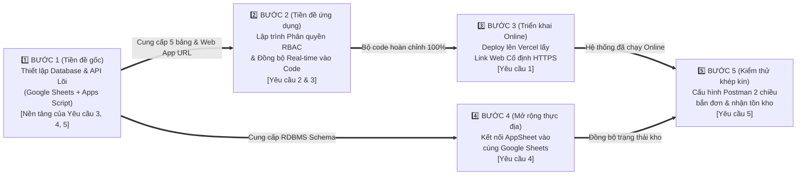

# LỘ TRÌNH TRIỂN KHAI & THỨ TỰ TIỀN ĐỀ KỸ THUẬT HỆ THỐNG ODOMS (IMPLEMENTATION ROADMAP)

* **Mã định danh tài liệu:** `lt2610.md`
* **Thư mục lưu trữ:** [`S:\HTTT\00_MASTER_SPECS\lt2610.md`](file:///S:/HTTT/00_MASTER_SPECS/lt2610.md)
* **Tài liệu yêu cầu gốc tham chiếu:** [`S:\HTTT\00_MASTER_SPECS\ycod2610.md`](file:///S:/HTTT/00_MASTER_SPECS/ycod2610.md)
* **Thư mục mã nguồn ứng dụng:** [`S:\HTTT\01_ODOMS_WEB_APP\`](file:///S:/HTTT/01_ODOMS_WEB_APP/)
* **Thư mục tài liệu kế thừa (`QLVT` / `OMS`):** [`S:\HTTT\`](file:///S:/HTTT/)
* **Ngày lập lộ trình:** 26/10/2026

---

## 1. NGUYÊN TẮC XẾP THỨ TỰ ƯU TIÊN & ĐIỀU KIỆN TIÊN QUYẾT

Để triển khai trọn vẹn 5 yêu cầu trong [`ycod2610.md`](file:///S:/HTTT/00_MASTER_SPECS/ycod2610.md) một cách khoa học, tránh việc phải chỉnh sửa mã nguồn nhiều lần và đảm bảo mỗi giai đoạn hoàn thành đều có thể kiểm thử được ngay, lộ trình được xây dựng theo chuỗi điều kiện tiên quyết (**Prerequisite Chain**):

> **Nguyên tắc cốt lõi:**  
> **Xây nền móng Dữ liệu & API Trung tâm trước (Bước 1)** $\rightarrow$ **Hoàn thiện Phân quyền RBAC & Đồng bộ Real-time trên Mã nguồn Web (Bước 2)** $\rightarrow$ **Đưa Web lên Vercel lấy Link cố định (Bước 3)** $\rightarrow$ **Kết nối AppSheet Hiện trường (Bước 4)** $\rightarrow$ **Mô phỏng Khép kín 2 Chiều bằng Postman (Bước 5)**.

---

## 2. SƠ ĐỒ CHUỖI TIỀN ĐỀ KỸ THUẬT (PREREQUISITE FLOWCHART)

---

## 3. CHI TIẾT THỨ TỰ THỰC HIỆN TỪ BƯỚC 1 ĐẾN BƯỚC 5

### 🥇 BƯỚC 1 (Điều kiện tiên quyết gốc): Thiết lập Cơ sở dữ liệu Trung tâm & Cổng API (`Yêu cầu 3 - Phần Backend`)

* **Hạng mục thực hiện:**
  1. Khởi tạo file **Google Sheets** đóng vai trò là Cơ sở dữ liệu quan hệ trung tâm (RDBMS Data Store) gồm **5 bảng chuẩn**:
     * `Orders` (Đơn hàng đa kênh tập trung, trạng thái đơn, mã lô FEFO, mã vận đơn `VD-ODOMS-...`).
     * `Inventory_ATP` (Danh mục SKU, tồn vật lý, tồn đang giữ chỗ, tồn khả dụng ATP).
     * `Batches` (Danh mục lô hàng, mã QR định danh lô, ngày nhập, hạn sử dụng phục vụ FEFO).
     * `Users_RBAC` (Danh sách tài khoản truy cập, mật khẩu, vai trò, danh sách quyền hạn chức năng).
     * `AuditLogs` (Nhật ký đăng nhập, lịch sử thao tác và đồng bộ).
  2. Xây dựng tệp **Google Apps Script (`ODOMS_Backend_API.gs`)** kế thừa từ [`FIFO_Engine.gs`](file:///S:/HTTT/02_REALTIME_BACKEND_SYNC/FIFO_Engine.gs):
     * Cung cấp cổng `doGet(e)` và `doPost(e)` để đọc/ghi dữ liệu thời gian thực.
     * Tích hợp `LockService.getScriptLock()` để chống xung đột dữ liệu khi tối đa **10 người dùng** thao tác cùng lúc.
     * Xuất bản thành **Web App URL** (cổng API trung tâm).
* **Lý do BẮT BUỘC làm đầu tiên (Điều kiện tiên quyết):**
  * Đây là **"Trái tim dữ liệu"** mà cả 3 thành phần (**Web ODOMS**, **AppSheet**, và **Postman**) đều phải kết nối vào.
  * Bảng `Users_RBAC` phải có sẵn cấu trúc cột phân quyền thì Bước 2 mới lưu trữ và đồng bộ được quyền hạn của từng tài khoản giữa nhiều thiết bị.
  * File Google Sheets phải tồn tại trước thì ở Bước 4 **AppSheet** mới có thể đọc cấu trúc bảng để dựng ứng dụng di động.

---

### 🥈 BƯỚC 2 (Điều kiện tiên quyết về Mã nguồn): Nâng cấp Phân quyền RBAC & Bộ Đồng bộ Real-time vào Code Web (`Yêu cầu 2` & `Yêu cầu 3 - Phần Client`)

* **Hạng mục thực hiện (tại [`S:\HTTT\01_ODOMS_WEB_APP\`](file:///S:/HTTT/01_ODOMS_WEB_APP/)):**
  1. **Lập trình Cơ chế Phân quyền Người dùng (RBAC) trong [`app.js`](file:///S:/HTTT/01_ODOMS_WEB_APP/js/app.js) và [`index.html`](file:///S:/HTTT/01_ODOMS_WEB_APP/index.html):**
     * **Quyền cao nhất (`Admin / Quản lý Điều phối` — VD: Đỗ Thị Thuỳ Dung `dttd`):** Mở khóa toàn bộ 100% các tab chức năng, cho phép thêm/xóa User, gán quyền cho từng User, nạp đơn, nhập bù kho, cấu hình hệ thống.
     * **Quyền giới hạn (`Chuyên viên Vận hành` / `Chuyên viên Kiểm soát Lô FEFO` / `Giao nhận` — VD: Lê Hoàng Minh Trung `lhmt` hoặc các User mới):** Tự động ẩn hoặc khóa các tab quản trị hệ thống (*Nhân sự (Thêm User)*, *Cài đặt hệ thống*, *Khôi phục dữ liệu*), chỉ hiển thị và cho phép thao tác đúng những chức năng được cấp quyền.
  2. **Lập trình Bộ Đồng bộ Real-time (`Cloud Sync Adapter`) trong [`app.js`](file:///S:/HTTT/01_ODOMS_WEB_APP/js/app.js):**
     * Kết nối trực tiếp với **Web App URL** đã tạo ở Bước 1.
     * Tự động đẩy (push) ngay mọi thay đổi khi có người dùng nạp đơn, trừ kho, nhập bù, tạo mã vận đơn QR hoặc thêm User mới.
     * Tự động kéo (poll/sync) dữ liệu mới về màn hình của các thiết bị khác đang mở (hỗ trợ mượt mà tối đa 10 người dùng đồng thời), đồng thời vẫn giữ cơ chế dự phòng `localStorage` để chạy tức thì.
* **Lý do thực hiện ở vị trí thứ 2 (Trước khi đưa lên Vercel):**
  * Hoàn thiện và kiểm thử kỹ toàn bộ tính năng Phân quyền RBAC + Đồng bộ Real-time ngay tại máy local (`S:\HTTT\01_ODOMS_WEB_APP\`). Khi mã nguồn đã hoàn chỉnh 100%, việc đưa lên Vercel ở Bước 3 sẽ thành công trọn vẹn ngay trong một lần duy nhất.

---

### 🥉 BƯỚC 3 (Triển khai Trực tuyến): Đưa Giao diện [`S:\HTTT\01_ODOMS_WEB_APP\`](file:///S:/HTTT/01_ODOMS_WEB_APP/) lên Vercel lấy Link Cố định (`Yêu cầu 1`)

* **Hạng mục thực hiện:**
  1. Đưa toàn bộ thư mục [`S:\HTTT\01_ODOMS_WEB_APP\`](file:///S:/HTTT/01_ODOMS_WEB_APP/) (đã hoàn thiện từ Bước 2) lên nền tảng **Vercel** (thông qua lệnh `npx vercel` hoặc kết nối GitHub Repository).
  2. Thiết lập tên miền cố định có chứng chỉ bảo mật HTTPS (ví dụ: `https://odoms-httt.vercel.app`).
* **Lý do thực hiện ở vị trí thứ 3:**
  * Ngay sau khi hoàn tất Bước 3, hệ thống đã chính thức hoạt động trên Internet. Bạn có thể mở ngay đường link Vercel trên nhiều thiết bị khác nhau (Laptop, Điện thoại, Máy tính bảng) ở bất kỳ đâu có mạng để kiểm nghiệm thực tế:
    * Máy 1 đăng nhập tài khoản Toàn quyền (`dttd`).
    * Máy 2 đăng nhập tài khoản Giới hạn quyền (`lhmt`).
    * Kiểm tra sự thay đổi dữ liệu nhảy real-time giữa 2 máy.

---

### 4️⃣ BƯỚC 4 (Mở rộng Thực địa): Tích hợp Ứng dụng Di động AppSheet (`Yêu cầu 4`)

* **Hạng mục thực hiện:**
  1. Mở nền tảng **Google AppSheet** (kế thừa mô hình từ hệ thống `QLVT` trong [`APPSHEET_SURVEY_REPORT.md`](file:///S:/HTTT/03_APPSHEET_MOBILE/APPSHEET_SURVEY_REPORT.md) và [`ARCHITECTURE_DIAGRAM.md`](file:///S:/HTTT/03_APPSHEET_MOBILE/ARCHITECTURE_DIAGRAM.md)).
  2. Kết nối AppSheet trực tiếp vào file **Google Sheets** đã khởi tạo ở **Bước 1**.
  3. Thiết lập các màn hình tác nghiệp hiện trường trên điện thoại cho chuyên viên kiểm soát lô và nhân viên giao nhận:
     * **View `Pick-list Lô FEFO`:** Hiển thị các đơn hàng đang ở trạng thái `DA_GIU_HANG` kèm mã lô hàng Batch FEFO (`LO-2026-A1`, `LO-2026-A2`...) và mã vận đơn `VD-ODOMS-...` để quét mã QR xác nhận xuất lô.
     * **View `Giao nhận e-POD`:** Cho phép nhân viên xác nhận xuất hàng / giao hàng thành công, chụp ảnh và cập nhật trạng thái đơn sang `HOAN_TAT`.
* **Lý do thực hiện ở vị trí thứ 4:**
  * AppSheet đóng vai trò là thiết bị đầu cuối thực thi lệnh xuất kho sau khi **Web ODOMS** (ở Bước 2 & 3) đã tiếp nhận đơn và phân bổ lô hàng. Khi nhân viên thao tác trên AppSheet, kết quả sẽ đồng bộ ngược lại lên màn hình Dashboard của Web ODOMS trên Vercel.

---

### 5️⃣ BƯỚC 5 (Kiểm thử Khép kín Toàn trình): Mô phỏng Kết nối 2 Chiều bằng Postman & Sẵn sàng Thay thế API Sàn TMĐT (`Yêu cầu 5`)

* **Hạng mục thực hiện:**
  1. **Chiều 1 (Inbound Webhook - Sàn bắn đơn vào ODOMS):** Cấu hình **Postman Collection** chứa các mẫu JSON đơn hàng của 5 kênh (Shopee, TikTok Shop, Lazada, Facebook, POS) bắn phương thức `POST` vào cổng API của ODOMS (tạo ở Bước 1).
  2. **Chiều 2 (Outbound Stock Sync - ODOMS báo tồn kho mới ngược lại sàn):** Cấu hình **Postman Mock Server** (`PUT /update_stock`) để nhận bản tin cập nhật tồn kho khả dụng (`new_atp_stock`) hoặc lệnh khóa bán (`ATP = 0`) tự động bắn ra từ ODOMS.
  3. **Kiểm chứng khả năng thay thế bằng API thật:** Đảm bảo cấu hình URL Endpoint của các sàn được tách thành biến cấu hình độc lập để sau này khi người bán có Open API chính thức từ Shopee/TikTok Shop thì chỉ cần thay đổi đường dẫn URL mà không phải sửa thuật toán lõi.
* **Lý do thực hiện ở vị trí thứ 5 (Cuối cùng):**
  * Postman là **"Tác nhân kích hoạt đầu vào và kiểm chứng đầu ra"**. Khi toàn bộ hệ thống từ **Database (Bước 1) $\rightarrow$ Phân quyền & Real-time (Bước 2) $\rightarrow$ Web Vercel (Bước 3) $\rightarrow$ AppSheet (Bước 4)** đã sẵn sàng, chỉ cần bấm nút **`[Send]`** trên Postman là bạn sẽ trình diễn được một kịch bản tự động hóa khép kín 100% từ lúc khách đặt đơn trên sàn cho đến khi trừ kho, lên vận đơn QR và đồng bộ đa thiết bị.

---

## 4. BẢNG TỔNG HỢP LỘ TRÌNH THỰC HIỆN

| Thứ tự | Mã bước | Tên giai đoạn thực hiện | Yêu cầu đáp ứng (`ycod2610.md`) | Đầu ra (Deliverables) | Điều kiện tiên quyết |
|:---:|:---:|:---|:---|:---|:---|
| **1** | **BƯỚC 1** | Thiết lập Google Sheets Database (5 bảng) & Google Apps Script API | Yêu cầu 3 (Backend), nền tảng Yêu cầu 4 & 5 | File Google Sheets chuẩn + Tệp `ODOMS_Backend_API.gs` + Link Web App API | *Không (Bước khởi đầu)* |
| **2** | **BƯỚC 2** | Lập trình Phân quyền RBAC & Bộ đồng bộ Real-time vào Web ODOMS | Yêu cầu 2 (RBAC) & Yêu cầu 3 (Real-time Client) | Mã nguồn `index.html`, `style.css`, `app.js` hoàn chỉnh tại `S:\HTTT\01_ODOMS_WEB_APP\` | Hoàn thành **Bước 1** |
| **3** | **BƯỚC 3** | Triển khai (Deploy) Web ODOMS lên nền tảng Vercel | Yêu cầu 1 (Truy cập mọi nơi qua Link cố định) | Đường link cố định `https://...vercel.app` chạy trên mọi thiết bị | Hoàn thành **Bước 2** |
| **4** | **BƯỚC 4** | Kết nối và cấu hình ứng dụng di động AppSheet | Yêu cầu 4 (Kết hợp AppSheet như `QLVT`) | Ứng dụng AppSheet kết nối chung Google Sheets (View Pick-list & e-POD) | Hoàn thành **Bước 1 & 2** |
| **5** | **BƯỚC 5** | Cấu hình Postman & Postman Mock Server mô phỏng 2 chiều | Yêu cầu 5 (Mô phỏng Postman & Sẵn sàng cắm API thật) | Bộ kịch bản Postman Collection + Mock Server chạy khép kín | Hoàn thành **Bước 1, 2, 3** |

---
*Tài liệu lộ trình được lưu trữ tại:* [`S:\HTTT\00_MASTER_SPECS\lt2610.md`](file:///S:/HTTT/00_MASTER_SPECS/lt2610.md)
