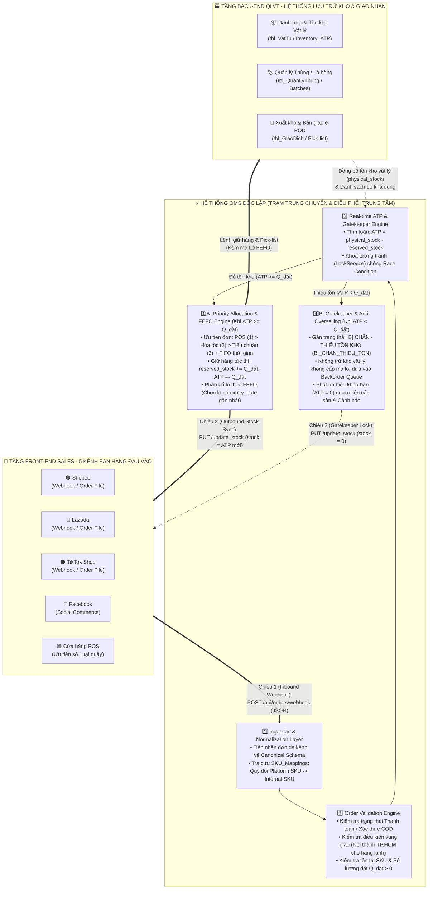
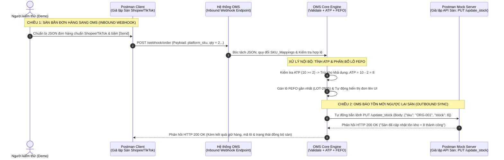
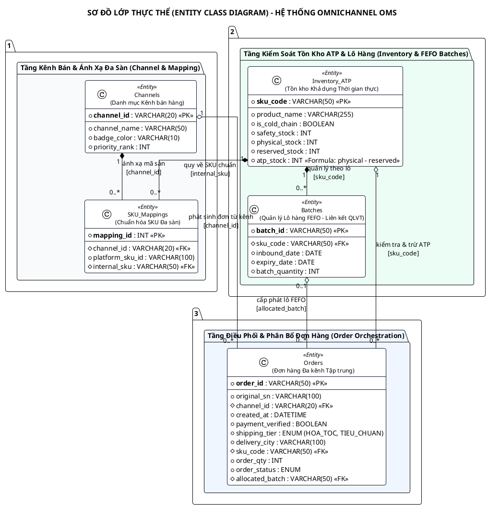

# KẾ HOẠCH CHUYỂN ĐỔI & TRIỂN KHAI HỆ THỐNG QUẢN LÝ ĐƠN HÀNG ĐA KÊNH ĐỘC LẬP (INDEPENDENT OMNICHANNEL OMS)
**Mã tài liệu:** `planOMS.md`  
**Căn cứ xây dựng:** Kế thừa kiến trúc & tài liệu hệ thống `QLVT-V1` kết hợp đặc tả nghiệp vụ `plan1.md` & khung yêu cầu `ycb1.14104.md`  
**Ngày lập:** 22/10/2026  

---

## 1. TỔNG QUAN DỰ ÁN & ĐÁNH GIÁ TÍNH KHẢ THI CHUYỂN ĐỔI TỪ HỆ THỐNG QLVT

### 1.1. Mục tiêu Hệ thống OMS
Xây dựng hệ thống **Quản lý Đơn hàng Đa kênh Độc lập (Independent Omnichannel OMS)** được thiết kế đồng bộ về ngôn ngữ giao diện và kiến trúc dữ liệu với hệ thống **QLVT**, đóng vai trò là **trạm trung chuyển dữ liệu (Middleware / Orchestration Hub)** giữa các kênh bán hàng (**Front-end Sales**) và hệ thống lưu trữ kho (**Back-end QLVT / WMS**):
- **Tổng hợp đơn hàng đa kênh:** Tiếp nhận tập trung từ **5 kênh bán hàng** (`Shopee`, `Lazada`, `TikTok Shop`, `Facebook`, và `Cửa hàng vật lý - POS`) về một cấu trúc chuẩn duy nhất (*Canonical Order Schema*).
- **Kiểm tra tính hợp lệ tự động (Validation Engine):** Xác thực trạng thái thanh toán/COD, điều kiện vùng giao hàng (ví dụ: nội thành TP.HCM đối với hàng bảo quản lạnh/đặc thù), mã SKU và số lượng đặt.
- **Tính toán tồn kho khả dụng thời gian thực (Real-time ATP):** Tự động giữ chỗ (*Reservation*) ngay khi đơn hợp lệ, kích hoạt cổng chặn (*Gatekeeper*) khóa bán đa kênh để loại bỏ 100% rủi ro bán vượt tồn kho (*Anti-Overselling*).
- **Phân bổ lô hàng theo nguyên tắc ưu tiên & FEFO/FIFO:** Xếp hàng đơn theo cấp độ ưu tiên (`POS` > `Hỏa tốc` > `Tiêu chuẩn theo thời gian đặt FIFO`) và tự động chỉ định lô hàng xuất kho có hạn sử dụng/hạn bảo hành gần nhất (**FEFO - First-Expired, First-Out**).

---

### 1.2. Kết luận Đánh giá Tính khả thi khi Chuyển đổi từ Bộ Tài liệu `QLVT`
> **KẾT LUẬN: HOÀN TOÀN KHẢ THI (Đạt tỷ lệ tái sử dụng & chuyển đổi trực tiếp từ 75% – 85% cấu trúc tài liệu, mô hình dữ liệu và thuật toán lõi).**

| Hạng mục trong QLVT | Tài liệu QLVT gốc | Phương án chuyển đổi & bổ sung sang Hệ thống OMS | Tỷ lệ kế thừa |
| :--- | :--- | :--- | :---: |
| **Kiến trúc Tổng thể & Ngôn ngữ UI/UX** | `ARCHITECTURE_DIAGRAM.md`<br>`BAO_CAO_GVHD_2808.md`<br>`APPSHEET_SURVEY_REPORT.md` | • Giữ nguyên tư duy bố cục: Thanh điều hướng trái (Sidebar), 4 thẻ KPI Header Cards, Thanh lọc nhanh (Filter Bar) và Bảng dữ liệu độ tương phản cao.<br>• Chuyển đổi sơ đồ kiến trúc thành 3 lớp: **Front-end Sales (5 kênh)** $\leftrightarrow$ **Independent OMS** $\leftrightarrow$ **Back-end QLVT**. | **85%** |
| **Cơ sở dữ liệu (Database Schema & ERD)** | `ERD_Diagram_PlantUML.puml`<br>`PROJECT_SURVEY_REPORT.md`<br>`ERD_tbl_*.md` | • Giảm tải từ 10 bảng của QLVT xuống **5 bảng cốt lõi** của OMS.<br>• Ánh xạ trực tiếp `tbl_VatTu` $\rightarrow$ `Inventory_ATP`, `tbl_QuanLyThung` / `tbl_ThietBi_ChiTiet` $\rightarrow$ `Batches`, `tbl_GiaoDich` $\rightarrow$ `Orders & Order_Items`.<br>• Thêm mới 2 bảng định danh đa kênh: `Channels` và `SKU_Mappings`. | **80%** |
| **Cổng Webhook & Khóa Tương tranh (Concurrency Lock)** | `FIFO_Engine.gs`<br>`td4.nv1.md` | • Tái sử dụng hàm `doPost(e)`, cơ chế xác thực `SECRET_TOKEN` (`PropertiesService`) và khóa độc quyền `LockService.getScriptLock()` để xử lý các đơn hàng đổ về đồng thời từ 5 kênh mà không bị xung đột tồn kho (*Race Condition*). | **90%** |
| **Bộ Kiểm tra Hợp lệ (Validation Parsers)** | `FIFO_Engine.gs` | • Kế thừa các hàm `parseQuantity()`, `parseCurrencyVND()`, `parseDateTimeCustom()` và *Pre-condition Guard Clauses* để kiểm tra định dạng đơn hàng, số lượng dương ($Q_{\text{đặt}} > 0$) và mã SKU hợp lệ. | **85%** |
| **Thuật toán Hàng đợi Phân bổ Lô (Queue Allocation)** | `FIFO_Engine.gs`<br>`FIFO_Engine.md` | • Giữ nguyên cấu trúc hàng đợi `queue` duyệt trừ số lượng tồn của từng lô.<br>• Nâng cấp tiêu chí sắp xếp: Sắp xếp đơn theo **Độ ưu tiên (`priority_rank` + `created_at`)** và sắp xếp lô hàng theo **FEFO (`expiry_date` tăng dần)**. | **80%** |
| **Luồng Trạng thái, Cảnh báo & Chứng từ** | `act7.1.md`, `act7.2_7.4.md`<br>`td4.nv2.md`, `td4.nv3.md`<br>`ycptnv.a.md` | • Chuyển luồng duyệt & giao nhận sang **Vòng đời Đơn hàng OMS** (`CHO_KIEM_TRA` $\rightarrow$ `DA_GIU_HANG` / `BI_CHAN_THIEU_TON` $\rightarrow$ `HOAN_TAT`).<br>• Kế thừa Webhook Telegram (`td4.nv2.md`) để bắn cảnh báo tức thời khi đơn bị chặn do thiếu tồn kho (OOS). | **75%** |

---

## 2. KIẾN TRÚC TỔNG THỂ & DÒNG CHẢY DỮ LIỆU (SYSTEM ARCHITECTURE & DATA FLOW)



---

### 2.2. Giải pháp Kỹ thuật Mô phỏng Luồng Đồng bộ 2 Chiều bằng Postman & Postman Mock Server

Vì trong phạm vi đồ án không kết nối trực tiếp vào môi trường Production của Shopee/TikTok Shop thật, hệ thống sử dụng **Postman** và **Postman Mock Server** để dựng hoàn chỉnh **luồng giao tiếp tự động 2 chiều (Bi-directional Real-time Sync)** mà không cần nhập tay hay nạp file thủ công:



#### Chi tiết 3 bước vận hành kỹ thuật (Kế thừa trực tiếp từ `QLVT`):
1. **Chiều 1 – Tiếp nhận đơn tự động (Inbound Webhook - Sàn gọi OMS):**
   - **Kế thừa từ `QLVT`:** Tận dụng nguyên vẹn cơ chế hàm [`doPost(e)`](file:///s:/QLVT/FIFO_Engine.gs#L313-L349) trong `FIFO_Engine.gs` (hoặc REST Endpoint `/api/webhook/order`).
   - **Cách hoạt động:** Mở Postman, đóng vai trò là máy chủ Shopee/TikTok bấm nút **Send** bắn gói tin `POST` JSON chứa đơn hàng (ví dụ: khách mua 2 sản phẩm mã `SP-AO-THUN-A` / `ORG-001`). Hệ thống OMS lập tức bắt gói tin và tự động render đơn hàng mới lên màn hình Dashboard.
   - **Mẫu JSON Payload Chiều vào (Postman $\rightarrow$ OMS):**
     ```json
     {
       "secret_token": "OMS_SECURE_TOKEN_2026",
       "channel_id": "SHOPEE",
       "original_sn": "SP2610229988",
       "shipping_tier": "HOA_TOC",
       "delivery_city": "TP.HCM",
       "payment_verified": true,
       "items": [
         {
           "platform_sku_id": "SP-SUA-HAT-01",
           "order_qty": 2
         }
       ]
     }
     ```

2. **Xử lý nội bộ tại OMS (Internal Processing - Tính ATP & Phân bổ Lô hàng FEFO):**
   - OMS quy đổi `SP-SUA-HAT-01` $\rightarrow$ `ORG-001`, kiểm tra tồn kho khả dụng $\text{ATP} = 10 \ge 2$.
   - Tự động giữ hàng (`reserved_stock` tăng thêm 2), cập nhật tồn kho khả dụng $\text{ATP}$ từ `10` xuống còn `8`, và chỉ định lô `LOT-2605` theo nguyên tắc Batch FEFO.

3. **Chiều 2 – Báo số tồn mới ngược lại sàn (Outbound Sync - OMS gọi Postman Mock Server):**
   - **Kế thừa từ `QLVT`:** Tận dụng cơ chế bắn HTTP Request ra bên ngoài (tương tự cách `QLVT` gọi Telegram Bot API qua Webhook / `UrlFetchApp.fetch(url, options)` trong `td4.nv2.md`).
   - **Cách hoạt động:** Trên **Postman Mock Server**, tạo sẵn một đường link giả lập cổng cập nhật tồn kho của Shopee/TikTok: `PUT https://<mock-id>.mock.pstmn.io/update_stock`.
   - Ngay khi OMS trừ tồn kho xuống còn `8` (hoặc khi Gatekeeper chặn đơn do $\text{ATP} = 0$), OMS tự động bắn lệnh `PUT /update_stock` kèm số tồn mới sang đường link Mock Server:
     ```json
     {
       "channel_id": "SHOPEE",
       "platform_sku_id": "SP-SUA-HAT-01",
       "internal_sku": "ORG-001",
       "new_atp_stock": 8,
       "sync_timestamp": "2026-10-22T16:20:00Z"
     }
     ```
   - **Postman Mock Server** lập tức trả về mã **`200 OK`** kèm JSON `{"status": "SUCCESS", "message": "Shopee Mock Server updated stock to 8"}`, hoàn tất vòng lặp chống bán lố (Anti-Overselling) khép kín 100%.

---

## 3. THIẾT KẾ CƠ SỞ DỮ LIỆU ĐỘC LẬP & ÁNH XẠ TỪ QLVT (DATABASE SCHEMA)

Hệ thống OMS sử dụng **5 bảng dữ liệu cốt lõi** được chuyển đổi và chuẩn hóa từ mô hình RDBMS của QLVT:

### 3.1. Bảng `Channels` (Danh mục Kênh bán hàng - *Thêm mới*)
| Tên trường | Kiểu dữ liệu | Ràng buộc | Mô tả & Quy tắc nghiệp vụ |
| :--- | :--- | :---: | :--- |
| `channel_id` | `VARCHAR(20)` | **PK** | Mã định danh kênh (`SHOPEE`, `TIKTOK`, `LAZADA`, `FACEBOOK`, `POS`) |
| `channel_name` | `VARCHAR(50)` | Not Null | Tên hiển thị của kênh bán hàng |
| `badge_color` | `VARCHAR(10)` | Not Null | Mã màu nhận diện UI (`#ee4d2d`, `#00f2fe`, `#0f146d`, `#1877f2`, `#8b5cf6`) |
| `priority_rank` | `INT` | Not Null | Độ ưu tiên kênh (1: POS tại quầy, 2: Sàn/Mạng xã hội) |

### 3.2. Bảng `SKU_Mappings` (Từ điển Ánh xạ SKU Đa sàn - *Thêm mới*)
| Tên trường | Kiểu dữ liệu | Ràng buộc | Mô tả & Quy tắc nghiệp vụ |
| :--- | :--- | :---: | :--- |
| `mapping_id` | `INT` | **PK** | Khóa chính tự tăng |
| `channel_id` | `VARCHAR(20)` | **FK** | Tham chiếu tới `Channels(channel_id)` |
| `platform_sku_id` | `VARCHAR(100)` | Not Null | Mã sản phẩm / phân loại hàng hóa gốc trên từng sàn TMĐT |
| `internal_sku` | `VARCHAR(50)` | **FK** | Mã SKU chuẩn nội bộ tham chiếu tới `Inventory_ATP(sku_code)` |

### 3.3. Bảng `Inventory_ATP` (Kiểm soát Tồn kho Khả dụng - *Chuyển đổi từ `tbl_VatTu`*)
| Tên trường OMS | Trường gốc QLVT | Kiểu dữ liệu | Mô tả & Công thức tính toán thời gian thực |
| :--- | :--- | :--- | :--- |
| `sku_code` | `ID_VatTu (PK)` | `VARCHAR(50)` | **PK** - Mã SKU chuẩn quản lý nội bộ (VD: `ORG-001`, `ORG-002`...) |
| `product_name` | `Ten_VatTu` | `VARCHAR(255)` | Tên thương mại đầy đủ của sản phẩm |
| `is_cold_chain` | `Loai_VatTu` | `BOOLEAN` | Hàng bảo quản lạnh/tươi sống (Bắt buộc giao nội thành TP.HCM) |
| `safety_stock` | `Nguong_An_Toan` | `INT` | Ngưỡng cảnh báo tồn kho an toàn tối thiểu |
| `physical_stock` | `So_Luong_Ton` | `INT` | Tổng tồn kho vật lý thực tế đồng bộ từ kho QLVT |
| `reserved_stock` | *(Thêm mới)* | `INT` | Số lượng đang giữ chỗ cho các đơn hàng đã duyệt chờ kho xuất |
| `atp_stock` | *(Thêm mới)* | `INT` | **Tồn kho khả dụng:** $\text{ATP} = \text{physical\_stock} - \text{reserved\_stock}$ |

### 3.4. Bảng `Batches` (Quản lý Lô hàng theo FEFO - *Chuyển đổi từ `tbl_QuanLyThung` & `tbl_ThietBi_ChiTiet`*)
| Tên trường OMS | Trường gốc QLVT | Kiểu dữ liệu | Mô tả & Quy tắc nghiệp vụ |
| :--- | :--- | :--- | :--- |
| `batch_id` | `ID_Thung (PK)` | `VARCHAR(50)` | **PK** - Mã lô hàng nhập kho (VD: `LOT-2605`, `LOT-2609`) |
| `sku_code` | `ID_VatTu (FK)` | `VARCHAR(50)` | **FK** - Liên kết tới `Inventory_ATP(sku_code)` |
| `inbound_date` | `Ngay_Truong_Tien_Nhap` | `DATE` | Ngày nhập lô hàng vào kho QLVT |
| `expiry_date` | `Ngay_Het_Han_BH_Hang` | `DATE` | Hạn sử dụng / Hạn bảo hành của lô (Sắp xếp tăng dần phục vụ **FEFO**) |
| `batch_quantity` | `Tong_So_Luong_Cai` | `INT` | Số lượng khả dụng còn lại trong lô |

### 3.5. Bảng `Orders` & `Order_Items` (Đơn hàng Đa kênh Tập trung - *Chuyển đổi từ `tbl_GiaoDich`*)
| Tên trường OMS | Trường gốc QLVT | Kiểu dữ liệu | Mô tả & Quy tắc nghiệp vụ |
| :--- | :--- | :--- | :--- |
| `order_id` | `ID_GiaoDich (PK)` | `VARCHAR(50)` | **PK** - Mã đơn hàng chuẩn hóa trên OMS (VD: `ORD-POS-01`, `ORD-SP-101`) |
| `original_sn` | *(Thêm mới)* | `VARCHAR(100)` | Mã đơn hàng gốc trên sàn TMĐT |
| `channel_id` | *(Thêm mới)* | `VARCHAR(20)` | **FK** - Nguồn kênh bán hàng (`SHOPEE`, `TIKTOK`, `LAZADA`, `FACEBOOK`, `POS`) |
| `created_at` | `Ngay_Gio` | `DATETIME` | Thời điểm khách đặt đơn (dùng xếp hàng đợi FIFO giữa các đơn cùng cấp) |
| `shipping_tier` | *(Thêm mới)* | `VARCHAR(20)` | Cấp độ vận chuyển (`HOA_TOC`, `TIEU_CHUAN`) |
| `delivery_city` | `Dia_Chi` (`tbl_KhachHang`)| `VARCHAR(100)` | Tỉnh/Thành phố nhận hàng (Kiểm tra điều kiện giao hàng lạnh) |
| `sku_code` | `ID_VatTu (FK)` | `VARCHAR(50)` | **FK** - Mã SKU nội bộ sau khi qua bước `SKU_Mappings` |
| `order_qty` | `So_Luong_Cai` | `INT` | Số lượng sản phẩm khách đặt ($Q_{\text{đặt}}$) |
| `order_status` | `Loai_Giao_Dich` | `VARCHAR(30)` | `CHO_KIEM_TRA`, `DA_GIU_HANG`, `BI_CHAN_THIEU_TON`, `KHONG_HOP_LE`, `HOAN_TAT` |
| `allocated_batch`| `Ma_Thung_Nhap` | `VARCHAR(50)` | Mã lô FEFO được hệ thống tự động chỉ định (VD: `LOT-2605`) |

---

### 3.6. Sơ đồ Lớp Thực thể Hệ thống OMS (PlantUML Entity Class Diagram)



---

## 4. QUY TRÌNH 4 BƯỚC XỬ LÝ LÕI CỦA HỆ THỐNG OMS

### Bước 1: Tiếp nhận & Chuẩn hóa Đơn hàng (Ingestion & Normalization)
1. Hệ thống nhận dữ liệu đơn hàng từ 5 kênh (`Shopee`, `Lazada`, `TikTok Shop`, `Facebook`, `POS`) qua cổng Webhook REST API (kế thừa hàm `doPost(e)` của `QLVT`) hoặc trình nạp file CSV/JSON đồng loạt.
2. Tra cứu bảng `SKU_Mappings` theo cặp `(channel_id, platform_sku_id)` để ánh xạ toàn bộ mã phân loại của từng sàn về mã `internal_sku` chuẩn nội bộ.
3. Gắn thẻ màu nhận diện kênh (`badge_color`) và tính toán điểm ưu tiên tổng hợp của đơn hàng.

### Bước 2: Kiểm tra Tính hợp lệ Đơn hàng (Order Validation Engine)
Đơn hàng được phép chuyển sang bước tính tồn kho khi thỏa mãn đồng thời **3 điều kiện hợp lệ**:
1. **Xác thực thanh toán (`payment_verified == true`):** Đơn đã thanh toán trực tuyến hoặc đơn COD đã vượt qua bước kiểm duyệt chống đơn ảo của sàn.
2. **Ràng buộc vận chuyển hàng bảo quản lạnh (`Cold-chain Rule`):** Nếu sản phẩm có cờ `is_cold_chain == true` (thực phẩm tươi sống/đông lạnh), trường `delivery_city` bắt buộc phải là `"TP.HCM"`. Nếu giao liên tỉnh, hệ thống tự động gắn cờ ngoại lệ `KHONG_HOP_LE (SAI_VUNG_GIAO)`.
3. **Định lượng & Danh mục hợp lệ:** Mã `sku_code` tồn tại trong `Inventory_ATP` và số lượng đặt mua $Q_{\text{đặt}} > 0$ (sử dụng hàm `parseQuantity()` kế thừa từ `FIFO_Engine.gs`).

### Bước 3: Đối chiếu Tồn kho Khả dụng Thời gian thực (Real-time ATP Check & Gatekeeper)
Ngay trong vùng khóa độc quyền (`LockService`), hệ thống tính toán tồn kho khả dụng tức thời:
$$\text{ATP}_{\text{hiện tại}} = \text{physical\_stock} - \text{reserved\_stock}$$

- **Trường hợp 1 ($\text{ATP}_{\text{hiện tại}} \ge Q_{\text{đặt}}$):** Đủ tồn kho khả dụng $\rightarrow$ Chuyển ngay sang **Bước 4** để giữ hàng và phân bổ lô.
- **Trường hợp 2 ($\text{ATP}_{\text{hiện tại}} < Q_{\text{đặt}}$ hoặc $\text{ATP}_{\text{hiện tại}} = 0$):**
  1. **Kích hoạt Cổng chặn (Gatekeeper):** Chuyển trạng thái đơn sang `BI_CHAN_THIEU_TON` (`BỊ CHẶN - OOS`).
  2. **Bảo toàn số liệu kho:** Tuyệt đối không trừ vào `physical_stock` hay `reserved_stock` (giữ nguyên $\text{ATP}$ hiện tại, chống âm kho).
  3. **Cách ly vận hành:** Không gán mã lô `allocated_batch`, không đẩy đơn xuống danh sách xuất kho QLVT (Pick-list), chuyển đơn vào tab **Xử lý Ngoại lệ (Backorder Queue)**.
  4. **Khóa bán đa kênh:** Phát tín hiệu đồng bộ $\text{ATP} = 0$ lên các sàn TMĐT còn lại để chặn khách đặt thêm.

### Bước 4: Tự động Giữ hàng & Phân bổ Lô theo Ưu tiên + FEFO
Khi đơn hàng đủ tồn kho ($\text{ATP}_{\text{hiện tại}} \ge Q_{\text{đặt}}$):
1. **Giữ hàng tức thì (Instant Reservation):**
   $$\text{reserved\_stock}_{\text{mới}} = \text{reserved\_stock}_{\text{cũ}} + Q_{\text{đặt}}$$
   $$\text{atp\_stock}_{\text{mới}} = \text{physical\_stock} - \text{reserved\_stock}_{\text{mới}}$$
2. **Thứ tự ưu tiên xét duyệt khi có nhiều đơn đồng thời (Priority Hierarchy):**
   - **Ưu tiên 1 (Kênh vật lý):** Đơn tại quầy `POS` (`priority_rank = 1`) được ưu tiên cấp phát trước tiên.
   - **Ưu tiên 2 (Cấp vận chuyển):** Đơn TMĐT có `shipping_tier = "HOA_TOC"` được xếp trước đơn `"TIEU_CHUAN"`.
   - **Ưu tiên 3 (Thời gian đặt - FIFO):** Các đơn cùng cấp độ ưu tiên được xét duyệt theo thứ tự thời gian khách đặt đơn (`created_at` tăng dần).
3. **Chỉ định Lô hàng theo thuật toán FEFO (First-Expired, First-Out):**
   - Lọc danh sách các lô của `sku_code` trong bảng `Batches` có `batch_quantity > 0`.
   - Sắp xếp các lô theo hạn sử dụng `expiry_date` **tăng dần** (lô nào sắp hết hạn trước được đẩy ra trước).
   - Khấu trừ số lượng vào lô có hạn gần nhất, gán mã `batch_id` vào trường `allocated_batch` của đơn hàng và đổi trạng thái đơn thành `DA_GIU_HANG`.

---

## 5. ÁNH XẠ NỘI DUNG SANG ĐỀ CƯƠNG PHÂN TÍCH THIẾT KẾ (`ycb1.14104.md`)

Bộ tài liệu QLVT có thể chuyển đổi trực tiếp sang báo cáo môn học **INT14104 - Phân tích thiết kế đảm bảo chất lượng phần mềm** với cấu trúc đầy đủ Chương 1 & Chương 2 như sau:

- **Tên đề tài:** *Xây dựng Hệ thống Quản lý Đơn hàng Đa kênh Độc lập (Independent Omnichannel OMS) tích hợp kiểm soát tồn kho khả dụng (ATP) và phân bổ lô hàng tự động.*
- **02 Chức năng trọng tâm đăng ký phân tích & thiết kế:**
  - **Chức năng 1:** Tiếp nhận, chuẩn hóa đơn hàng đa kênh và kiểm tra tính hợp lệ tự động *(Order Ingestion, SKU Mapping & Validation)*.
  - **Chức năng 2:** Tính toán tồn kho khả dụng (Real-time ATP), tự động giữ hàng chống bán lố và phân bổ lô theo nguyên tắc ưu tiên & FEFO *(Real-time ATP Check, Gatekeeper & Priority FEFO Allocation)*.

| Cấu trúc yêu cầu trong `ycb1.14104.md` | Nội dung triển khai trong Hệ thống OMS (Kế thừa từ QLVT + `plan1.md`) |
| :--- | :--- |
| **Chương 1: Giới thiệu đề tài & Công nghệ**<br>• 1.1 Giới thiệu đề tài<br>• 1.2 Công nghệ sử dụng | • **1.1:** Bài toán xung đột tồn kho (Overselling), độ trễ đồng bộ khi bán trên 5 kênh (Shopee, Lazada, TikTok, Facebook, POS) và vai trò trạm trung chuyển độc lập của OMS.<br>• **1.2:** Kiến trúc Web UI Dark Slate/Emerald (HTML5, Tailwind CSS, JavaScript ES6 / Google Apps Script V8 Engine, REST Webhook API, Cơ sở dữ liệu quan hệ 5 bảng). |
| **Chương 2 - Mục 2.1 & 2.2:**<br>Khảo sát yêu cầu & Biểu đồ Use Case | • **Actors:** (1) *Hệ thống Sàn TMĐT / POS*, (2) *Nhân viên Điều phối Đơn (OMS Operator)*, (3) *Quản trị viên Hệ thống (Admin)*, (4) *Hệ thống Kho QLVT (WMS Backend)*.<br>• **Use Cases:** Tiếp nhận & ánh xạ SKU đa kênh, Kiểm tra hợp lệ đơn, Tính toán ATP & giữ hàng, Phân bổ lô FEFO, Xử lý đơn bị chặn (Backorder). |
| **Chương 2 - Mục 2.3:**<br>Đặc tả Use Case (Use Case Specification) | • Kế thừa chuẩn **Bảng đặc tả 9 trường** từ `uc1_sa_v5.md` của QLVT (Mã UC, Tên UC, Actor, Mục tiêu, Tiền điều kiện, Kích hoạt, Luồng chính, Luồng ngoại lệ, Hậu điều kiện) cho Chức năng 1 và Chức năng 2. |
| **Chương 2 - Mục 2.4:**<br>Biểu đồ Hoạt động (Activity Diagram) | • **AD Chức năng 1:** Luồng nhận payload đơn $\rightarrow$ Tra cứu `SKU_Mappings` $\rightarrow$ Kiểm tra 3 điều kiện hợp lệ (Thanh toán, Vùng giao hàng lạnh TP.HCM, $Q_{\text{đặt}} > 0$).<br>• **AD Chức năng 2:** Luồng sắp xếp hàng đợi ưu tiên (`POS > Hỏa tốc > FIFO`) $\rightarrow$ Tính $\text{ATP}$ $\rightarrow$ Nhánh đủ tồn (Giữ hàng + Gán lô FEFO) vs Nhánh thiếu tồn (Gatekeeper chặn đơn + Khóa bán đa sàn). |
| **Chương 2 - Mục 2.5:**<br>Phân tích Lớp Thực thể (Entity Class Diagram) | • Sơ đồ 5 lớp thực thể chuẩn UML: `Channels`, `SKU_Mappings`, `Inventory_ATP`, `Batches`, `Orders` (Mục 3.6 ở trên). |
| **Chương 2 - Mục 2.6:**<br>Biểu đồ Trình tự (Sequence Diagram) | • Biểu đồ trình tự tương tác giữa: `KenhBanHang` $\rightarrow$ `OMS_IngestionController` $\rightarrow$ `ValidationEngine` $\rightarrow$ `ATPEngine` $\rightarrow$ `FEFOAllocator` $\rightarrow$ `Database_OMS` $\rightarrow$ `HeThongKho_QLVT`. |
| **Chương 2 - Mục 2.7:**<br>Biểu đồ Trạng thái (State Diagram) | • **Lớp `Orders`:** `Mới tiếp nhận` $\rightarrow$ `Chờ kiểm tra (CHO_KIEM_TRA)` $\rightarrow$ [`Không hợp lệ` \| `Đã giữ hàng & Cấp lô (DA_GIU_HANG)` \| `Bị chặn thiếu tồn (BI_CHAN_THIEU_TON)`] $\rightarrow$ `Đã chuyển kho QLVT` $\rightarrow$ `Hoàn tất (HOAN_TAT)` / `Đã hủy`.<br>• **Lớp `Inventory_ATP`:** `Sẵn sàng cung ứng (ATP > Safety_Stock)` $\rightarrow$ `Cảnh báo chạm ngưỡng (0 < ATP <= Safety_Stock)` $\rightarrow$ `Khóa bán đa kênh (ATP = 0 - Out of Stock)`. |

---

## 6. THIẾT KẾ GIAO DIỆN ĐỒNG BỘ & KỊCH BẢN KIỂM THỬ (TEST CASES)

### 6.1. Ngôn ngữ Thiết kế Giao diện (Dark Slate & Emerald Theme)
- **Bảng màu chủ đạo:** Nền chính Dark Slate (`#0f172a`), khung thẻ Secondary Slate (`#1e293b`), điểm nhấn trạng thái thành công Emerald (`#10b981`), cảnh báo chặn đơn Rose Red (`#f43f5e`).
- **4 Thẻ KPI Header Cards:**
  1. **Tổng đơn tiếp nhận hôm nay** (Hiển thị tổng đơn từ 5 kênh).
  2. **Đơn đã giữ kho & cấp lô FEFO** (Badge xanh lá `#10b981`).
  3. **Đơn bị chặn do thiếu tồn kho - OOS** (Badge đỏ cảnh báo `#f43f5e`).
  4. **Tổng tồn kho khả dụng (Real-time ATP)** (Đồng bộ trực tiếp với kho QLVT).

### 6.2. Bảng Dữ liệu Minh họa & Kịch bản Kiểm thử Cốt lõi

| Mã Test | Kênh bán | Dữ liệu đơn đầu vào | Trạng thái Tồn trước xử lý | Kết quả Hệ thống OMS xử lý | Trạng thái Đơn & Lô gán |
| :---: | :---: | :--- | :--- | :--- | :--- |
| **TC-01** | **TikTok Shop** | Đặt `5` hộp `ORG-001` (Sữa hạt hữu cơ) | `physical = 10`<br>`reserved = 0`<br>$\Rightarrow \text{ATP} = 10$ | Hợp lệ $\rightarrow$ $\text{ATP} (10) \ge 5$ $\rightarrow$ Giữ hàng: `reserved = 5`, $\text{ATP}$ giảm còn `5` | 🟢 **`ĐÃ GIỮ HÀNG`**<br>Lô FEFO: `LOT-2605` (15/11/2026) |
| **TC-02** | **Shopee** | Đặt `7` hộp `ORG-001` (Sữa hạt hữu cơ) | `physical = 10`<br>`reserved = 5`<br>$\Rightarrow \text{ATP} = 5$ | Hợp lệ $\rightarrow$ $\text{ATP} (5) < 7$ $\rightarrow$ **Gatekeeper kích hoạt CHẶN ĐƠN** $\rightarrow$ Giữ nguyên $\text{ATP} = 5$ | 🔴 **`BỊ CHẶN (OOS)`**<br>Lô FEFO: *Chưa cấp phát* |
| **TC-03** | **Cửa hàng POS** | Đặt `2` hộp `ORG-001` (Mua trực tiếp tại quầy) | `physical = 10`<br>`reserved = 5`<br>$\Rightarrow \text{ATP} = 5$ | Ưu tiên số 1 (`priority_rank = 1`) $\rightarrow$ $\text{ATP} (5) \ge 2$ $\rightarrow$ `reserved = 7`, $\text{ATP}$ còn `3` | 🟢 **`ĐÃ GIỮ HÀNG`**<br>Lô FEFO: `LOT-2605` (15/11/2026) |
| **TC-04** | **Facebook** | Đặt `2` hộp `ORG-003` (Thực phẩm đông lạnh - Giao đi Hà Nội) | `physical = 20`<br>`reserved = 0`<br>$\Rightarrow \text{ATP} = 20$ | Vi phạm quy tắc vận chuyển hàng lạnh (`delivery_city != "TP.HCM"`) $\rightarrow$ Chặn ngay tại Bước 2 | 🟡 **`KHÔNG HỢP LỆ (SAI VÙNG GIAO)`**<br>Lô FEFO: *Không cấp phát* |

---

## 7. LỘ TRÌNH THỰC HIỆN CHUYỂN ĐỔI (4 GIAI ĐOẠN)

1. **Giai đoạn 1 – Chuẩn hóa Tài liệu Phân tích & Thiết kế (Chương 1 & Chương 2):**
   - Biên tập hoàn chỉnh Chương 1 (Giới thiệu đề tài OMS & Công nghệ) và Chương 2 (Use Case, Bảng đặc tả 9 trường, Activity, Sequence, Entity Class ERD, State Diagram) theo đúng khung `ycb1.14104.md`.
2. **Giai đoạn 2 – Khởi tạo Cơ sở Dữ liệu 5 Bảng & Từ điển SKU Mapping:**
   - Chuyển đổi dữ liệu từ cấu trúc QLVT sang 5 bảng `Channels`, `SKU_Mappings`, `Inventory_ATP`, `Batches`, `Orders`.
3. **Giai đoạn 3 – Xây dựng Engine Xử lý 4 Bước (Validation + ATP + Priority FEFO):**
   - Nâng cấp thuật toán từ `FIFO_Engine.gs` sang bộ xử lý `OMS_Core_Engine` hỗ trợ tính $\text{ATP}$ tức thời, cổng chặn Gatekeeper và phân bổ lô FEFO.
4. **Giai đoạn 4 – Dựng Giao diện Web Dashboard OMS (Dark Slate UI) & Kiểm thử:**
   - Xây dựng giao diện điều hành trực quan với 4 thẻ KPI, bộ lọc 5 kênh bán và nút chạy mô phỏng trực tiếp các kịch bản kiểm thử `TC-01` $\rightarrow$ `TC-04`.
