# SƠ ĐỒ KIẾN TRÚC TỔNG THỂ HỆ THỐNG (SYSTEM ARCHITECTURE DIAGRAM)

**Dự án:** Số hóa quản lý thiết bị, trực quan hóa dữ liệu và tự động hóa giao dịch thực địa bằng QR Code  
**Đơn vị chủ quản:** Công ty Viễn thông Trường Tiến  
**Mã tài liệu:** `ARCHITECTURE_DIAGRAM.md`  
**Ngày thiết kế:** 2026-08-28  
**Phiên bản:** `v1.0`  

---

## 1. SƠ ĐỒ KIẾN TRÚC TOÀN CẢNH (MERMAID DIAGRAM)

```mermaid
flowchart TD
    %% ======================= SUBGRAPH: CLIENT LAYER =======================
    subgraph CLIENT_LAYER["📱 TẦNG CLIENT - ĐIỂM CUỐI THU THẬP DỮ LIỆU"]
        direction TB
        subgraph MOBILE_CLIENTS["Thiết bị Di động (Android / iOS)"]
            DEV_TECH["👷 Kỹ thuật viên\n• Quét QR Code/MAC\n• Khảo sát & Nhật ký bảo trì"]
            DEV_SHIP["🚚 Nhân viên Giao nhận\n• Quét QR Code đơn vị\n• e-POD & Ký nhận điện tử\n• Chụp ảnh & Lấy GPS thực địa"]
        end

        subgraph DESKTOP_CLIENTS["Thiết bị Máy tính (Windows / macOS Web)"]
            DESK_ADMIN["👨‍💼 Quản trị viên (Admin)\n• Phân quyền RBAC nhân sự\n• Cấu hình hệ thống & danh mục"]
            DESK_STOCK["📦 Thủ kho\n• Quét mã vạch bàn cố định\n• Nhập/Xuất kho quy cách"]
            DESK_BOD["📊 Ban Giám đốc (BOD)\n• Dashboard KPI & Tồn kho\n• Giám sát doanh thu & báo cáo"]
        end
    end

    %% ================== SUBGRAPH: FRONTEND / MIDDLEWARE ===================
    subgraph MIDDLEWARE_LAYER["⚡ TẦNG FRONTEND & MIDDLEWARE - GOOGLE APPSHEET CLOUD"]
        direction TB
        APPSHEET_CORE["🌐 Google AppSheet Platform (App ID: fc56fb22...)"]
        
        subgraph APPSHEET_MODULES["Các Module Xử lý AppSheet"]
            MOD_UX["🎨 Giao diện Đa nền tảng (UX)\n• Mobile UI / Tablet / Desktop Web\n• View Map GPS / Deck / Table"]
            MOD_RBAC["🛡️ Bộ lọc Phân quyền RBAC\n• 4 Nhóm quyền (Admin, KTV, Kho, Giao nhận)\n• Dynamic Security Filters & Slices"]
            MOD_OFFLINE["📶 Cơ chế Offline Sync Engine\n• Bộ nhớ đệm cục bộ (Local Cache)\n• Tự động đồng bộ 2 chiều khi có mạng"]
            MOD_BOTS["🤖 Automation & Actions Engine\n• Bắt sự kiện Form Save / Edit / Delete\n• Kích hoạt Webhook & Apps Script Trigger"]
        end
        
        APPSHEET_CORE --- MOD_UX
        APPSHEET_CORE --- MOD_RBAC
        APPSHEET_CORE --- MOD_OFFLINE
        APPSHEET_CORE --- MOD_BOTS
    end

    %% ======================= SUBGRAPH: DATABASE LAYER =======================
    subgraph DATABASE_LAYER["💾 TẦNG DATABASE - GOOGLE SHEETS RDBMS DATA STORE"]
        direction TB
        SHEETS_DB["📑 Google Sheets: rdbms-schema-truong-tien-v9 (Spreadsheet ID: 1IU0bFj13...)"]
        
        subgraph SHEETS_TABLES["10 Bảng Dữ liệu Quan hệ (RDBMS)"]
            T_NV["👥 tbl_NhanVien\n(Email_NhanVien PK, Vai_Tro)"]
            T_VT["📦 tbl_VatTu & Quy cách\n(ID_VatTu PK, Dinh_Muc)"]
            T_TB["🔍 tbl_ThietBi_ChiTiet\n(QR_Code_Don_Vi PK, MAC, Bảo hành)"]
            T_GD["📋 tbl_GiaoDich\n(ID_GiaoDich PK, GPS, POD, Sign)"]
            T_BT["🛠️ tbl_NhatKyBaoTri\n(ID_BaoTri PK, Lỗi, Xử lý)"]
            T_KH["🏢 tbl_KhachHang & Thùng\n(ID_KhachHang, ID_Thung)"]
        end
        
        SHEETS_DB --- T_NV
        SHEETS_DB --- T_VT
        SHEETS_DB --- T_TB
        SHEETS_DB --- T_GD
        SHEETS_DB --- T_BT
        SHEETS_DB --- T_KH
    end

    %% =================== SUBGRAPH: BACKEND / SERVERLESS ====================
    subgraph BACKEND_LAYER["⚙️ TẦNG BACKEND - GOOGLE APPS SCRIPT SERVERLESS LOGIC"]
        direction TB
        GAS_CORE["⚡ Google Apps Script: QLVT-V1 (Script ID: 137oMwTepy...)"]
        
        subgraph GAS_SERVICES["Logic Xử lý & Dịch vụ Nền"]
            SRV_FIFO["🔄 Thuật toán Trừ kho FIFO\n• Tự động tính hạn bảo hành\n• Cập nhật tồn kho an toàn"]
            SRV_TRIGGERS["⏱️ Triggers Sự kiện Tự động\n• onEdit / onChange / Time-driven\n• Xử lý background batch jobs"]
            SRV_DOCGEN["📄 Bộ máy Xuất Biên bản Bàn giao\n• Merge Template Google Docs\n• Render file PDF chuẩn doanh nghiệp"]
        end
        
        GAS_CORE --- SRV_FIFO
        GAS_CORE --- SRV_TRIGGERS
        GAS_CORE --- SRV_DOCGEN
    end

    %% ===================== SUBGRAPH: EXTERNAL APIS =======================
    subgraph EXTERNAL_LAYER["🌍 TẦNG EXTERNAL APIS - DỊCH VỤ TÍCH HỢP NGOẠI VI"]
        direction TB
        API_TELE["🤖 Telegram Bot API\n• Webhook thông báo sự cố tức thì\n• Cảnh báo thiết bị sắp hết hạn bảo hành"]
        API_MAPS["🗺️ Google Maps Distance Matrix API\n• Tính lộ trình di chuyển thực địa\n• Dự tính ETA về trụ sở 82 Trần Văn Kiểu"]
        API_WORKSPACE["✉️ Google Workspace (Gmail & Drive API)\n• Lưu trữ PDF Biên bản vào Google Drive\n• Tự động gửi Email đính kèm PDF cho Khách hàng"]
    end

    %% ======================== CONNECTIONS & FLOWS =========================
    
    %% Client <--> AppSheet
    DEV_TECH <==>|"Quét QR / Đẩy nhật ký sự cố\n(Offline Cache & Sync)"| MOD_UX
    DEV_SHIP <==>|"e-POD / Ký nhận / Tọa độ GPS\n(Offline-first Sync)"| MOD_UX
    DESK_ADMIN <==>|"Cấu hình / Quản trị User RBAC\n(HTTPS Web Client)"| MOD_RBAC
    DESK_STOCK <==>|"Quét Barcode / Kiểm kê kho\n(Zero-handwork Input)"| MOD_UX
    DESK_BOD <==>|"Giám sát KPI / Trực quan hóa\n(Realtime Dashboard)"| MOD_UX

    %% AppSheet <--> Database
    MIDDLEWARE_LAYER <==>|"Đọc/Ghi dữ liệu hai chiều\n(Google Sheets API v4 / Service Account)"| DATABASE_LAYER

    %% Database <--> Backend (GAS)
    DATABASE_LAYER <==>|"Kích hoạt Event Triggers\n& Cập nhật dữ liệu sau xử lý"| BACKEND_LAYER

    %% Backend <--> External APIs
    BACKEND_LAYER ==>|"1. Webhook Alert (Zero-latency)"| API_TELE
    BACKEND_LAYER ==>|"2. Query tọa độ & Tính toán khoảng cách"| API_MAPS
    BACKEND_LAYER ==>|"3. Tải PDF lên Drive & Gửi Email tự động"| API_WORKSPACE
    API_MAPS -.->|"Phản hồi thời gian ETA di chuyển"| BACKEND_LAYER

    %% ============================ STYLING =================================
    classDef clientStyle fill:#e3f2fd,stroke:#1565c0,stroke-width:2px,color:#0d47a1;
    classDef middlewareStyle fill:#e8f5e9,stroke:#2e7d32,stroke-width:2px,color:#1b5e20;
    classDef dbStyle fill:#fff3e0,stroke:#e65100,stroke-width:2px,color:#bf360c;
    classDef backendStyle fill:#f3e5f5,stroke:#7b1fa2,stroke-width:2px,color:#4a148c;
    classDef externalStyle fill:#fce4ec,stroke:#c2185b,stroke-width:2px,color:#880e4f;

    class CLIENT_LAYER,DEV_TECH,DEV_SHIP,DESK_ADMIN,DESK_STOCK,DESK_BOD clientStyle;
    class MIDDLEWARE_LAYER,APPSHEET_CORE,MOD_UX,MOD_RBAC,MOD_OFFLINE,MOD_BOTS middlewareStyle;
    class DATABASE_LAYER,SHEETS_DB,T_NV,T_VT,T_TB,T_GD,T_BT,T_KH dbStyle;
    class BACKEND_LAYER,GAS_CORE,SRV_FIFO,SRV_TRIGGERS,SRV_DOCGEN backendStyle;
    class EXTERNAL_LAYER,API_TELE,API_MAPS,API_WORKSPACE externalStyle;
```

---

## 2. GIẢI THÍCH CHI TIẾT CÁC TẦNG KIẾN TRÚC

### 📱 1. Tầng Client (Thu thập Dữ liệu & Trải nghiệm Người dùng)
* **Thiết bị Di động (Mobile Android / iOS):**
  - Dành cho **Kỹ thuật viên hiện trường** và **Nhân viên Giao nhận**.
  - Tích hợp sâu phần cứng thiết bị: Camera quét mã QR Code/Barcode tốc độ cao, cảm biến định vị toàn cầu GPS (`HERE()`), màn hình cảm ứng thu thập chữ ký điện tử (*e-Signature*), máy ảnh chụp bằng chứng giao hàng (*e-POD Image*).
  - Hoạt động ở chế độ **Offline-First**: Cho phép thao tác toàn diện khi mất sóng (tầng hầm, nhà máy) và tự động đồng bộ khi có kết nối.
* **Thiết bị Máy tính (Desktop Web Windows / macOS):**
  - Dành cho **Quản trị viên (Admin)**, **Thủ kho** và **Ban Giám đốc (BOD)**.
  - Phục vụ quản lý danh mục dữ liệu lớn, quét mã vạch bằng máy quét tĩnh để nhập/xuất thùng quy cách, theo dõi trực quan hóa báo cáo tài chính/tồn kho và cấu hình người dùng.

---

### ⚡ 2. Tầng Frontend / Middleware (Google AppSheet No-Code Cloud)
* **Xử lý UI/UX đa nền tảng:** Tự động điều chỉnh layout phù hợp giữa điện thoại, máy tính bảng và desktop mà không cần viết lại mã giao diện.
* **Cơ chế phân quyền RBAC (Role-Based Access Control):**
  - Phân tách 4 nhóm vai trò chuẩn hóa: `Ban Giám đốc`, `Nhân viên quản trị hệ thống`, `Kỹ thuật viên`, `Nhân viên giao nhận`.
  - Kiểm soát hiển thị Form/View (`Show_If`), quyền chỉnh sửa trường dữ liệu (`Editable_If`), và bảo mật lọc dòng dữ liệu (`Security Filters / Slices`).
* **Offline Sync Engine:** Bộ nhớ đệm SQLite/IndexedDB trên thiết bị di động đảm bảo tính liên tục của tác nghiệp hiện trường.

---

### 💾 3. Tầng Cơ sở Dữ liệu (Google Sheets RDBMS Data Store)
* **Trọng tâm lưu trữ:** Bảng tính `rdbms-schema-truong-tien-v9` tổ chức theo mô hình cơ sở dữ liệu quan hệ (RDBMS) gồm 10 bảng:
  1. `tbl_Overview`: Mục lục điều hướng hệ thống.
  2. `tbl_VatTu`: Danh mục vật tư gốc (Bảng Cha).
  3. `tbl_Template_QuyCach`: Quy cách đóng gói phần cứng.
  4. `tbl_Template_License`: Định chuẩn License Vivotek.
  5. `tbl_QuanLyThung`: Quản lý mã thùng quy cách.
  6. `tbl_ThietBi_ChiTiet`: Quản lý từng đơn vị thiết bị theo Serial, QR Code, địa chỉ MAC, dải bảo hành kép.
  7. `tbl_NhanVien`: Danh bạ nhân sự & định danh phân quyền tài khoản.
  8. `tbl_KhachHang`: Hồ sơ khách hàng, dự án & tọa độ địa lý.
  9. `tbl_GiaoDich`: Nhật ký giao dịch xuất/nhập/giao hàng hiện trường (GPS, ảnh POD, chữ ký).
  10. `tbl_NhatKyBaoTri`: Nhật ký bảo hành, bảo trì, khắc phục sự cố thiết bị.

---

### ⚙️ 4. Tầng Backend Logic (Google Apps Script Serverless Compute)
* **Dự án mã nguồn:** `QLVT-V1` (Script ID: `137oMwTepyKihl0hTa1kg2zEcVkyXdBZCpFcPu_ZcbBv2LqOSQHj_aXHr`).
* **Nhiệm vụ xử lý chuyên sâu (Serverless Processing):**
  - **Thuật toán trừ kho FIFO:** Tự động đối soát xuất nhập thiết bị theo lô nhập trước - xuất trước, tính toán thời gian bảo hành còn lại.
  - **Trigger tự động hóa:** Kích hoạt ngầm (`Time-driven` định kỳ hàng đêm hoặc `Event-driven` khi có đơn giao mới) để kiểm toán dữ liệu và tính toán tồn kho an toàn.
  - **Tự động sinh tài liệu (DocGen Engine):** Trộn dữ liệu giao dịch vào biểu mẫu Google Docs để xuất ra file PDF Biên bản bàn giao chuẩn hóa.

---

### 🌍 5. Tầng External APIs (Tích hợp Dịch vụ Ngoại vi)
* **Telegram Bot API:** Gửi tin nhắn cảnh báo tức thì (Zero-latency alert) vào nhóm điều hành khi phát sinh sự cố bảo trì khẩn cấp hoặc khi lượng tồn kho chạm ngưỡng an toàn.
* **Google Maps Distance Matrix API:** Tự động tính toán khoảng cách và thời gian dự kiến (ETA) của nhân viên giao nhận khi di chuyển từ điểm khách hàng về lại trụ sở công ty (82 Trần Văn Kiểu, Phường 10, Quận 6, TP.HCM).
* **Google Workspace (Gmail & Drive API):** Tự động lưu trữ file PDF Biên bản bàn giao vào thư mục Google Drive tương ứng của từng khách hàng và gửi email đính kèm xác nhận đến đại diện đối tác.

---

## 3. CÁC ĐẶC TÍNH CỐT LÕI CỦA HỆ THỐNG

1. ⚡ **Zero-handwork (Không thao tác thừa):** Tối ưu hóa việc nhập liệu bằng quét mã QR/Barcode và tự động điền tọa độ GPS, thời gian, tên nhân viên đăng nhập.
2. ☁️ **Serverless Architecture (100% Đám mây):** Hoạt động hoàn toàn trên hạ tầng Google Cloud & AppSheet, không cần máy chủ vật lý hay chi phí bảo trì server.
3. 📶 **Offline-Ready:** Đảm bảo luồng giao nhận e-POD không bị gián đoạn dù ở bất kỳ điều kiện mạng nào.
4. 🔒 **Bảo mật & Toàn vẹn:** Mô hình dữ liệu phân tầng chặt chẽ, ràng buộc khóa chính - khóa ngoại (PK/FK) chống trùng lặp và mồ côi dữ liệu.
