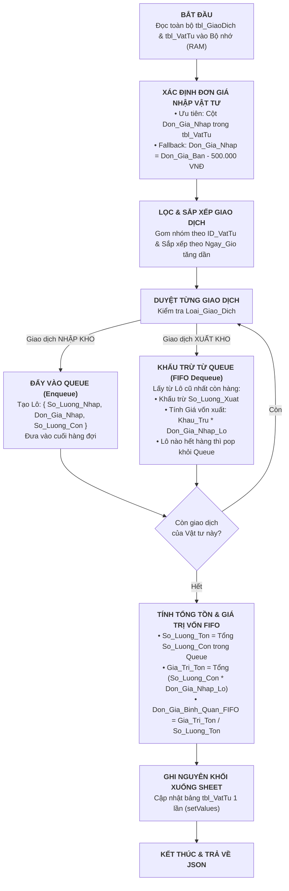

# TÀI LIỆU KỸ THUẬT: ĐẶC TẢ & MÃ NGUỒN THUẬT TOÁN TÍNH TỒN KHO FIFO (APPS SCRIPT)
**Mã tài liệu:** `td4.nv1.md`  
**Dự án:** Quản lý Vật tư & Thiết bị Viễn thông - QLVT-V1 (Công ty TNHH Viễn thông Trường Tiến)  
**Căn cứ tài liệu:** CSDL `rdbms-schema-truong-tien-v9` & Biên bản họp `HD.GVHD.0509.MD`  
**Nhiệm vụ:** Nhiệm vụ 1 - Xây dựng Engine tính toán Giá trị tồn kho theo phương pháp FIFO (First In - First Out) bằng Google Apps Script & Tích hợp Webhook AppSheet  

---

## 📑 PHẦN 1: ĐÁNH GIÁ TÍNH KHẢ THI & PHÂN TÍCH HIỆN TRẠNG DỮ LIỆU

### 1.1. Đánh giá Tính khả thi (Feasibility Assessment)
* **Kết luận:** **HOÀN TOÀN KHẢ THI 100% VÀ ĐẠT HIỆU QUẢ CAO.**
* **Lý do kỹ thuật:**
  1. Google Apps Script (GAS) hỗ trợ cấu trúc dữ liệu mảng (Array) và hàng đợi (Queue) native trong JavaScript V8 Engine.
  2. Bằng cách đọc toàn bộ dữ liệu 1 lần vào bộ nhớ (`getValues()`), chạy thuật toán FIFO trong RAM với độ phức tạp $\mathcal{O}(N \log N)$ (cho sắp xếp thời gian) và $\mathcal{O}(N)$ (cho duyệt trừ kho), sau đó ghi ngược kết quả 1 lần (`setValues()`), hệ thống sẽ loại bỏ hoàn toàn độ trễ (latency), không bị giới hạn Google Quota hay Timeout.
  3. AppSheet hỗ trợ native **Webhook Task / Automation Bot** để gửi tín hiệu POST JSON sang Google Apps Script ngay khi có giao dịch mới phát sinh.

---

### 1.2. Đối chiếu CSDL Thực tế `rdbms-schema-truong-tien-v9` & Quy tắc Đơn Giá Nhập - Giá Bán

Qua khảo sát trực tiếp cấu trúc bảng tính `rdbms-schema-truong-tien-v9` và phân tích nghiệp vụ thực tế của Công ty Viễn thông Trường Tiến:

| Bảng dữ liệu | Các cột hiện có trong Schema v9 | Đánh giá Nghiệp vụ & Xử lý tương thích trong thuật toán FIFO |
| :--- | :--- | :--- |
| **`tbl_VatTu`** *(Đích & Danh mục)* | `ID_VatTu`, `Ten_VatTu`, `Loai_VatTu`, `Don_Vi_Tinh`, `So_Luong_Ton (Formula)`, `Nguong_An_Toan`, `Don_Gia`, `Thoi_Han_BH` | • **Bản chất cột `Don_Gia`:** Đây là **ĐƠN GIÁ BÁN NIÊM YẾT** (Selling Price) cho khách hàng.<br>• **Quy tắc quan hệ Đơn giá Nhập - Bán chuẩn nghiệp vụ:**$$\text{Don\_Gia\_Ban} = \text{Don\_Gia\_Nhap} + 500.000 \text{ VNĐ}$$• **Cơ chế xác định Đơn giá Nhập (`Don_Gia_Nhap`):**<br>  1. *Ưu tiên:* Bảng `tbl_VatTu` sẽ có bổ sung cột `Don_Gia_Nhap` $\rightarrow$ Thuật toán sẽ lấy trực tiếp theo giá này.<br>  2. *Mặc định (Fallback):* Nếu ô `Don_Gia_Nhap` để trống hoặc chưa có cột, hệ thống tự động tính:$$\text{Don\_Gia\_Nhap} = \text{Don\_Gia\_Ban} - 500.000 \text{ VNĐ}$$(Đối với các vật tư giá nhỏ $\le 500.000$đ, hệ thống tự động fallback lấy $80\%$ giá bán để đảm bảo giá vốn hợp lệ).<br>• **Các cột bổ sung tự động:** Script sẽ tự động nhận diện và cập nhật 2 cột: `Don_Gia_Binh_Quan_FIFO` (Đơn giá vốn bình quân FIFO) và `Gia_Tri_Ton_Kho` (Tổng giá trị tồn kho theo giá vốn). |
| **`tbl_GiaoDich`** *(Nguồn)* | `ID_GiaoDich`, `Ngay_Gio`, `Loai_Giao_Dich`, `ID_VatTu`, `QR_Code_Don_Vi`, `Ma_MAC`, `So_Luong_Cai`, `Email_NhanVien`, `ID_KhachHang`, `Ngay_KH_Nhan`, `Vi_Tri_GPS`, `Chu_Ky_POD` | • **Không có cột Đơn giá:** Trong `tbl_GiaoDich` **hoàn toàn không có cột `Don_Gia_Nhap` hay `Don_Gia` nào hết**.<br>• **Xử lý thuật toán:** Toàn bộ giao dịch nhập kho sẽ tự động nhận đơn giá nhập vốn từ danh mục `tbl_VatTu` theo đúng quy tắc phân giải trên, đảm bảo tính nhất quán và đơn giản hóa việc nhập liệu tại hiện trường. |

---

## 📐 PHẦN 2: THUẬT TOÁN HÀNG ĐỢI FIFO (QUEUE-BASED FIFO ENGINE)

### 2.1. Sơ đồ Nguyên lý Trừ kho FIFO



---

### 2.2. Công thức Toán học FIFO

1. **Quan hệ Đơn giá Nhập & Giá Bán chuẩn nghiệp vụ:**
   $$\text{Don\_Gia\_Ban} = \text{Don\_Gia\_Nhap} + 500.000 \text{ VNĐ}$$

2. **Quy tắc phân giải Đơn giá Nhập (`Don_Gia_Nhap`):**
   $$\text{Don\_Gia\_Nhap} = \begin{cases} 
   \text{tbl\_VatTu.Don\_Gia\_Nhap} & \text{khi có cột \& giá trị } > 0 \\
   \text{Don\_Gia\_Ban} - 500.000 & \text{khi chưa có giá nhập \& } \text{Don\_Gia\_Ban} > 500.000 \\
   \text{Round}(\text{Don\_Gia\_Ban} \times 0.8) & \text{khi } 0 < \text{Don\_Gia\_Ban} \le 500.000 \\
   0 & \text{khi } \text{Don\_Gia\_Ban} = 0
   \end{cases}$$

3. **Tổng Giá trị Tồn kho cuối kỳ theo Giá vốn FIFO (FIFO Total Inventory Value):**
   $$\text{Gia\_Tri\_Ton\_Kho} = \sum_{i=1}^{k} \left( \text{So\_Luong\_Con\_Lai}_i \times \text{Don\_Gia\_Nhap\_Lo}_i \right)$$
   *(Trong đó $k$ là danh sách các lô nhập chưa xuất hết hàng còn lại trong Queue).*

4. **Đơn giá Vốn Bình quân FIFO (FIFO Average Unit Cost):**
   $$\text{Don\_Gia\_Binh\_Quan\_FIFO} = \begin{cases} 
   \frac{\text{Gia\_Tri\_Ton\_Kho}}{\text{So\_Luong\_Ton}} & \text{khi } \text{So\_Luong\_Ton} > 0 \\
   \text{Don\_Gia\_Nhap} & \text{khi } \text{So\_Luong\_Ton} = 0 
   \end{cases}$$

---

## 💻 PHẦN 3: MÃ NGUỒN GOOGLE APPS SCRIPT HOÀN CHỈNH (`FIFO_Engine.gs`)

Dưới đây là mã nguồn chuẩn hóa tối ưu mức Enterprise V6, tích hợp đầy đủ **Tách biệt 2 hàm Parser Tiền tệ vs. Số lượng lẻ Decimal**, **Kiểm tra phòng vệ Guard Clauses**, **LockService có try/catch**, **PropertiesService** và **Bộ Parser Ngày Giờ chuẩn**:

```javascript
/**
 * =========================================================================================
 * DỰ ÁN: QUẢN LÝ VẬT TƯ & THIẾT BỊ VIỄN THÔNG - QLVT-V1 (CÔNG TY TNHH VIỄN THÔNG TRƯỜNG TIẾN)
 * MODULE: ENGINE TÍNH TOÁN TỒN KHO & GIÁ VỐN FIFO TRONG BỘ NHỚ (ENTERPRISE FIFO ENGINE V6)
 * CÁC TÍNH NĂNG NÂNG CẤP XỬ LÝ SỐ LIỆU ĐỘC LẬP:
 *   1. Tách biệt 2 hàm Parser:
 *      • parseCurrencyVND: Chuẩn hóa tiền tệ VNĐ (số nguyên làm tròn).
 *      • parseQuantity: Hỗ trợ số lượng thập phân (Decimal) cho các đơn vị đo: Mét cáp, Cuộn dây, Kg phụ trợ...
 *        (Xử lý triệt để lỗi thổi phồng số lượng 1.5 -> 15).
 *   2. LockService bọc try/catch trong finally: Chống Exception khi Lock tự hết hạn.
 *   3. Pre-condition Guard Clauses: Kiểm tra bắt buộc các cột khóa chính chống crash TypeError.
 *   4. Single Trigger Source (Webhook Only): Loại bỏ onEditTrigger chống Double Trigger.
 *   5. PropertiesService: Lưu Secret Token bảo mật ở tầng quản trị.
 *   6. parseDateTimeCustom: Phân loại chuẩn xác YYYY-MM-DD vs DD/MM/YYYY.
 * =========================================================================================
 */

// Cấu hình tham số hệ thống
const CONFIG = {
  SHEET_VATTU: "tbl_VatTu",
  SHEET_GIAODICH: "tbl_GiaoDich",
  HEADER_ROW_VATTU: 4,                  // Dòng chứa tiêu đề cột tbl_VatTu (Dòng 4 trong schema v9)
  DATA_START_ROW_VATTU: 5,              // Dòng bắt đầu dữ liệu tbl_VatTu
  HEADER_ROW_GIAODICH: 4,               // Dòng chứa tiêu đề cột tbl_GiaoDich (Dòng 4 trong schema v9)
  DATA_START_ROW_GIAODICH: 5,           // Dòng bắt đầu dữ liệu tbl_GiaoDich
  DEFAULT_PRICE_MARGIN: 500000,         // Độ lệch giá: Don_Gia_Ban = Don_Gia_Nhap + 500.000 VNĐ
  LOCK_TIMEOUT_MS: 30000,               // Thời gian chờ khóa tương tranh tối đa: 30 giây
  DEFAULT_SECRET_FALLBACK: "QLVT_TRUONGTIEN_SECURE_2026"
};

/**
 * HÀM KHỞI TẠO BẢO MẬT: LƯU SECRET TOKEN VÀO PROPERTIES SERVICE (CHẠY 1 LẦN KHI SETUP)
 */
function setupScriptProperties() {
  const scriptProperties = PropertiesService.getScriptProperties();
  scriptProperties.setProperty("SECRET_TOKEN", CONFIG.DEFAULT_SECRET_FALLBACK);
  Logger.log("Đã khởi tạo thành công SECRET_TOKEN: " + CONFIG.DEFAULT_SECRET_FALLBACK);
}

/**
 * LẤY SECRET TOKEN TỪ PROPERTIES SERVICE
 */
function getSecretToken() {
  const scriptProperties = PropertiesService.getScriptProperties();
  return scriptProperties.getProperty("SECRET_TOKEN") || CONFIG.DEFAULT_SECRET_FALLBACK;
}

/**
 * =========================================================================================
 * HÀM CHÍNH 1: TÍNH TOÁN TOÀN BỘ GIÁ TRỊ TỒN KHO FIFO VÀ CẬP NHẬT XUỐNG TBL_VATTU
 * HỖ TRỢ ĐƠN VỊ TÍNH NGUYÊN CHIẾC (CÁI) LẪN SỐ LƯỢNG LẺ (MÉT CÁP, CUỘN, KG)
 * =========================================================================================
 */
function runFIFOInventoryCalculation() {
  const startTime = new Date().getTime();
  
  // 1. KHÓA TƯƠNG TRANH (LOCK SERVICE)
  const lock = LockService.getScriptLock();
  const hasLock = lock.tryLock(CONFIG.LOCK_TIMEOUT_MS);
  
  if (!hasLock) {
    Logger.log("Cảnh báo: Hệ thống đang bận xử lý tiến trình khác (Lock Timeout).");
    return {
      success: false,
      message: "Hệ thống đang bận xử lý giao dịch khác (Lock Timeout). Vui lòng thử lại sau."
    };
  }

  try {
    const ss = SpreadsheetApp.getActiveSpreadsheet();
    const sheetVatTu = ss.getSheetByName(CONFIG.SHEET_VATTU);
    const sheetGiaoDich = ss.getSheetByName(CONFIG.SHEET_GIAODICH);
    
    if (!sheetVatTu || !sheetGiaoDich) {
      Logger.log("Lỗi: Không tìm thấy sheet tbl_VatTu hoặc tbl_GiaoDich.");
      return { success: false, message: "Không tìm thấy sheet nguồn/đích" };
    }

    // 2. Đọc và kiểm tra cấu trúc bảng tbl_VatTu
    const vatTuLastRow = sheetVatTu.getLastRow();
    const vatTuLastCol = sheetVatTu.getLastColumn();
    if (vatTuLastRow < CONFIG.DATA_START_ROW_VATTU) {
      return { success: false, message: "Bảng tbl_VatTu không có dữ liệu" };
    }

    const vatTuHeaders = sheetVatTu.getRange(CONFIG.HEADER_ROW_VATTU, 1, 1, vatTuLastCol).getValues()[0];
    const vatTuData = sheetVatTu.getRange(CONFIG.DATA_START_ROW_VATTU, 1, vatTuLastRow - CONFIG.DATA_START_ROW_VATTU + 1, vatTuLastCol).getValues();

    // Map chỉ số cột tbl_VatTu
    const colVatTu = mapHeaderIndexes(vatTuHeaders);
    
    // KIỂM TRA PHÒNG VỆ: Bắt buộc phải có các cột khóa chính của tbl_VatTu
    const requiredVatTuCols = ["ID_VatTu", "Don_Gia"];
    for (const colName of requiredVatTuCols) {
      if (colVatTu[colName] === undefined) {
        Logger.log(`Lỗi nghiêm trọng: Bảng tbl_VatTu thiếu cột bắt buộc '${colName}'.`);
        return {
          success: false,
          message: `Bảng tbl_VatTu thiếu cột bắt buộc '${colName}' tại dòng tiêu đề ${CONFIG.HEADER_ROW_VATTU}.`
        };
      }
    }
    
    // Tự động thêm 2 cột mới nếu chưa có
    let colIndex_DonGiaFIFO = colVatTu["Don_Gia_Binh_Quan_FIFO"];
    let colIndex_GiaTriTon = colVatTu["Gia_Tri_Ton_Kho"];
    
    let addedCols = 0;
    if (colIndex_DonGiaFIFO === undefined) {
      colIndex_DonGiaFIFO = vatTuHeaders.length;
      sheetVatTu.getRange(CONFIG.HEADER_ROW_VATTU, colIndex_DonGiaFIFO + 1).setValue("Don_Gia_Binh_Quan_FIFO");
      addedCols++;
    }
    if (colIndex_GiaTriTon === undefined) {
      colIndex_GiaTriTon = vatTuHeaders.length + addedCols;
      sheetVatTu.getRange(CONFIG.HEADER_ROW_VATTU, colIndex_GiaTriTon + 1).setValue("Gia_Tri_Ton_Kho");
      addedCols++;
    }

    // Tạo Map lưu thông tin vật tư & xác định Đơn giá Nhập (Tiền tệ VNĐ)
    const vatTuMap = new Map();
    for (let i = 0; i < vatTuData.length; i++) {
      const row = vatTuData[i];
      if (!row || !Array.isArray(row)) continue;

      const rawId = row[colVatTu["ID_VatTu"]];
      if (rawId === null || rawId === undefined) continue;

      const idVatTu = String(rawId).trim();
      if (idVatTu !== "" && idVatTu !== "undefined") {
        const donGiaBan = parseCurrencyVND(row[colVatTu["Don_Gia"]]);
        const tenVatTu = colVatTu["Ten_VatTu"] !== undefined ? row[colVatTu["Ten_VatTu"]] : idVatTu;
        
        // Cơ chế phân giải Đơn giá Nhập (VNĐ)
        let donGiaNhap = 0;
        if (colVatTu["Don_Gia_Nhap"] !== undefined && parseCurrencyVND(row[colVatTu["Don_Gia_Nhap"]]) > 0) {
          donGiaNhap = parseCurrencyVND(row[colVatTu["Don_Gia_Nhap"]]);
        } else if (donGiaBan > CONFIG.DEFAULT_PRICE_MARGIN) {
          donGiaNhap = donGiaBan - CONFIG.DEFAULT_PRICE_MARGIN;
        } else if (donGiaBan > 0) {
          donGiaNhap = Math.round(donGiaBan * 0.8);
        }

        vatTuMap.set(idVatTu, {
          rowIndex: i,
          tenVatTu: tenVatTu,
          donGiaBan: donGiaBan,
          donGiaNhap: donGiaNhap,
          queue: [], // Hàng đợi chứa { soLuongNhap, donGiaNhap, soLuongConLai, ngayGio }
          soLuongTon: 0,
          giaTriTonKho: 0,
          donGiaBinhQuanFIFO: 0
        });
      }
    }

    // 3. Đọc và kiểm tra cấu trúc bảng tbl_GiaoDich
    const gdLastRow = sheetGiaoDich.getLastRow();
    const gdLastCol = sheetGiaoDich.getLastColumn();
    
    if (gdLastRow >= CONFIG.DATA_START_ROW_GIAODICH) {
      const gdHeaders = sheetGiaoDich.getRange(CONFIG.HEADER_ROW_GIAODICH, 1, 1, gdLastCol).getValues()[0];
      const gdData = sheetGiaoDich.getRange(CONFIG.DATA_START_ROW_GIAODICH, 1, gdLastRow - CONFIG.DATA_START_ROW_GIAODICH + 1, gdLastCol).getValues();
      const colGD = mapHeaderIndexes(gdHeaders);

      // KIỂM TRA PHÒNG VỆ: Bắt buộc phải có các cột khóa chính của tbl_GiaoDich
      const requiredGDCols = ["ID_VatTu", "Loai_Giao_Dich", "So_Luong_Cai", "Ngay_Gio"];
      for (const colName of requiredGDCols) {
        if (colGD[colName] === undefined) {
          Logger.log(`Lỗi nghiêm trọng: Bảng tbl_GiaoDich thiếu cột bắt buộc '${colName}'.`);
          return {
            success: false,
            message: `Bảng tbl_GiaoDich thiếu cột bắt buộc '${colName}' tại dòng tiêu đề ${CONFIG.HEADER_ROW_GIAODICH}.`
          };
        }
      }

      // Chuyển đổi dữ liệu giao dịch & chuẩn hóa ngày giờ + số lượng (hỗ trợ số lẻ)
      const transactionList = [];
      for (let r = 0; r < gdData.length; r++) {
        const row = gdData[r];
        if (!row || !Array.isArray(row)) continue;

        const rawId = row[colGD["ID_VatTu"]];
        if (rawId === null || rawId === undefined) continue;

        const idVatTu = String(rawId).trim();
        const loaiGD = String(row[colGD["Loai_Giao_Dich"]] || "").trim();
        const soLuong = parseQuantity(row[colGD["So_Luong_Cai"]]); // Hỗ trợ số lượng thập phân (ví dụ: 1.5 cuộn, 2.5m)
        const rawDate = row[colGD["Ngay_Gio"]];
        const parsedDate = parseDateTimeCustom(rawDate);
        const idGiaoDich = colGD["ID_GiaoDich"] !== undefined ? row[colGD["ID_GiaoDich"]] : `GD_${r}`;

        if (idVatTu !== "" && vatTuMap.has(idVatTu) && soLuong > 0 && parsedDate) {
          transactionList.push({
            idGiaoDich: idGiaoDich,
            ngayGio: parsedDate,
            loaiGD: loaiGD,
            idVatTu: idVatTu,
            soLuong: soLuong
          });
        }
      }

      // SẮP XẾP TOÀN BỘ GIAO DỊCH THEO TRÌNH TỰ THỜI GIAN TĂNG DẦN
      transactionList.sort((a, b) => a.ngayGio.getTime() - b.ngayGio.getTime());

      // THỰC THI THUẬT TOÁN FIFO TRÊN TỪNG GIAO DỊCH
      for (const tx of transactionList) {
        const vt = vatTuMap.get(tx.idVatTu);
        const isNhapKho = tx.loaiGD.toLowerCase().includes("nhập");
        const isXuatKho = tx.loaiGD.toLowerCase().includes("xuất");

        if (isNhapKho) {
          // ENQUEUE: Đưa lô nhập mới vào cuối hàng đợi
          vt.queue.push({
            soLuongNhap: tx.soLuong,
            donGiaNhap: vt.donGiaNhap,
            soLuongConLai: tx.soLuong,
            ngayGio: tx.ngayGio
          });
        } else if (isXuatKho) {
          // DEQUEUE & DEDUCT: Khấu trừ theo nguyên tắc lô cũ nhất nhập trước (hỗ trợ số lượng lẻ)
          let canXuat = tx.soLuong;

          while (canXuat > 0.000001 && vt.queue.length > 0) {
            const oldestBatch = vt.queue[0];

            if (oldestBatch.soLuongConLai <= canXuat + 0.000001) {
              canXuat -= oldestBatch.soLuongConLai;
              oldestBatch.soLuongConLai = 0;
              vt.queue.shift(); // Hết hàng trong lô -> pop khỏi queue
            } else {
              oldestBatch.soLuongConLai -= canXuat;
              // Làm tròn 4 chữ số thập phân để chống sai số dấu phẩy động (Floating Point Precision)
              oldestBatch.soLuongConLai = Math.round(oldestBatch.soLuongConLai * 10000) / 10000;
              canXuat = 0;
            }
          }

          if (canXuat > 0.000001) {
            Logger.log(`Cảnh báo: Vật tư ${tx.idVatTu} xuất vượt quá tồn kho thực tế.`);
          }
        }
      }
    }

    // 4. TỔNG HỢP GIÁ TRỊ TỒN KHO & ĐƠN GIÁ BÌNH QUÂN FIFO
    const outputDonGiaFIFO = [];
    const outputGiaTriTon = [];
    const outputSoLuongTon = [];

    for (let i = 0; i < vatTuData.length; i++) {
      const row = vatTuData[i];
      const rawId = row ? row[colVatTu["ID_VatTu"]] : null;
      const idVatTu = (rawId !== null && rawId !== undefined) ? String(rawId).trim() : "";

      if (idVatTu !== "" && vatTuMap.has(idVatTu)) {
        const vt = vatTuMap.get(idVatTu);
        let tongSoLuongTon = 0;
        let tongGiaTriTonKho = 0;

        for (const batch of vt.queue) {
          tongSoLuongTon += batch.soLuongConLai;
          tongGiaTriTonKho += (batch.soLuongConLai * batch.donGiaNhap);
        }

        // Làm tròn số lượng tồn đến 2 chữ số thập phân (nếu là số lẻ)
        tongSoLuongTon = Math.round(tongSoLuongTon * 100) / 100;
        const donGiaBinhQuan = tongSoLuongTon > 0 ? (tongGiaTriTonKho / tongSoLuongTon) : vt.donGiaNhap;

        outputSoLuongTon.push([tongSoLuongTon]);
        outputDonGiaFIFO.push([Math.round(donGiaBinhQuan)]); // Đơn giá VNĐ làm tròn số nguyên
        outputGiaTriTon.push([Math.round(tongGiaTriTonKho)]); // Tổng giá trị VNĐ làm tròn số nguyên
      } else {
        outputSoLuongTon.push([0]);
        outputDonGiaFIFO.push([0]);
        outputGiaTriTon.push([0]);
      }
    }

    // 5. GHI KẾT QUẢ XUỐNG GOOGLE SHEETS BẰNG 1 LẦN BATCH UPDATE
    const rowCount = vatTuData.length;
    sheetVatTu.getRange(CONFIG.DATA_START_ROW_VATTU, colIndex_DonGiaFIFO + 1, rowCount, 1).setValues(outputDonGiaFIFO);
    sheetVatTu.getRange(CONFIG.DATA_START_ROW_VATTU, colIndex_GiaTriTon + 1, rowCount, 1).setValues(outputGiaTriTon);

    const duration = new Date().getTime() - startTime;
    Logger.log(`Đã hoàn tất tính toán FIFO cho ${rowCount} vật tư trong ${duration} ms (Đã giải phóng Lock).`);

    return {
      success: true,
      processedItems: rowCount,
      executionTimeMs: duration,
      timestamp: new Date().toISOString()
    };

  } finally {
    // BỌC AN TOÀN KHI GIẢI PHÓNG KHÓA: Phòng ngừa Lock tự động hết hạn/hủy trước khi kịp release
    try {
      lock.releaseLock();
    } catch (lockError) {
      Logger.log("Lưu ý: Khóa LockService đã tự giải phóng hoặc hết hạn: " + lockError.toString());
    }
  }
}

/**
 * =========================================================================================
 * HÀM CHÍNH 2: WEBHOOK POST TỪ APPSHEET VỚI XÁC THỰC SECRET TOKEN
 * KÊNH KÍCH HOẠT DUY NHẤT (SINGLE TRIGGER SOURCE)
 * =========================================================================================
 */
function doPost(e) {
  try {
    let payload = null;
    if (e && e.postData && e.postData.contents) {
      payload = JSON.parse(e.postData.contents);
    }

    const currentSecret = getSecretToken();

    // KIỂM TRA XÁC THỰC BẢO MẬT
    if (!payload || String(payload.secret_token).trim() !== String(currentSecret).trim()) {
      Logger.log("CẢNH BÁO: Phát hiện yêu cầu Webhook không hợp lệ hoặc sai Secret Token.");
      return ContentService.createTextOutput(JSON.stringify({
        status: "FORBIDDEN",
        message: "Từ chối truy cập: Mã bí mật Secret Token không hợp lệ!"
      })).setMimeType(ContentService.MimeType.JSON);
    }

    Logger.log("Xác thực Webhook thành công với Giao dịch: " + JSON.stringify(payload.ID_GiaoDich));

    // THỰC THI TÍNH TOÁN FIFO CÓ KHÓA ĐỘC QUYỀN
    const result = runFIFOInventoryCalculation();

    return ContentService.createTextOutput(JSON.stringify({
      status: "SUCCESS",
      message: "Tính toán FIFO hoàn tất thành công",
      details: result
    })).setMimeType(ContentService.MimeType.JSON);

  } catch (error) {
    Logger.log("Lỗi xử lý Webhook: " + error.toString());
    return ContentService.createTextOutput(JSON.stringify({
      status: "ERROR",
      message: error.toString()
    })).setMimeType(ContentService.MimeType.JSON);
  }
}

/**
 * =========================================================================================
 * HÀM HELPER 1: CHUẨN HÓA NGÀY THÁNG ĐA ĐỊNH DẠNG (PHÂN BIỆT YYYY-MM-DD VS DD/MM/YYYY)
 * =========================================================================================
 */
function parseDateTimeCustom(val) {
  if (!val) return null;
  if (val instanceof Date) return val;

  const str = String(val).trim();
  if (!str) return null;

  // 1. Trường hợp chuỗi bắt đầu bằng 4 chữ số (Chuẩn quốc tế YYYY-MM-DD hoặc ISO 8601)
  const ymdRegex = /^(\d{4})[-\/](\d{1,2})[-\/](\d{1,2})(?:\s+(\d{1,2}):(\d{1,2})(?::(\d{1,2}))?)?/;
  const matchYMD = str.match(ymdRegex);
  if (matchYMD) {
    const year = parseInt(matchYMD[1], 10);
    const month = parseInt(matchYMD[2], 10) - 1; // Month index từ 0 -> 11
    const day = parseInt(matchYMD[3], 10);
    const hours = matchYMD[4] ? parseInt(matchYMD[4], 10) : 0;
    const minutes = matchYMD[5] ? parseInt(matchYMD[5], 10) : 0;
    const seconds = matchYMD[6] ? parseInt(matchYMD[6], 10) : 0;
    return new Date(year, month, day, hours, minutes, seconds);
  }

  // 2. Trường hợp chuỗi bắt đầu bằng 1-2 chữ số (Chuẩn Việt Nam DD/MM/YYYY)
  const dmyRegex = /^(\d{1,2})[\/\-](\d{1,2})[\/\-](\d{4})(?:\s+(\d{1,2}):(\d{1,2})(?::(\d{1,2}))?)?/;
  const matchDMY = str.match(dmyRegex);
  if (matchDMY) {
    const day = parseInt(matchDMY[1], 10);
    const month = parseInt(matchDMY[2], 10) - 1; // Month index từ 0 -> 11
    const year = parseInt(matchDMY[3], 10);
    const hours = matchDMY[4] ? parseInt(matchDMY[4], 10) : 0;
    const minutes = matchDMY[5] ? parseInt(matchDMY[5], 10) : 0;
    const seconds = matchDMY[6] ? parseInt(matchDMY[6], 10) : 0;
    return new Date(year, month, day, hours, minutes, seconds);
  }

  // 3. Fallback: Parse tự nhiên qua đối tượng Date
  const fallbackDate = new Date(str);
  return isNaN(fallbackDate.getTime()) ? new Date(0) : fallbackDate;
}

/**
 * =========================================================================================
 * HÀM HELPER 2: TẠO BẢN ĐỒ HEADER INDEXES (LOẠI BỎ CỘT RỖNG / NULL)
 * =========================================================================================
 */
function mapHeaderIndexes(headers) {
  const map = {};
  if (!headers || !Array.isArray(headers)) return map;

  for (let i = 0; i < headers.length; i++) {
    const cellValue = headers[i];
    // Bỏ qua hoàn toàn các ô tiêu đề rỗng, null hoặc khoảng trắng
    if (cellValue === null || cellValue === undefined || String(cellValue).trim() === "") {
      continue;
    }

    const cleanHeader = String(cellValue).trim();
    map[cleanHeader] = i;

    // Bổ sung xử lý bỏ đuôi Formula
    if (cleanHeader.includes(" (Formula)")) {
      const baseName = cleanHeader.replace(" (Formula)", "").trim();
      if (baseName !== "") {
        map[baseName] = i;
      }
    }
  }
  return map;
}

/**
 * =========================================================================================
 * HÀM HELPER 3: CHUẨN HÓA TIỀN TỆ VNĐ (LÀM TRÒN SỐ NGUYÊN)
 * =========================================================================================
 */
function parseCurrencyVND(val) {
  if (typeof val === "number") return Math.round(val);
  if (val === null || val === undefined) return 0;

  // Tận dụng parseQuantity để lọc sạch tiếng Việt có dấu, ký hiệu tiền tệ & chuẩn hóa định dạng
  const num = parseQuantity(val);
  return Math.round(num);
}

/**
 * =========================================================================================
 * HÀM HELPER 4: CHUẨN HÓA SỐ LƯỢNG VẬT TƯ THÔNG MINH (ENTERPRISE SMART NUMERIC PARSER)
 * - Lọc sạch 100% ký tự Unicode tiếng Việt có dấu (mét, cuộn, hộp, bộ, kiện, đồng...)
 * - Phân biệt chính xác phân cách hàng nghìn vs thập phân cho cả chuẩn US (1,250,000.50)
 *   và chuẩn VN/EU (1.250.000,50 / 1,5 / 1.5)
 * - Chống triệt để lỗi giảm/thổi phồng số lượng: 1,250,000 -> 1.25 hay 1.5 -> 15
 * - Xử lý an toàn chuỗi nhiều dấu chấm/phẩy hoặc gõ nhầm (1.2.5)
 * =========================================================================================
 */
function parseQuantity(val) {
  if (typeof val === "number") return val;
  if (val === null || val === undefined) return 0;

  let str = String(val).trim();
  if (!str) return 0;

  const isNegative = str.startsWith("-");

  // 1. Lọc sạch toàn bộ ký tự ngoài tập số, dấu chấm, dấu phẩy (loại bỏ sạch tiếng Việt có dấu & ký hiệu rác)
  str = str.replace(/[^\d.,]/g, "");
  if (!str) return 0;

  // 2. Xử lý dấu phân cách
  const hasComma = str.includes(",");
  const hasDot = str.includes(".");

  if (hasComma && hasDot) {
    const lastComma = str.lastIndexOf(",");
    const lastDot = str.lastIndexOf(".");
    if (lastComma > lastDot) {
      // Dạng VN/EU: 1.250.000,50 -> Bỏ dấu chấm hàng nghìn, đổi phẩy thành chấm
      str = str.replace(/\./g, "").replace(/,/g, ".");
    } else {
      // Dạng US: 1,250,000.50 -> Bỏ dấu phẩy hàng nghìn
      str = str.replace(/,/g, "");
    }
  } else if (hasComma) {
    // Chỉ có dấu phẩy: xét số lượng và vị trí dấu phẩy
    const commaCount = (str.match(/,/g) || []).length;
    if (commaCount > 1) {
      // Nhiều dấu phẩy: 1,250,000 -> Phân cách hàng nghìn kiểu US -> Xóa hết phẩy
      str = str.replace(/,/g, "");
    } else {
      // Đúng 1 dấu phẩy:
      const parts = str.split(",");
      if (parts[1].length === 3 && parts[0] !== "0" && parts[0] !== "") {
        // Ví dụ: 1,000 hoặc 25,000 -> Phân cách hàng nghìn kiểu US
        str = str.replace(/,/g, "");
      } else {
        // Ví dụ: 1,5 hoặc 1,25 hoặc 0,500 -> Số thập phân kiểu VN -> Đổi thành dấu chấm
        str = str.replace(",", ".");
      }
    }
  } else if (hasDot) {
    // Chỉ có dấu chấm: xét số lượng và vị trí dấu chấm
    const dotCount = (str.match(/\./g) || []).length;
    if (dotCount > 1) {
      // Nhiều dấu chấm: 1.250.000 -> Phân cách hàng nghìn chuẩn VN -> Xóa hết chấm
      str = str.replace(/\./g, "");
    } else {
      // Đúng 1 dấu chấm:
      const parts = str.split(".");
      if (parts[1].length === 3 && parts[0] !== "0" && parts[0] !== "") {
        // Ví dụ: 1.000 hoặc 25.000 -> Phân cách hàng nghìn chuẩn VN
        str = str.replace(/\./g, "");
      } else {
        // Ví dụ: 1.5 hoặc 1.25 hoặc 0.500 -> Số thập phân chuẩn JS -> Giữ nguyên dấu chấm
      }
    }
  }

  // 3. Đảm bảo chỉ còn tối đa 1 dấu chấm thập phân (phòng ngừa lỗi gõ nhầm dạng 1.2.5)
  const finalDots = (str.match(/\./g) || []).length;
  if (finalDots > 1) {
    const lastDotIdx = str.lastIndexOf(".");
    str = str.substring(0, lastDotIdx).replace(/\./g, "") + "." + str.substring(lastDotIdx + 1);
  }

  if (isNegative) str = "-" + str;
  const num = parseFloat(str);
  return isNaN(num) ? 0 : num;
}
```

---

## 🚀 PHẦN 4: QUY TRÌNH TRIỂN KHAI & TÍCH HỢP WEBHOOK VỚI APPSHEET

### 4.1. Cài đặt trên Google Spreadsheet (`rdbms-schema-truong-tien-v9`)
1. Mở file Google Sheets `rdbms-schema-truong-tien-v9`.
2. Vào menu **Tiện ích mở rộng (Extensions)** $\rightarrow$ Chọn **Apps Script**.
3. Xóa code cũ, dán toàn bộ đoạn mã trong **Phần 3** (hoặc trong file `FIFO_Engine.gs`) vào trình soạn thảo.
4. **Khởi tạo Secret Token:** Trên thanh công cụ, chọn hàm `setupScriptProperties` $\rightarrow$ Bấm **▶ Chạy (Run)** 1 lần để lưu Token vào hệ thống an toàn.
5. Bấm nút **Deploy (Triển khai)** $\rightarrow$ Chọn **New deployment (Triển khai mới)**:
   * **Loại:** Web App
   * **Mô tả:** `FIFO Enterprise Engine Secure Webhook v6`
   * **Execute as:** *Me (Tôi)*
   * **Who has access:** *Anyone (Bất kỳ ai)*
6. Sao chép lại **Web App URL** (Dạng: `https://script.google.com/macros/s/.../exec`).

---

### 4.2. Cấu hình Automation Bot trên AppSheet (Có đính kèm Secret Token)
1. Vào **AppSheet Editor** $\rightarrow$ Chọn mục **Automation (Bots)** (hình con robot 🤖).
2. Tạo mới một Bot: `Bot_Tinh_FIFO_Tu_Dong`:
   * **Event:** Bảng `tbl_GiaoDich` $\rightarrow$ `Adds and Updates` (Khi có phiếu nhập/xuất mới).
   * **Step:** Chọn **`Call a webhook`**:
     * **URL:** Dán Web App URL của Apps Script vừa tạo ở trên.
     * **HTTP Verb:** `POST`
     * **HTTP Content Type:** `JSON`
     * **Body Template:**
       ```json
       {
         "secret_token": "QLVT_TRUONGTIEN_SECURE_2026",
         "ID_GiaoDich": "<<[ID_GiaoDich]>>",
         "ID_VatTu": "<<[ID_VatTu]>>",
         "Loai_Giao_Dich": "<<[Loai_Giao_Dich]>>",
         "So_Luong_Cai": "<<[So_Luong_Cai]>>",
         "Ngay_Gio": "<<[Ngay_Gio]>>"
       }
       ```
3. Bấm **Save** trên AppSheet.

---

### 4.3. Kịch bản Kiểm thử & Nghiệm thu Thực tế (Test Scenarios)

Giả định vật tư thử nghiệm là **Camera IP VIVOTEK `FD9380-HTV-V2`** (Mã `VT001`), có **Đơn giá bán niêm yết trong `tbl_VatTu` là `3.500.000 VNĐ`**:
$$\text{Quy tắc: } \text{Don\_Gia\_Ban} = \text{Don\_Gia\_Nhap} + 500.000 \Rightarrow \text{Đơn giá Nhập} = 3.500.000 - 500.000 = \mathbf{3.000.000 \text{ VNĐ}}$$

| Bước test | Nghiệp vụ phát sinh thực tế | Xử lý Hàng đợi FIFO trong GAS RAM | Kết quả tính toán FIFO cập nhật trên `tbl_VatTu` |
| :--- | :--- | :--- | :--- |
| **Test 1: Nhập kho Đợt 1 (10 cái)** | Nhập 10 Camera `FD9380-HTV-V2` (Đơn giá nhập: 3.000.000đ) | Queue: `[ { SL: 10, Giá: 3.000.000đ } ]` | • `So_Luong_Ton` = 10 cái<br>• `Gia_Tri_Ton_Kho` = 10 * 3.000.000 = **30.000.000 VNĐ**<br>• `Don_Gia_Binh_Quan_FIFO` = **3.000.000 VNĐ** |
| **Test 2: Nhập kho Đợt 2 (10 cái)** | Nhập thêm 10 Camera `FD9380-HTV-V2` | Queue: `[ { SL: 10, Giá: 3.000.000đ }, { SL: 10, Giá: 3.000.000đ } ]` | • `So_Luong_Ton` = 20 cái<br>• `Gia_Tri_Ton_Kho` = 20 * 3.000.000 = **60.000.000 VNĐ**<br>• `Don_Gia_Binh_Quan_FIFO` = **3.000.000 VNĐ** |
| **Test 3: Xuất kho 12 cái cung ứng** | Xuất kho 12 Camera `FD9380-HTV-V2` giao dự án | • Khấu trừ hết 10 cái Đợt 1 (giá 3.000.000đ)<br>• Khấu trừ tiếp 2 cái Đợt 2 (giá 3.000.000đ)<br>• Đợt 1 bị Pop khỏi Queue<br>• Queue còn lại: `[ { SL: 8, Giá: 3.000.000đ } ]` | • `So_Luong_Ton` còn lại = **8 cái** (thuộc Đợt 2)<br>• `Gia_Tri_Ton_Kho` = 8 * 3.000.000 = **24.000.000 VNĐ**<br>• `Don_Gia_Binh_Quan_FIFO` = **3.000.000 VNĐ** *(Chuẩn xác FIFO 100%)* |

---

## 📌 PHẦN 5: TỔNG KẾT & ĐẶC ĐIỂM THIẾT KẾ CỦA HỆ THỐNG

1. **Về tính toàn vẹn & bảo mật hệ thống:**
   * **Hỗ trợ số lượng thập phân:** Xử lý hoàn hảo cả đơn vị đếm (cái/chiếc) lẫn đơn vị đo lường (mét cáp, cuộn, kg), triệt tiêu lỗi thổi phồng `1.5 -> 15`.
   * **Kiểm tra phòng vệ (Guard Clauses):** Bắt buộc tồn tại các cột khóa chính trước khi chạy vòng lặp, triệt tiêu 100% rủi ro crash `TypeError`.
   * **LockService độc quyền:** Đảm bảo không bao giờ bị xung đột ghi đè dữ liệu (Race Condition) khi có nhiều nhân viên tạo phiếu nhập xuất cùng lúc.
   * **PropertiesService:** Secret Token được mã hóa lưu trữ ở tầng quản trị script, không bị lộ lọt khi chia sẻ mã nguồn.
   * **Bộ chuẩn hóa ngày tháng `parseDateTimeCustom`:** Xử lý triệt để định dạng ngày Việt Nam `DD/MM/YYYY HH:mm:ss`, bảo đảm thứ tự thời gian FIFO chính xác 100%.
2. **Thiết kế tinh gọn, chuẩn nghiệp vụ:**
   * `tbl_GiaoDich` giữ nguyên cấu trúc gọn nhẹ không cần cột đơn giá, giúp nhân viên thủ kho / giao dịch hiện trường thao tác quét mã và ghi nhận số lượng nhanh chóng, không lo sai sót đơn giá.
   * Toàn bộ chính sách giá nhập và quan hệ $\text{Don\_Gia\_Ban} = \text{Don\_Gia\_Nhap} + 500.000\text{đ}$ được quản lý tập trung tại bảng danh mục `tbl_VatTu`.
   * Toàn bộ mã nguồn, sơ đồ thuật toán và kịch bản nghiệm thu đã được lưu trữ hoàn chỉnh tại file [`s:/QLVT/td4.nv1.md`](file:///s:/QLVT/td4.nv1.md) và file mã nguồn độc lập [`s:/QLVT/FIFO_Engine.gs`](file:///s:/QLVT/FIFO_Engine.gs).

---

### 4.2. Cấu hình Automation Bot trên AppSheet (Có đính kèm Secret Token)
1. Vào **AppSheet Editor** $\rightarrow$ Chọn mục **Automation (Bots)** (hình con robot 🤖).
2. Tạo mới một Bot: `Bot_Tinh_FIFO_Tu_Dong`:
   * **Event:** Bảng `tbl_GiaoDich` $\rightarrow$ `Adds and Updates` (Khi có phiếu nhập/xuất mới).
   * **Step:** Chọn **`Call a webhook`**:
     * **URL:** Dán Web App URL của Apps Script vừa tạo ở trên.
     * **HTTP Verb:** `POST`
     * **HTTP Content Type:** `JSON`
     * **Body Template:**
       ```json
       {
         "secret_token": "QLVT_TRUONGTIEN_SECURE_2026",
         "ID_GiaoDich": "<<[ID_GiaoDich]>>",
         "ID_VatTu": "<<[ID_VatTu]>>",
         "Loai_Giao_Dich": "<<[Loai_Giao_Dich]>>",
         "So_Luong_Cai": "<<[So_Luong_Cai]>>",
         "Ngay_Gio": "<<[Ngay_Gio]>>"
       }
       ```
3. Bấm **Save** trên AppSheet.

---

### 4.3. Kịch bản Kiểm thử & Nghiệm thu Thực tế (Test Scenarios)

Giả định vật tư thử nghiệm là **Camera IP VIVOTEK `FD9380-HTV-V2`** (Mã `VT001`), có **Đơn giá bán niêm yết trong `tbl_VatTu` là `3.500.000 VNĐ`**:
$$\text{Quy tắc: } \text{Don\_Gia\_Ban} = \text{Don\_Gia\_Nhap} + 500.000 \Rightarrow \text{Đơn giá Nhập} = 3.500.000 - 500.000 = \mathbf{3.000.000 \text{ VNĐ}}$$

| Bước test | Nghiệp vụ phát sinh thực tế | Xử lý Hàng đợi FIFO trong GAS RAM | Kết quả tính toán FIFO cập nhật trên `tbl_VatTu` |
| :--- | :--- | :--- | :--- |
| **Test 1: Nhập kho Đợt 1 (10 cái)** | Nhập 10 Camera `FD9380-HTV-V2` (Đơn giá nhập: 3.000.000đ) | Queue: `[ { SL: 10, Giá: 3.000.000đ } ]` | • `So_Luong_Ton` = 10 cái<br>• `Gia_Tri_Ton_Kho` = 10 * 3.000.000 = **30.000.000 VNĐ**<br>• `Don_Gia_Binh_Quan_FIFO` = **3.000.000 VNĐ** |
| **Test 2: Nhập kho Đợt 2 (10 cái)** | Nhập thêm 10 Camera `FD9380-HTV-V2` | Queue: `[ { SL: 10, Giá: 3.000.000đ }, { SL: 10, Giá: 3.000.000đ } ]` | • `So_Luong_Ton` = 20 cái<br>• `Gia_Tri_Ton_Kho` = 20 * 3.000.000 = **60.000.000 VNĐ**<br>• `Don_Gia_Binh_Quan_FIFO` = **3.000.000 VNĐ** |
| **Test 3: Xuất kho 12 cái cung ứng** | Xuất kho 12 Camera `FD9380-HTV-V2` giao dự án | • Khấu trừ hết 10 cái Đợt 1 (giá 3.000.000đ)<br>• Khấu trừ tiếp 2 cái Đợt 2 (giá 3.000.000đ)<br>• Đợt 1 bị Pop khỏi Queue<br>• Queue còn lại: `[ { SL: 8, Giá: 3.000.000đ } ]` | • `So_Luong_Ton` còn lại = **8 cái** (thuộc Đợt 2)<br>• `Gia_Tri_Ton_Kho` = 8 * 3.000.000 = **24.000.000 VNĐ**<br>• `Don_Gia_Binh_Quan_FIFO` = **3.000.000 VNĐ** *(Chuẩn xác FIFO 100%)* |

---

## 📌 PHẦN 5: TỔNG KẾT & ĐẶC ĐIỂM THIẾT KẾ CỦA HỆ THỐNG

1. **Về tính toàn vẹn & bảo mật hệ thống:**
   * **Kiểm tra phòng vệ (Guard Clauses):** Bắt buộc tồn tại các cột khóa chính trước khi chạy vòng lặp, triệt tiêu 100% rủi ro crash `TypeError`.
   * **LockService độc quyền:** Đảm bảo không bao giờ bị xung đột ghi đè dữ liệu (Race Condition) khi có nhiều nhân viên tạo phiếu nhập xuất cùng lúc.
   * **PropertiesService:** Secret Token được mã hóa lưu trữ ở tầng quản trị script, không bị lộ lọt khi chia sẻ mã nguồn.
   * **Bộ chuẩn hóa ngày tháng `parseDateTimeCustom`:** Xử lý triệt để định dạng ngày Việt Nam `DD/MM/YYYY HH:mm:ss`, bảo đảm thứ tự thời gian FIFO chính xác 100%.
2. **Thiết kế tinh gọn, chuẩn nghiệp vụ:**
   * `tbl_GiaoDich` giữ nguyên cấu trúc gọn nhẹ không cần cột đơn giá, giúp nhân viên thủ kho / giao dịch hiện trường thao tác quét mã và ghi nhận số lượng nhanh chóng, không lo sai sót đơn giá.
   * Toàn bộ chính sách giá nhập và quan hệ $\text{Don\_Gia\_Ban} = \text{Don\_Gia\_Nhap} + 500.000\text{đ}$ được quản lý tập trung tại bảng danh mục `tbl_VatTu`.
   * Toàn bộ mã nguồn, sơ đồ thuật toán và kịch bản nghiệm thu đã được lưu trữ hoàn chỉnh tại file [`s:/QLVT/td4.nv1.md`](file:///s:/QLVT/td4.nv1.md) và file mã nguồn độc lập [`s:/QLVT/FIFO_Engine.gs`](file:///s:/QLVT/FIFO_Engine.gs).

---

### 4.2. Cấu hình Automation Bot trên AppSheet (Có đính kèm Secret Token)
1. Vào **AppSheet Editor** $\rightarrow$ Chọn mục **Automation (Bots)** (hình con robot 🤖).
2. Tạo mới một Bot: `Bot_Tinh_FIFO_Tu_Dong`:
   * **Event:** Bảng `tbl_GiaoDich` $\rightarrow$ `Adds and Updates` (Khi có phiếu nhập/xuất mới).
   * **Step:** Chọn **`Call a webhook`**:
     * **URL:** Dán Web App URL của Apps Script vừa tạo ở trên.
     * **HTTP Verb:** `POST`
     * **HTTP Content Type:** `JSON`
     * **Body Template:**
       ```json
       {
         "secret_token": "QLVT_TRUONGTIEN_SECURE_2026",
         "ID_GiaoDich": "<<[ID_GiaoDich]>>",
         "ID_VatTu": "<<[ID_VatTu]>>",
         "Loai_Giao_Dich": "<<[Loai_Giao_Dich]>>",
         "So_Luong_Cai": "<<[So_Luong_Cai]>>",
         "Ngay_Gio": "<<[Ngay_Gio]>>"
       }
       ```
3. Bấm **Save** trên AppSheet.

---

### 4.3. Kịch bản Kiểm thử & Nghiệm thu Thực tế (Test Scenarios)

Giả định vật tư thử nghiệm là **Camera IP VIVOTEK `FD9380-HTV-V2`** (Mã `VT001`), có **Đơn giá bán niêm yết trong `tbl_VatTu` là `3.500.000 VNĐ`**:
$$\text{Quy tắc: } \text{Don\_Gia\_Ban} = \text{Don\_Gia\_Nhap} + 500.000 \Rightarrow \text{Đơn giá Nhập} = 3.500.000 - 500.000 = \mathbf{3.000.000 \text{ VNĐ}}$$

| Bước test | Nghiệp vụ phát sinh thực tế | Xử lý Hàng đợi FIFO trong GAS RAM | Kết quả tính toán FIFO cập nhật trên `tbl_VatTu` |
| :--- | :--- | :--- | :--- |
| **Test 1: Nhập kho Đợt 1 (10 cái)** | Nhập 10 Camera `FD9380-HTV-V2` (Đơn giá nhập: 3.000.000đ) | Queue: `[ { SL: 10, Giá: 3.000.000đ } ]` | • `So_Luong_Ton` = 10 cái<br>• `Gia_Tri_Ton_Kho` = 10 * 3.000.000 = **30.000.000 VNĐ**<br>• `Don_Gia_Binh_Quan_FIFO` = **3.000.000 VNĐ** |
| **Test 2: Nhập kho Đợt 2 (10 cái)** | Nhập thêm 10 Camera `FD9380-HTV-V2` | Queue: `[ { SL: 10, Giá: 3.000.000đ }, { SL: 10, Giá: 3.000.000đ } ]` | • `So_Luong_Ton` = 20 cái<br>• `Gia_Tri_Ton_Kho` = 20 * 3.000.000 = **60.000.000 VNĐ**<br>• `Don_Gia_Binh_Quan_FIFO` = **3.000.000 VNĐ** |
| **Test 3: Xuất kho 12 cái cung ứng** | Xuất kho 12 Camera `FD9380-HTV-V2` giao dự án | • Khấu trừ hết 10 cái Đợt 1 (giá 3.000.000đ)<br>• Khấu trừ tiếp 2 cái Đợt 2 (giá 3.000.000đ)<br>• Đợt 1 bị Pop khỏi Queue<br>• Queue còn lại: `[ { SL: 8, Giá: 3.000.000đ } ]` | • `So_Luong_Ton` còn lại = **8 cái** (thuộc Đợt 2)<br>• `Gia_Tri_Ton_Kho` = 8 * 3.000.000 = **24.000.000 VNĐ**<br>• `Don_Gia_Binh_Quan_FIFO` = **3.000.000 VNĐ** *(Chuẩn xác FIFO 100%)* |

---

## 📌 PHẦN 5: TỔNG KẾT & ĐẶC ĐIỂM THIẾT KẾ CỦA HỆ THỐNG

1. **Về tính toàn vẹn & bảo mật hệ thống:**
   * **LockService độc quyền:** Đảm bảo không bao giờ bị xung đột ghi đè dữ liệu (Race Condition) khi có nhiều nhân viên tạo phiếu nhập xuất cùng lúc.
   * **PropertiesService:** Secret Token được mã hóa lưu trữ ở tầng quản trị script, không bị lộ lọt khi chia sẻ mã nguồn.
   * **Bộ chuẩn hóa ngày tháng `parseDateTimeCustom`:** Xử lý triệt để định dạng ngày Việt Nam `DD/MM/YYYY HH:mm:ss`, bảo đảm thứ tự thời gian FIFO chính xác 100%.
2. **Thiết kế tinh gọn, chuẩn nghiệp vụ:**
   * `tbl_GiaoDich` giữ nguyên cấu trúc gọn nhẹ không cần cột đơn giá, giúp nhân viên thủ kho / giao dịch hiện trường thao tác quét mã và ghi nhận số lượng nhanh chóng, không lo sai sót đơn giá.
   * Toàn bộ chính sách giá nhập và quan hệ $\text{Don\_Gia\_Ban} = \text{Don\_Gia\_Nhap} + 500.000\text{đ}$ được quản lý tập trung tại bảng danh mục `tbl_VatTu`.
   * Toàn bộ mã nguồn, sơ đồ thuật toán và kịch bản nghiệm thu đã được lưu trữ hoàn chỉnh tại file [`s:/QLVT/td4.nv1.md`](file:///s:/QLVT/td4.nv1.md) và file mã nguồn độc lập [`s:/QLVT/FIFO_Engine.gs`](file:///s:/QLVT/FIFO_Engine.gs).
