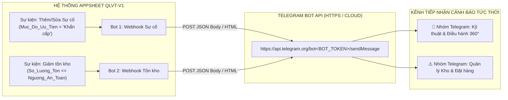

# TÀI LIỆU KỸ THUẬT: CẤU HÌNH WEBHOOK GỌI TELEGRAM BOT API BẮN CẢNH BÁO TỨC THỜI (REAL-TIME ALERTS)
**Mã tài liệu:** `td4.nv2.md`  
**Dự án:** Quản lý Vật tư & Thiết bị Viễn thông - QLVT-V1 (Công ty TNHH Viễn thông Trường Tiến)  
**Căn cứ tài liệu:** CSDL `rdbms-schema-truong-tien-v9` & Đặc tả ma trận phân quyền `PQ.V2.MD`  
**Nhiệm vụ:** Nhiệm vụ 2 - Thiết lập AppSheet Automation gọi Webhook đến Telegram Bot API bắn cảnh báo tức thời cho Sự cố Thiết bị Khẩn cấp và Vi phạm Ngưỡng An toàn Tồn kho  

---

## 📑 PHẦN 1: ĐÁNH GIÁ TÍNH KHẢ THI VÀ PHÂN TÍCH HIỆN TRẠNG DỮ LIỆU

### 1.1. Đánh giá Tính khả thi (Feasibility Assessment)

* **Kết luận chung:** **HOÀN TOÀN KHẢ THI 100% VÀ ĐẠT ĐỘ ỔN ĐỊNH CAO.**
* **Cơ sở phân tích kỹ thuật:**
  1. **Nền tảng AppSheet Automation:** Hỗ trợ tính năng native `Call a webhook` trong luồng Bot, cho phép gửi các yêu cầu `HTTP POST` mang tải trọng `JSON Body` trực tiếp đến các REST API đầu cuối bên ngoài (như Telegram Bot API) mà không cần cấu hình máy chủ trung gian hay Google Apps Script phụ trợ.
  2. **Telegram Bot API Compatibility:** Endpoint `https://api.telegram.org/bot<BOT_TOKEN>/sendMessage` hỗ trợ đầy đủ chuẩn `application/json`, nhận trực tiếp thuộc tính `parse_mode: "HTML"` với các thẻ định dạng tiêu chuẩn như `<b>`, `<code>`, `<i>`, `<s>`, `<a>`, giúp bản tin trực quan, sinh động.
  3. **Độ trễ xử lý (Real-time Latency):** Cơ chế kích hoạt dựa trên sự kiện dữ liệu (`Data Change: Adds and Updates`) của AppSheet đẩy webhook ngay khi giao dịch đồng bộ thành công, độ trễ nhận tin trên nhóm Telegram thường dao động trong khoảng **1 - 3 giây**.
  4. **Tương thích hoàn toàn với Ma trận phân quyền `PQ.V2.MD`:**
     * **Kỹ thuật viên (Nhóm 3):** Khi lập phiếu ghi nhận sự cố phần cứng trên `tbl_NhatKyBaoTri`, hệ thống tự động kích hoạt Webhook đẩy thông báo sự cố vào nhóm Telegram Kỹ thuật & Ban Giám đốc (khoản 4, mục 3 - `PQ.V2.MD`).
     * **SuperAdmin (Nhóm 1):** Chịu trách nhiệm cấu hình, cấp phát token và duy trì hạ tầng kết nối Webhook gửi tin cảnh báo (khoản 4, mục 3 - `PQ.V2.MD`).
     * **Thủ kho (Nhóm 4) & Admin (Nhóm 2):** Tiếp nhận tức thời cảnh báo vi phạm ngưỡng an toàn tồn kho để kịp thời điều phối đặt hàng, tránh gián đoạn chuỗi cung ứng.

---

### 1.2. Đối chiếu Cấu trúc Bảng Dữ liệu Thực tế (`rdbms-schema-truong-tien-v9`)

| Bảng dữ liệu | Các trường thông tin liên quan | Ý nghĩa nghiệp vụ trong luồng cảnh báo Telegram |
| :--- | :--- | :--- |
| **`tbl_NhatKyBaoTri`** *(Bảo trì & Sự cố)* | `ID_BaoTri`, `Ngay_Bao_Tri`, `ID_VatTu`, `QR_Code_Don_Vi`, `Ma_MAC`, `ID_KhachHang`, `Email_NhanVien`, `Tinh_Trang_Loi`, `Huong_Xu_Ly`, `Don_Vi_Bao_Hanh`, `Chi_Phi`, `Muc_Do_Uu_Tien` | • **`ID_BaoTri`:** Mã định danh duy nhất của ca sự cố (VD: `BT-20260814-001`).<br>• **`ID_VatTu` $\rightarrow$ `Ten_VatTu`:** Truy xuất tên thiết bị thông qua Dereference `[ID_VatTu].[Ten_VatTu]`.<br>• **`QR_Code_Don_Vi` / `Ma_MAC`:** Định danh phần cứng chính xác của thiết bị lỗi.<br>• **`Muc_Do_Uu_Tien`:** Giá trị `"Khẩn cấp"` là điều kiện kích hoạt Trigger.<br>• **`Email_NhanVien`:** Định danh kỹ thuật viên lập phiếu báo cáo. |
| **`tbl_VatTu`** *(Danh mục & Tồn kho)* | `ID_VatTu`, `Ten_VatTu`, `Loai_VatTu`, `Don_Vi_Tinh`, `So_Luong_Ton`, `Nguong_An_Toan`, `Don_Gia`, `Thoi_Han_BH` | • **`ID_VatTu`:** Mã model thiết bị/vật tư (VD: `FD9380-HTV-V2`, `HDD-WD-6TB`).<br>• **`Ten_VatTu`:** Tên sản phẩm rõ ràng phục vụ nhận diện cảnh báo.<br>• **`So_Luong_Ton`:** Số lượng thực tế trong kho sau khi đồng bộ trừ kho.<br>• **`Nguong_An_Toan`:** Định mức dự trữ an toàn tối thiểu.<br>• **Điều kiện Trigger:** `[So_Luong_Ton] <= [Nguong_An_Toan]`. |

---

## ⚙️ PHẦN 2: THÔNG SỐ KẾT NỐI CHUẨN TELEGRAM BOT API



### 2.1. Quy chuẩn Kết nối Endpoint
* **Endpoint URL:** `https://api.telegram.org/bot<BOT_TOKEN>/sendMessage`
* **HTTP Method:** `POST`
* **HTTP Headers:**
  * `Content-Type`: `application/json`
* **Message Parse Mode:** `"HTML"` (hỗ trợ thẻ `<b>`, `<code>`, `<i>`, `<s>`, `<a>` tiêu chuẩn).

---

## 🛠 PHẦN 3: CẤU HÌNH CHI TIẾT APPSHEET AUTOMATION BOT

---

### 🔹 KỊCH BẢN 1: CẢNH BÁO SỰ CỐ KHẨN CẤP (`tbl_NhatKyBaoTri`)

#### 1. Cấu hình Event (Sự kiện kích hoạt)
* **Event Name:** `Event_NhatKyBaoTri_KhanCap`
* **Event Type:** `Data Change`
* **Table:** `tbl_NhatKyBaoTri`
* **Data change type:** `Adds and Updates`
* **Condition Rule (Công thức lọc kích hoạt phòng vệ):**
  ```appsheet
  AND(
    [Muc_Do_Uu_Tien] = "Khẩn cấp",
    OR(
      ISBLANK([_THISROW_BEFORE].[Muc_Do_Uu_Tien]),
      [_THISROW_BEFORE].[Muc_Do_Uu_Tien] <> "Khẩn cấp"
    )
  )
  ```
  > **Giải thích công thức:** Biểu thức đảm bảo chỉ kích hoạt Webhook khi tạo mới ca bảo trì khẩn cấp hoặc khi chuyển mức độ ưu tiên từ trạng thái thường sang "Khẩn cấp". Ngăn chặn tuyệt đối việc bắn tin trùng lặp khi người dùng cập nhật các trường thông tin khác.

#### 2. Cấu hình Task (Tác vụ Webhook)
* **Task Name:** `Task_Webhook_Telegram_SuCo`
* **Task Type:** `Call a webhook`
* **Table:** `tbl_NhatKyBaoTri`
* **URL:** `https://api.telegram.org/bot<BOT_TOKEN>/sendMessage`
* **HTTP Method:** `POST`
* **HTTP Headers:**
  * `Content-Type`: `application/json`

#### 3. Đoạn JSON Body Payload (Kịch bản 1)
```json
{
  "chat_id": "<CHAT_ID>",
  "parse_mode": "HTML",
  "text": "🚨 <b>[CẢNH BÁO SỰ CỐ THIẾT BỊ KHẨN CẤP]</b> 🚨\n━━━━━━━━━━━━━━━━━━━━\n📌 <b>Mã bảo trì:</b> <code><<[ID_BaoTri]>></code>\n🏷 <b>Thiết bị/Vật tư:</b> <b><<[ID_VatTu].[Ten_VatTu]>></b> (<code><<[ID_VatTu]>></code>)\n🔍 <b>Mã QR / Serial:</b> <code><<[QR_Code_Don_Vi]>></code>\n🌐 <b>Địa chỉ MAC:</b> <code><<[Ma_MAC]>></code>\n⚡ <b>Mức độ ưu tiên:</b> <b><<[Muc_Do_Uu_Tien]>></b> 🔴\n⚠️ <b>Tình trạng lỗi:</b> <i><<[Tinh_Trang_Loi]>></i>\n🛠 <b>Hướng xử lý đề xuất:</b> <<[Huong_Xu_Ly]>>\n🏢 <b>Đơn vị phụ trách:</b> <<[Don_Vi_Bao_Hanh]>>\n━━━━━━━━━━━━━━━━━━━━\n👤 <b>Kỹ thuật viên báo cáo:</b> <<[Email_NhanVien]>>\n🕒 <b>Thời gian ghi nhận:</b> <<[Ngay_Bao_Tri]>> | <<TIMENOW()>>\n👉 <i>Yêu cầu Kỹ thuật viên & Ban Giám đốc kiểm tra xử lý ngay!</i>"
}
```

---

### 🔹 KỊCH BẢN 2: CẢNH BÁO VI PHẠM NGƯỠNG AN TOÀN TỒN KHO (`tbl_VatTu`)

#### 1. Cấu hình Event (Sự kiện kích hoạt)
* **Event Name:** `Event_VatTu_Duoi_Nguong_An_Toan`
* **Event Type:** `Data Change`
* **Table:** `tbl_VatTu`
* **Data change type:** `Updates only` *(hoặc `Adds and Updates`)*
* **Condition Rule (Công thức lọc kích hoạt chuẩn xác):**
  ```appsheet
  AND(
    ISNOTBLANK([Nguong_An_Toan]),
    [So_Luong_Ton] <= [Nguong_An_Toan],
    [_THISROW_BEFORE].[So_Luong_Ton] > [_THISROW_BEFORE].[Nguong_An_Toan]
  )
  ```
  > **Giải thích công thức:** Kích hoạt đúng thời điểm số lượng tồn kho giảm xuống chạm hoặc vượt qua ngưỡng an toàn tối thiểu sau một thao tác xuất kho.

#### 2. Cấu hình Task (Tác vụ Webhook)
* **Task Name:** `Task_Webhook_Telegram_TonKho`
* **Task Type:** `Call a webhook`
* **Table:** `tbl_VatTu`
* **URL:** `https://api.telegram.org/bot<BOT_TOKEN>/sendMessage`
* **HTTP Method:** `POST`
* **HTTP Headers:**
  * `Content-Type`: `application/json`

#### 3. Đoạn JSON Body Payload (Kịch bản 2)
```json
{
  "chat_id": "<CHAT_ID>",
  "parse_mode": "HTML",
  "text": "⚠️ <b>[CẢNH BÁO TỒN KHO CHẠM NGƯỠNG AN TOÀN]</b> ⚠️\n━━━━━━━━━━━━━━━━━━━━\n📦 <b>Tên vật tư:</b> <b><<[Ten_VatTu]>></b>\n🔖 <b>Mã định danh (Mã vật tư):</b> <code><<[ID_VatTu]>></code>\n🗂 <b>Phân loại:</b> <<[Loai_VatTu]>> (ĐVT: <<[Don_Vi_Tinh]>>)\n📊 <b>Số lượng tồn hiện tại:</b> <b><<[So_Luong_Ton]>></b> <<[Don_Vi_Tinh]>> 🚨\n🛡 <b>Ngưỡng an toàn tối thiểu:</b> <b><<[Nguong_An_Toan]>></b> <<[Don_Vi_Tinh]>>\n📉 <b>Mức độ chênh lệch:</b> <i>Thiếu hụt / Đạt mức báo động</i>\n━━━━━━━━━━━━━━━━━━━━\n👤 <b>Tài khoản cập nhật:</b> <<USEREMAIL()>>\n🕒 <b>Thời gian kích hoạt:</b> <<TODAY()>> | <<TIMENOW()>>\n👉 <i>Đề nghị Thủ kho và Admin lập kế hoạch đặt hàng bổ sung vật tư!</i>"
}
```

---

## 📱 PHẦN 4: HÌNH THỨC HIỂN THỊ THỰC TẾ TRÊN TELEGRAM (MESSAGE PREVIEW)

### 🔴 Mẫu thông báo Kịch bản 1:
```text
🚨 [CẢNH BÁO SỰ CỐ THIẾT BỊ KHẨN CẤP] 🚨
━━━━━━━━━━━━━━━━━━━━
📌 Mã bảo trì: BT-20260814-001
🏷 Thiết bị/Vật tư: Camera IP Dome Vivotek 5MP (FD9380-HTV-V2)
🔍 Mã QR / Serial: SN-CAM-FD9380-002
🌐 Địa chỉ MAC: 00-02-D1-A1-B2-C2
⚡ Mức độ ưu tiên: Khẩn cấp 🔴
⚠️ Tình trạng lỗi: Camera hỏng hồng ngoại ban đêm, mất giám sát kho chính
🛠 Hướng xử lý đề xuất: Đổi thiết bị mới
🏢 Đơn vị phụ trách: Hãng VIVOTEK
━━━━━━━━━━━━━━━━━━━━
👤 Kỹ thuật viên báo cáo: chinhvd@truongtien.com
🕒 Thời gian ghi nhận: 2026-08-14 | 16:05:22
👉 Yêu cầu Kỹ thuật viên & Ban Giám đốc kiểm tra xử lý ngay!
```

### 🟡 Mẫu thông báo Kịch bản 2:
```text
⚠️ [CẢNH BÁO TỒN KHO CHẠM NGƯỠNG AN TOÀN] ⚠️
━━━━━━━━━━━━━━━━━━━━
📦 Tên vật tư: Ổ cứng HDD Western Digital Purple 6TB
🔖 Mã định danh (Mã vật tư): HDD-WD-6TB
🗂 Phân loại: Vật tư phụ (ĐVT: Cái)
📊 Số lượng tồn hiện tại: 0 Cái 🚨
🛡 Ngưỡng an toàn tối thiểu: 10 Cái
📉 Mức độ chênh lệch: Thiếu hụt / Đạt mức báo động
━━━━━━━━━━━━━━━━━━━━
👤 Tài khoản cập nhật: iontt.minhtrung@gmail.com
🕒 Thời gian kích hoạt: 17/09/2026 | 16:10:15
👉 Đề nghị Thủ kho và Admin lập kế hoạch đặt hàng bổ sung vật tư!
```

---

## 🔒 PHẦN 5: NGUYÊN TẮC BẢO MẬT & QUẢN TRỊ HẠ TẦNG

1. **Bảo mật Bot Token:** `<BOT_TOKEN>` đại diện cho quyền điều khiển Bot, chỉ lưu trữ và cấu hình bởi vai trò **SuperAdmin** trên AppSheet Backend; tuyệt đối không để lộ trong giao diện người dùng thường.
2. **Quản lý Chat ID:** Có thể phân tách 2 nhóm Telegram riêng biệt:
   * **Nhóm Kỹ thuật & Bảo hành:** Nhận cảnh báo sự cố phần cứng (`tbl_NhatKyBaoTri`).
   * **Nhóm Quản lý Kho & Ban Giám đốc:** Nhận cảnh báo chạm ngưỡng tồn an toàn (`tbl_VatTu`).
3. **Tuân thủ quy trình kiểm soát:** Mọi cấu hình Webhook không làm thay đổi trực tiếp cấu trúc bảng nguồn `rdbms-schema-truong-tien-v9`, đảm bảo tính nguyên vẹn và an toàn dữ liệu 100%.
