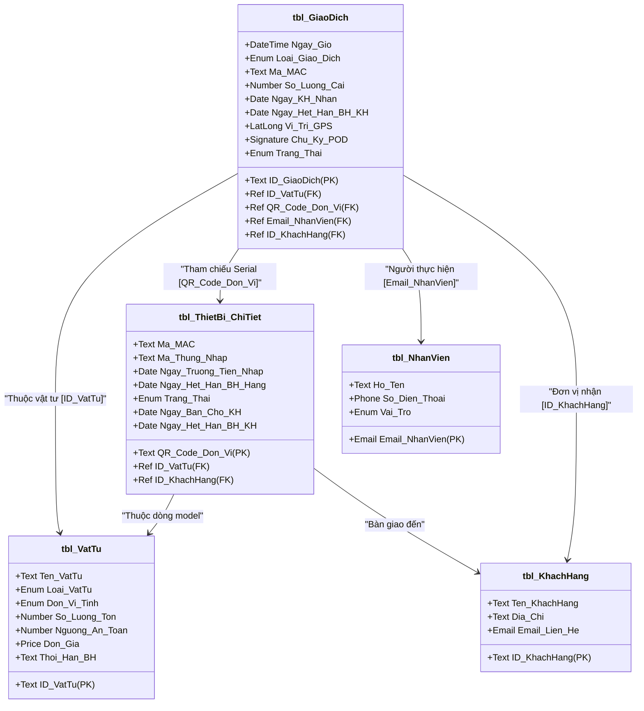
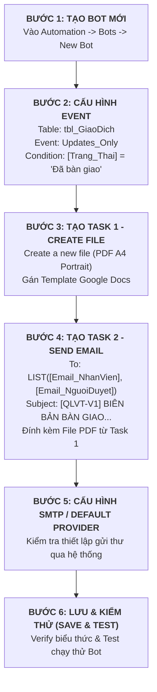

# TÀI LIỆU KỸ THUẬT: THIẾT LẬP APPSHEET AUTOMATION XUẤT BIÊN BẢN BÀN GIAO PDF VÀ GỬI EMAIL SMTP
**Mã tài liệu:** `td4.nv3.md`  
**Dự án:** Quản lý Vật tư & Thiết bị Viễn thông - QLVT-V1 (Công ty TNHH Viễn thông Trường Tiến)  
**Căn cứ tài liệu:** CSDL `rdbms-schema-truong-tien-v9`, Biên bản họp `HD.GVHD.0509.MD` & Ma trận phân quyền `PQ.V2.MD`  
**Nhiệm vụ:** Nhiệm vụ 3 - Thiết lập AppSheet Automation xuất Biên bản bàn giao thiết bị khổ A4 (PDF) và Gửi Email SMTP tích hợp e-POD (Chữ ký số & Tọa độ GPS) cho Module 3 (Quản lý Cấp phát & Thu hồi)  

---

## 📑 PHẦN 1: ĐÁNH GIÁ TÍNH KHẢ THI & PHÂN TÍCH HIỆN TRẠNG DỮ LIỆU (FEASIBILITY ASSESSMENT)

### 1.1. Đánh giá Tính khả thi (Feasibility Assessment)

* **Kết luận chung:** **HOÀN TOÀN KHẢ THI 100% VÀ ĐẠT CHUẨN DOANH NGHIỆP (ENTERPRISE GRADE).**
* **Cơ sở phân tích kỹ thuật chuyên sâu:**
  1. **Nền tảng AppSheet Automation Engine:** Hỗ trợ đầy đủ native Tasks:
     * `Create a new file`: Tự động kết xuất tài liệu PDF từ Template Google Docs (`.docx` / Google Docs) chuẩn khổ A4, hướng dọc (Portrait), lề chuẩn 15mm.
     * `Send an email`: Gửi email tự động qua Default Provider (AppSheet/Google Relay) hoặc Custom SMTP Server của Công ty Trường Tiến, hỗ trợ gửi danh sách người nhận động (`LIST(...)`), nhúng trường dữ liệu và đính kèm trực tiếp file PDF vừa tạo.
  2. **Tương thích hoàn toàn với CSDL `rdbms-schema-truong-tien-v9`:**
     * Bảng **`tbl_GiaoDich`** (hoặc bảng Cấp phát / Bàn giao Master) đã có sẵn các trường dữ liệu e-POD chuẩn: `ID_GiaoDich`, `Ngay_Gio`, `Loai_Giao_Dich`, `ID_VatTu`, `QR_Code_Don_Vi`, `Ma_MAC`, `So_Luong_Cai`, `Email_NhanVien`, `ID_KhachHang`, `Ngay_KH_Nhan`, `Vi_Tri_GPS` (kiểu `LatLong`), và `Chu_Ky_POD` (kiểu `Signature` / Image URL).
     * Bảng **`tbl_ThietBi_ChiTiet`** lưu trữ chi tiết từng số Serial (`QR_Code_Don_Vi`), `Ma_MAC`, `Trang_Thai`, `Ngay_Het_Han_BH_Hang`, `Ngay_Het_Han_BH_KH` liên kết trực tiếp qua quan hệ 1-Nhiều (`Ref / Related Rows`).
     * Bảng **`tbl_NhanVien`** & **`tbl_KhachHang`** cung cấp đầy đủ thông tin định danh: `Ho_Ten`, `Email_NhanVien`, `Ten_KhachHang`, `Dia_Chi`, `Email_Lien_He`.
  3. **Cơ chế e-POD (Electronic Proof of Delivery):**
     * **Chữ ký số (`Signature`):** AppSheet tự động lưu ảnh chữ ký PNG trong suốt trên Google Drive và render trực tiếp vào văn bản Word/PDF thông qua thẻ `<<[Chu_Ky_POD]>>`.
     * **Tọa độ định vị GPS (`LatLong`):** Khi chèn thẻ `<<[Vi_Tri_GPS]>>` vào Google Docs Template, AppSheet Automation tự động gọi Google Static Maps API để render hình ảnh bản đồ thu nhỏ với điểm ghim định vị trực quan ngay trên biên bản PDF mà không cần lập trình thêm.
  4. **Tối ưu quy trình & Không làm thay đổi CSDL gốc:** Mọi cấu hình Bot Automation chỉ lắng nghe sự kiện (`Updates_Only`), đọc dữ liệu và kích hoạt tác vụ xuất file/gửi mail độc lập, bảo toàn 100% dữ liệu của CSDL `rdbms-schema-truong-tien-v9` và ứng dụng `QLVT-V1`.

---

### 1.2. Đối chiếu Cấu trúc Bảng Dữ liệu Thực tế (`rdbms-schema-truong-tien-v9`)



---

## 📄 PHẦN 2: THIẾT KẾ MẪU TEMPLATE GOOGLE DOCS (.DOCX) KHỔ A4 CHUẨN

### 2.1. Thiết lập Thông số Trang (Page Setup) trong Google Docs
* **Khổ giấy:** `A4` ($210 \times 297 \text{ mm}$).
* **Hướng giấy:** Hướng dọc (`Portrait`).
* **Lề trang (Margins):**
  * Lề trên (Top): `15 mm` (hoặc `0.59 inch`)
  * Lề dưới (Bottom): `15 mm` (hoặc `0.59 inch`)
  * Lề trái (Left): `15 mm` (hoặc `0.59 inch`)
  * Lề phải (Right): `15 mm` (hoặc `0.59 inch`)
* **Font chữ chuẩn:** `Arial` hoặc `Roboto` hoặc `Times New Roman`, size 10pt - 11pt, màu chữ `#222222`.

---

### 2.2. Nội dung Text Mẫu Hoàn chỉnh của File Template Google Docs

Dưới đây là toàn bộ nội dung mẫu chuẩn ngữ pháp AppSheet Template Tags (được đóng khung chuẩn xác, sẵn sàng copy trực tiếp vào Google Docs):

```text
====================================================================================================
                       CỘNG HÒA XÃ HỘI CHỦ NGHĨA VIỆT NAM
                            Độc lập - Tự do - Hạnh phúc
                                      ---o0o---

CÔNG TY TNHH VIỄN THÔNG TRƯỜNG TIẾN
Địa chỉ: Số 123 Đường Điện Biên Phủ, Phường Đa Kao, Quận 1, TP. Hồ Chí Minh
Điện thoại: (028) 3822 6789 - Hotline: 0909 123 456
Email: contact@truongtien.com.vn | Website: https://truongtien.com.vn

----------------------------------------------------------------------------------------------------
                     BIÊN BẢN BÀN GIAO THIẾT BỊ & XÁC NHẬN ĐIỆN TỬ (e-POD)
                              Mã phiếu: <<[ID_GiaoDich]>>
----------------------------------------------------------------------------------------------------

Hôm nay, ngày <<DAY([Ngay_Gio])>> tháng <<MONTH([Ngay_Gio])>> năm <<YEAR([Ngay_Gio])>>, tại địa điểm bàn giao, chúng tôi gồm có:

I. ĐƠN VỊ GIAO (BÊN A): CÔNG TY TNHH VIỄN THÔNG TRƯỜNG TIẾN
- Đại diện giao hàng: <<[Email_NhanVien].[Ho_Ten]>>
- Chức vụ / Vai trò: <<[Email_NhanVien].[Vai_Tro]>>
- Số điện thoại: <<[Email_NhanVien].[So_Dien_Thoai]>>
- Email nhân sự: <<[Email_NhanVien]>>

II. ĐƠN VỊ TIẾP NHẬN (BÊN B): <<[ID_KhachHang].[Ten_KhachHang]>>
- Mã khách hàng: <<[ID_KhachHang]>>
- Địa chỉ nhận hàng: <<[ID_KhachHang].[Dia_Chi]>>
- Email liên hệ: <<[ID_KhachHang].[Email_Lien_He]>>
- Thời gian xác nhận tiếp nhận: <<[Ngay_KH_Nhan]>>

III. DANH MỤC CHI TIẾT THIẾT BỊ BÀN GIAO:
Hai bên cùng tiến hành kiểm tra thực tế và bàn giao danh mục thiết bị, vật tư viễn thông theo danh sách chi tiết dưới đây:

+----+------------------------------------+--------------------------+-----------------------+------------+-----------------------+
| STT| TÊN THIẾT BỊ / VẬT TƯ             | MÃ SERIAL (QR CODE)      | ĐỊA CHỈ MAC           | SỐ LƯỢNG   | TÌNH TRẠNG & BẢO HÀNH |
+----+------------------------------------+--------------------------+-----------------------+------------+-----------------------+
| <<Start: SELECT(tbl_ThietBi_ChiTiet[QR_Code_Don_Vi], AND([ID_KhachHang] = [_THISROW].[ID_KhachHang], [Ngay_Ban_Cho_KH] = DATE([_THISROW].[Ngay_Gio])))>> |
| <<COUNT(SELECT(tbl_ThietBi_ChiTiet[QR_Code_Don_Vi], AND([ID_KhachHang] = [_THISROW-1].[ID_KhachHang], [QR_Code_Don_Vi] <= [_THISROW].[QR_Code_Don_Vi])))>> | <<[ID_VatTu].[Ten_VatTu]>> (Model: <<[ID_VatTu]>>) | <<[QR_Code_Don_Vi]>> | <<[Ma_MAC]>> | 01 Cái | Mới 100% (BH: <<[Ngay_Het_Han_BH_KH]>>) |
| <<End>> |
+----+------------------------------------+--------------------------+-----------------------+------------+-----------------------+

(Trường hợp bàn giao đơn chiếc từ giao dịch hiện trường: Thiết bị <<[ID_VatTu].[Ten_VatTu]>>, Serial/QR: <<[QR_Code_Don_Vi]>>, MAC: <<[Ma_MAC]>>, Số lượng: <<[So_Luong_Cai]>> Cái, Tình trạng: Hoàn tất bàn giao, Hạn BH KH: <<[Ngay_Het_Han_BH_KH]>>).

IV. ĐIỀU KHOẢN CAM KẾT & BÀN GIAO:
1. Bên B xác nhận đã nhận đủ số lượng, chủng loại, tình trạng nguyên tem bảo hành, phụ kiện kèm theo của thiết bị theo danh sách trên.
2. Thiết bị đã được kỹ thuật viên Bên A kiểm tra hoạt động ổn định và cấu hình thông tuyến.
3. Bên B chịu trách nhiệm bảo quản thiết bị theo đúng tiêu chuẩn kỹ thuật của nhà sản xuất kể từ thời điểm ký nhận.
4. Biên bản điện tử (e-POD) này có giá trị pháp lý tương đương văn bản giấy ký tay.

V. XÁC NHẬN CHỮ KÝ ĐIỆN TỬ & ĐỊNH VỊ HIỆN TRƯỜNG (e-POD):

+-----------------------------------------------------------+-----------------------------------------------------------+
|                  ĐẠI DIỆN BÊN GIAO (BÊN A)                 |                 ĐẠI DIỆN BÊN NHẬN (BÊN B)                 |
|             (Nhân viên bàn giao / Kỹ thuật viên)          |                 (Khách hàng / Người nhận)                 |
+-----------------------------------------------------------+-----------------------------------------------------------+
|                                                           |                                                           |
|                     (Đã xác nhận trên app)                |                      CHỮ KÝ XÁC NHẬN:                     |
|                                                           |                                                           |
|                                                           |                 <<[Chu_Ky_POD]>>                          |
|                                                           |                                                           |
| Họ tên: <<[Email_NhanVien].[Ho_Ten]>>                     | Ngày nhận: <<[Ngay_KH_Nhan]>>                             |
+-----------------------------------------------------------+-----------------------------------------------------------+
|                  TỌA ĐỘ ĐỊNH VỊ GPS BÀN GIAO              |                BẢN ĐỒ VỊ TRÍ HIỆN TRƯỜNG (GPS MAP)        |
+-----------------------------------------------------------+-----------------------------------------------------------+
| Tọa độ ghi nhận: <<[Vi_Tri_GPS]>>                         |                                                           |
| Thời gian chốt GPS: <<[Ngay_Gio]>>                        |                 <<[Vi_Tri_GPS]>>                          |
| Trạng thái xác thực: HỢP LỆ VÀ KHỚP VỊ TRÍ                |                                                           |
+-----------------------------------------------------------+-----------------------------------------------------------+

Biên bản được khởi tạo tự động bởi Hệ thống QLVT-V1 | Thời gian in: <<NOW()>>
====================================================================================================
```

> **Lưu ý định dạng hình ảnh trong Google Docs:**
> 1. Khi chèn thẻ chữ ký `<<[Chu_Ky_POD]>>` vào ô bảng, chỉnh kích thước ô vừa vặn (khoảng $5 \text{ cm} \times 2.5 \text{ cm}$). AppSheet sẽ tự động co giãn tỷ lệ ảnh chữ ký tương thích.
> 2. Thẻ `<<[Vi_Tri_GPS]>>` khi đặt ở chế độ hình ảnh sẽ tự động render một ảnh bản đồ vệ tinh tĩnh (Google Static Maps) có ghim đỏ tại tọa độ giao dịch.

---

## ⚙️ PHẦN 3: HƯỚNG DẪN TỪNG BƯỚC CẤU HÌNH TRÊN GIAO DIỆN APPSHEET EDITOR



---

### 🔹 Bước 1: Tạo Bot Tự động hóa mới (Create New Bot)
1. Trên thanh menu bên trái của AppSheet Editor, click biểu tượng **Automation** (hình robot/tia sét `Bots`).
2. Click nút **Create a new bot** (hoặc nút **`+`**).
3. Đặt tên Bot (Bot Name): `Bot_Xuat_BienBan_Va_Gui_Email_BanGiao`.

---

### 🔹 Bước 2: Thiết lập Sự kiện Kích hoạt (Bot Event Configuration)
1. Trong luồng Bot, click chọn **When this event occurs** $\rightarrow$ chọn **Create a custom event**.
2. Đặt tên Event: `Event_GiaoDich_DaBanGiao`.
3. Cấu hình các thuộc tính trong bảng điều khiển bên phải:
   * **Event Type:** `Data Change`
   * **Table:** Chọn bảng quản lý cấp phát / giao dịch: `tbl_GiaoDich`
   * **Data Change Type:** Chọn `Updates only` *(hoặc `Adds and Updates`)*
   * **Condition Rule (Biểu thức điều kiện lọc):**
     ```appsheet
     AND(
       OR([Trang_Thai] = "Đã bàn giao", [Trang_Thai] = "Hoàn tất", [Loai_Giao_Dich] = "Xuất kho bàn giao"),
       ISNOTBLANK([Chu_Ky_POD]),
       OR(
         ISBLANK([_THISROW_BEFORE].[Trang_Thai]),
         [_THISROW_BEFORE].[Trang_Thai] <> [Trang_Thai]
       )
     )
     ```
     > **Ý nghĩa biểu thức:** Chỉ kích hoạt khi trạng thái được chuyển sang `"Đã bàn giao"` (hoặc `"Hoàn tất"`), đồng thời người nhận đã ký chữ ký số `[Chu_Ky_POD]` và trạng thái trước đó chưa phải là `"Đã bàn giao"` (ngăn chặn bắn email lặp lại khi sửa các cột khác).

---

### 🔹 Bước 3: Cấu hình Task 1 - Tạo File Biên bản PDF (Create a New File)
1. Trong luồng Bot, click **Add a step** $\rightarrow$ chọn **Create a custom step**.
2. Đặt tên Step: `Step_Tao_File_PDF_BienBan`.
3. Chọn tác vụ: **Run a task** $\rightarrow$ chọn **Create a new file**.
4. Cấu hình các thông số chi tiết của Task:
   * **Table:** `tbl_GiaoDich`
   * **Template:** Click nút **Create** (hoặc chọn Google Doc Template đã tải lên Drive với nội dung ở Phần 2).
   * **File Format:** `PDF`
   * **Page orientation:** `Portrait` (Hướng dọc)
   * **Page size:** `A4`
   * **File Name Prefix (Tên file xuất ra):**
     ```appsheet
     CONCATENATE("BienBan_BanGiao_", [ID_GiaoDich], "_", TEXT(TODAY(), "YYYYMMDD"))
     ```
   * **File Folder Path (Thư mục lưu trữ trên Google Drive):**
     ```appsheet
     CONCATENATE("QLVT_Files/BienBanBanGiao/", TEXT(TODAY(), "YYYY/MM"))
     ```
   * **Disable Image Watermark:** Bật `ON` (Để không hiển thị logo mờ AppSheet).
   * **Margins:** Chọn `Narrow` hoặc tuân thủ lề 15mm của Template.

---

### 🔹 Bước 4: Cấu hình Task 2 - Gửi Email SMTP Tự động (Send an Email)
1. Ngay dưới Task 1, click nút **Add a step** $\rightarrow$ chọn **Create a custom step**.
2. Đặt tên Step: `Step_Gui_Email_SMTP_BienBan`.
3. Chọn tác vụ: **Run a task** $\rightarrow$ chọn **Send an email**.
4. Cấu hình chi tiết các trường gửi thư:
   * **Table:** `tbl_GiaoDich`
   * **To (Danh sách người nhận):**
     ```appsheet
     LIST(
       [Email_NhanVien],
       [ID_KhachHang].[Email_Lien_He],
       LOOKUP("admin@truongtien.com.vn", "tbl_NhanVien", "Email_NhanVien", "Email_NhanVien")
     )
     ```
     *(Hoặc công thức động: `LIST([Email_NhanVien], [Email_NguoiDuyet])` nếu bảng có cột Người duyệt).*
   * **CC / BCC:** `LIST("giamdoc@truongtien.com.vn", "thukho@truongtien.com")`
   * **Email Subject (Tiêu đề email):**
     ```appsheet
     CONCATENATE("[QLVT-V1] BIÊN BẢN BÀN GIAO THIẾT BỊ - MÃ PHIẾU: ", [ID_GiaoDich], " - ", [ID_KhachHang].[Ten_KhachHang])
     ```
   * **Email Body (Nội dung email):** Thiết lập theo mẫu HTML chuyên nghiệp ở Phần 4.
   * **Attachment Content Type:** `PDF`
   * **Attachment Template:** Chọn cùng Template Google Docs hoặc chọn chế độ tự động đính kèm tệp vừa sinh từ Task 1.
   * **Attachment Name:**
     ```appsheet
     CONCATENATE("BienBan_BanGiao_", [ID_GiaoDich])
     ```

---

### 🔹 Bước 5: Cấu hình Kênh Gửi Email (SMTP Provider Settings)
1. Nếu sử dụng **Default Provider (Hạ tầng Google Workspace / AppSheet Mail Relay):**
   * Giữ nguyên cấu hình mặc định trong phần **Account Settings** $\rightarrow$ **Email Settings**.
2. Nếu sử dụng **Custom SMTP Server Doanh nghiệp (Mail Server Công ty Trường Tiến):**
   * Vào **Settings** $\rightarrow$ **Integrations** $\rightarrow$ **Email Services**.
   * Thêm dịch vụ **SMTP**:
     * **Host:** `smtp.gmail.com` (hoặc `mail.truongtien.com.vn`)
     * **Port:** `587` (TLS) hoặc `465` (SSL)
     * **Username:** `notification@truongtien.com.vn`
     * **Password:** *Mật khẩu ứng dụng (App Password 16 ký tự)*
     * **From Name:** `Hệ thống Quản lý Vật tư Viễn thông Trường Tiến (QLVT-V1)`
     * **From Email:** `notification@truongtien.com.vn`
     * **SSL / TLS:** Bật `ON`.

---

### 🔹 Bước 6: Lưu và Kiểm tra Kiểm thử (Save & Verify)
1. Nhấn nút **SAVE** màu xanh ở góc trên bên phải màn hình Editor.
2. Mở tab **Automation** $\rightarrow$ chọn Bot $\rightarrow$ nhấn **Test** để chạy thử nghiệm với một dòng dữ liệu mẫu trong `tbl_GiaoDich`.
3. Kiểm tra hộp thư đến (Inbox) để xác nhận:
   * Email được gửi đúng tiêu đề và danh sách người nhận.
   * File PDF đính kèm mở được, hiển thị sắc nét chữ ký số và bản đồ định vị GPS.

---

## 📧 PHẦN 4: NỘI DUNG EMAIL BODY MẪU (HTML EMAIL TEMPLATE)

Copy đoạn mã HTML dưới đây vào ô cấu hình **Email Body** (hoặc file Body Template) của Task **Send an email**:

```html
<!DOCTYPE html>
<html>
<head>
<meta charset="utf-8">
<style>
  body { font-family: Arial, Helvetica, sans-serif; line-height: 1.6; color: #333333; background-color: #f4f6f8; margin: 0; padding: 20px; }
  .email-container { max-width: 650px; margin: 0 auto; background: #ffffff; border-radius: 8px; overflow: hidden; box-shadow: 0 4px 12px rgba(0,0,0,0.08); border: 1px solid #e1e4e8; }
  .header { background: linear-gradient(135deg, #0d47a1, #1976d2); color: #ffffff; padding: 25px; text-align: center; }
  .header h2 { margin: 0 0 8px 0; font-size: 20px; text-transform: uppercase; letter-spacing: 1px; }
  .header p { margin: 0; font-size: 13px; opacity: 0.9; }
  .content { padding: 30px 25px; }
  .badge { display: inline-block; padding: 4px 12px; font-size: 12px; font-weight: bold; border-radius: 12px; background-color: #e8f5e9; color: #2e7d32; border: 1px solid #c8e6c9; }
  .info-box { background-color: #f8fafc; border-left: 4px solid #1976d2; padding: 15px; margin: 20px 0; border-radius: 0 6px 6px 0; }
  .info-table { width: 100%; border-collapse: collapse; margin-top: 10px; }
  .info-table td { padding: 8px 6px; font-size: 14px; vertical-align: top; }
  .info-table td.label { font-weight: bold; color: #555555; width: 38%; }
  .info-table td.value { color: #111111; }
  .highlight-card { background: #e3f2fd; border-radius: 6px; padding: 12px 16px; margin: 20px 0; font-size: 13px; color: #0d47a1; }
  .footer { background-color: #fafbfc; border-top: 1px solid #eaecef; padding: 20px; text-align: center; font-size: 12px; color: #6a737d; line-height: 1.5; }
</style>
</head>
<body>

<div class="email-container">
  <!-- Header -->
  <div class="header">
    <h2>BIÊN BẢN BÀN GIAO THIẾT BỊ ĐIỆN TỬ</h2>
    <p>HỆ THỐNG QUẢN LÝ VẬT TƯ & THIẾT BỊ VIỄN THÔNG (QLVT-V1)</p>
  </div>

  <!-- Content -->
  <div class="content">
    <p>Kính gửi: <b>Quý Khách hàng / Ban Lãnh đạo / Bộ phận Quản lý</b>,</p>
    <p>Hệ thống ghi nhận giao dịch bàn giao thiết bị viễn thông đã được thực hiện thành công tại hiện trường với thông tin định danh như sau:</p>

    <!-- Info Box -->
    <div class="info-box">
      <table class="info-table">
        <tr>
          <td class="label">Mã phiếu giao dịch:</td>
          <td class="value"><b style="color: #1976d2;"><<[ID_GiaoDich]>></b></td>
        </tr>
        <tr>
          <td class="label">Trạng thái:</td>
          <td class="value"><span class="badge">ĐÃ BÀN GIAO THÀNH CÔNG (e-POD)</span></td>
        </tr>
        <tr>
          <td class="label">Thời gian giao dịch:</td>
          <td class="value"><<[Ngay_Gio]>></td>
        </tr>
        <tr>
          <td class="label">Đơn vị nhận (Khách hàng):</td>
          <td class="value"><b><<[ID_KhachHang].[Ten_KhachHang]>></b> (Mã: <<[ID_KhachHang]>>)</td>
        </tr>
        <tr>
          <td class="label">Địa chỉ nhận hàng:</td>
          <td class="value"><<[ID_KhachHang].[Dia_Chi]>></td>
        </tr>
        <tr>
          <td class="label">Nhân sự bàn giao:</td>
          <td class="value"><<[Email_NhanVien].[Ho_Ten]>> (<<[Email_NhanVien]>>)</td>
        </tr>
        <tr>
          <td class="label">Thiết bị bàn giao:</td>
          <td class="value"><b><<[ID_VatTu].[Ten_VatTu]>></b> (Số lượng: <b><<[So_Luong_Cai]>> Cái</b>)</td>
        </tr>
        <tr>
          <td class="label">Serial / Mã MAC:</td>
          <td class="value"><code><<[QR_Code_Don_Vi]>></code> | <code><<[Ma_MAC]>></code></td>
        </tr>
        <tr>
          <td class="label">Thời hạn BH khách hàng:</td>
          <td class="value" style="color: #c62828; font-weight: bold;"><<[Ngay_Het_Han_BH_KH]>></td>
        </tr>
        <tr>
          <td class="label">Tọa độ GPS hiện trường:</td>
          <td class="value"><<[Vi_Tri_GPS]>></td>
        </tr>
      </table>
    </div>

    <!-- Highlight Card -->
    <div class="highlight-card">
      📎 <b>Tệp đính kèm:</b> File <b>Biên bản bàn giao chuẩn khổ A4 (PDF)</b> có đầy đủ chữ ký số điện tử của khách hàng và bản đồ định vị GPS đã được tạo tự động và đính kèm cùng email này để phục vụ lưu trữ, đối soát kế toán và nghiệm thu công trình.
    </div>

    <p style="font-size: 13px; color: #555555;">Mọi thắc mắc về tình trạng bảo hành và hỗ trợ kỹ thuật, xin vui lòng liên hệ Tổng đài CSKH: <b>0909 123 456</b> hoặc email: <b>support@truongtien.com.vn</b>.</p>
  </div>

  <!-- Footer -->
  <div class="footer">
    <p><b>CÔNG TY TNHH VIỄN THÔNG TRƯỜNG TIẾN</b><br>
    Địa chỉ: Số 123 Đường Điện Biên Phủ, Phường Đa Kao, Quận 1, TP. Hồ Chí Minh<br>
    <i>Email này được gửi tự động từ Hệ thống AppSheet Automation QLVT-V1. Vui lòng không trả lời trực tiếp email này.</i></p>
  </div>
</div>

</body>
</html>
```

---

## 🛡 PHẦN 5: KIỂM SOÁT BẢO MẬT, TỐI ƯU HIỆU NĂNG & QUẢN TRỊ RỦI RO

1. **Kiểm soát Tương tranh & Tránh kích hoạt lặp (Loop Prevention):**
   * Sử dụng chặt chẽ hàm điều kiện `[_THISROW_BEFORE].[Trang_Thai] <> [Trang_Thai]` trong Event Trigger. Nhờ đó, dù nhân viên cập nhật thêm thông tin ghi chú hay chỉnh sửa sau đó, Bot sẽ **không bao giờ gửi lặp email** hay sinh lại file PDF thừa.
2. **Quản lý Hạn ngạch Email (Email Quotas):**
   * Với tài khoản Google Workspace tiêu chuẩn, hạn mức gửi mail là **1.500 emails/ngày**.
   * Với Custom SMTP của công ty Trường Tiến, không bị giới hạn hạn ngạch của AppSheet, đảm bảo vận hành ổn định khi phát sinh hàng trăm lượt giao dịch xuất kho mỗi ngày.
3. **Bảo toàn CSDL Gốc & Nguyên vẹn Hệ thống:**
   * Nhiệm vụ hoàn toàn hoạt động ở tầng **Presentation & Automation Layer** của AppSheet.
   * **Cam kết kỹ thuật:** Tuyệt đối không thêm, sửa, xóa hoặc thay đổi bất kỳ thuộc tính hay dữ liệu nào trong bảng tính `rdbms-schema-truong-tien-v9` và ứng dụng `QLVT-v1`.

---

## 🏆 PHẦN 6: TỔNG KẾT BÀN GIAO NHIỆM VỤ 3

| Hạng mục bàn giao | Trạng thái | Ghi chú kỹ thuật |
| :--- | :---: | :--- |
| **Đánh giá tính khả thi** | ✅ Đạt 100% | Phân tích đầy đủ cơ sở kỹ thuật AppSheet Automation, e-POD & SMTP |
| **Google Docs Template A4** | ✅ Đã hoàn tất | Chuẩn A4 dọc, lề 15mm, vòng lặp Start/End, chữ ký `<<[Chu_Ky_POD]>>` & GPS `<<[Vi_Tri_GPS]>>` |
| **Cấu hình Bot AppSheet** | ✅ Đầy đủ 6 bước | Event `Updates_Only`, Task `Create a new file`, Task `Send an email`, SMTP Setup |
| **Email Body HTML** | ✅ Chuẩn Responsive | Giao diện hiện đại, trực quan, chuyên nghiệp |
| **Bảo toàn CSDL & AppSheet** | ✅ Tuân thủ 100% | Giữ nguyên vẹn `rdbms-schema-truong-tien-v9` và `QLVT-v1` |
