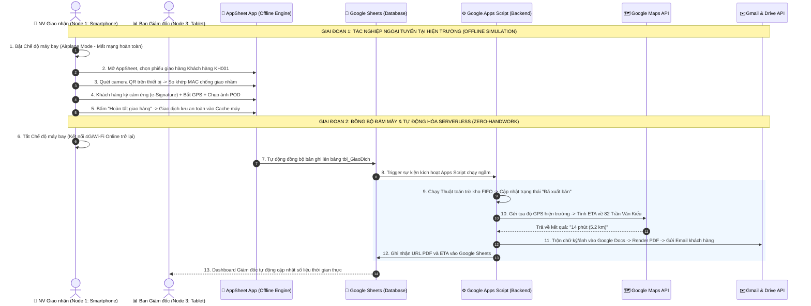

# BÁO CÁO PHẢN BIỆN KỸ THUẬT VÀ KỊCH BẢN THỰC NGHIỆM HỆ THỐNG
## (MASTER DEFENSE DOCUMENT FOR SCIENTIFIC & TECHNICAL REVIEW)

* **Đề tài:** Số hóa quản lý thiết bị, trực quan hóa dữ liệu và tự động hóa giao dịch thực địa bằng QR Code
* **Đơn vị ứng dụng thực tế:** Công ty Viễn thông Trường Tiến
* **Thời gian báo cáo:** Ngày 28 tháng 08 năm 2026
* **Mã hồ sơ lưu trữ:** `BAO_CAO_GVHD_2808.md`

---

# PHẦN 1: MÔ HÌNH VÀ HẠ TẦNG KỸ THUẬT
*(Giải trình các câu hỏi kỹ thuật trọng tâm: Mục 0, 1, 2, 3, 4, 5, 10, 11, 12, 13, 15)*

---

### 🏛️ SƠ ĐỒ KIẾN TRÚC TỔNG THỂ HỆ THỐNG (SYSTEM ARCHITECTURE)

```mermaid
flowchart TD
    %% ======================= SUBGRAPH: CLIENT LAYER =======================
    subgraph CLIENT_LAYER["📱 TẦNG CLIENT - ĐIỂM CUỐI THU THẬP DỮ LIỆU"]
        direction TB
        subgraph MOBILE_CLIENTS["Thiết bị Di động (Android / iOS)"]
            DEV_TECH["👷 Kỹ thuật viên\n• Quét QR Code/MAC\n• Khảo sát & Nhật ký bảo trì"]
            DEV_SHIP["🚚 Nhân viên Giao nhận\n• Quét QR Code đơn vị\n• e-POD & Ký nhận điện tử\n• Chụp ảnh & Lấy GPS thực địa"]
        end

        subgraph DESKTOP_CLIENTS["Thiết bị Máy tính (Windows / macOS Web)"]
            DESK_ADMIN["👨‍💼 Quản trị viên (Admin)\n• Phân quyền RBAC nhân sự\n• Cấu hình hệ thống & danh mục"]
            DESK_STOCK["📦 Thủ kho\n• Quét mã vạch bàn cố định\n• Nhập/Xuất kho quy cách"]
            DESK_BOD["📊 Ban Giám đốc (BOD)\n• Dashboard KPI & Tồn kho\n• Giám sát doanh thu & báo cáo"]
        end
    end

    %% ================== SUBGRAPH: FRONTEND / MIDDLEWARE ===================
    subgraph MIDDLEWARE_LAYER["⚡ TẦNG FRONTEND & MIDDLEWARE - GOOGLE APPSHEET CLOUD"]
        direction TB
        APPSHEET_CORE["🌐 Google AppSheet Platform (App ID: fc56fb22...)"]
        
        subgraph APPSHEET_MODULES["Các Module Xử lý AppSheet"]
            MOD_UX["🎨 Giao diện Đa nền tảng (UX)\n• Mobile UI / Tablet / Desktop Web\n• View Map GPS / Deck / Table"]
            MOD_RBAC["🛡️ Bộ lọc Phân quyền RBAC\n• 4 Nhóm quyền (Admin, KTV, Kho, Giao nhận)\n• Dynamic Security Filters & Slices"]
            MOD_OFFLINE["📶 Cơ chế Offline Sync Engine\n• Bộ nhớ đệm cục bộ (Local Cache)\n• Tự động đồng bộ 2 chiều khi có mạng"]
            MOD_BOTS["🤖 Automation & Actions Engine\n• Bắt sự kiện Form Save / Edit / Delete\n• Kích hoạt Webhook & Apps Script Trigger"]
        end
        
        APPSHEET_CORE --- MOD_UX
        APPSHEET_CORE --- MOD_RBAC
        APPSHEET_CORE --- MOD_OFFLINE
        APPSHEET_CORE --- MOD_BOTS
    end

    %% ======================= SUBGRAPH: DATABASE LAYER =======================
    subgraph DATABASE_LAYER["💾 TẦNG DATABASE - GOOGLE SHEETS RDBMS DATA STORE"]
        direction TB
        SHEETS_DB["📑 Google Sheets: rdbms-schema-truong-tien-v9 (Spreadsheet ID: 1IU0bFj13...)"]
        
        subgraph SHEETS_TABLES["10 Bảng Dữ liệu Quan hệ (RDBMS)"]
            T_NV["👥 tbl_NhanVien\n(Email_NhanVien PK, Vai_Tro)"]
            T_VT["📦 tbl_VatTu & Quy cách\n(ID_VatTu PK, Dinh_Muc)"]
            T_TB["🔍 tbl_ThietBi_ChiTiet\n(QR_Code_Don_Vi PK, MAC, Bảo hành)"]
            T_GD["📋 tbl_GiaoDich\n(ID_GiaoDich PK, GPS, POD, Sign)"]
            T_BT["🛠️ tbl_NhatKyBaoTri\n(ID_BaoTri PK, Lỗi, Xử lý)"]
            T_KH["🏢 tbl_KhachHang & Thùng\n(ID_KhachHang, ID_Thung)"]
        end
        
        SHEETS_DB --- T_NV
        SHEETS_DB --- T_VT
        SHEETS_DB --- T_TB
        SHEETS_DB --- T_GD
        SHEETS_DB --- T_BT
        SHEETS_DB --- T_KH
    end

    %% =================== SUBGRAPH: BACKEND / SERVERLESS ====================
    subgraph BACKEND_LAYER["⚙️ TẦNG BACKEND - GOOGLE APPS SCRIPT SERVERLESS LOGIC"]
        direction TB
        GAS_CORE["⚡ Google Apps Script: QLVT-V1 (Script ID: 137oMwTepy...)"]
        
        subgraph GAS_SERVICES["Logic Xử lý & Dịch vụ Nền"]
            SRV_FIFO["🔄 Thuật toán Trừ kho FIFO\n• Tự động tính hạn bảo hành\n• Cập nhật tồn kho an toàn"]
            SRV_TRIGGERS["⏱️ Triggers Sự kiện Tự động\n• onEdit / onChange / Time-driven\n• Xử lý background batch jobs"]
            SRV_DOCGEN["📄 Bộ máy Xuất Biên bản Bàn giao\n• Merge Template Google Docs\n• Render file PDF chuẩn doanh nghiệp"]
        end
        
        GAS_CORE --- SRV_FIFO
        GAS_CORE --- SRV_TRIGGERS
        GAS_CORE --- SRV_DOCGEN
    end

    %% ===================== SUBGRAPH: EXTERNAL APIS =======================
    subgraph EXTERNAL_LAYER["🌍 TẦNG EXTERNAL APIS - DỊCH VỤ TÍCH HỢP NGOẠI VI"]
        direction TB
        API_TELE["🤖 Telegram Bot API\n• Webhook thông báo sự cố tức thì\n• Cảnh báo thiết bị sắp hết hạn bảo hành"]
        API_MAPS["🗺️ Google Maps Distance Matrix API\n• Tính lộ trình di chuyển thực địa\n• Dự tính ETA về trụ sở 82 Trần Văn Kiểu"]
        API_WORKSPACE["✉️ Google Workspace (Gmail & Drive API)\n• Lưu trữ PDF Biên bản vào Google Drive\n• Tự động gửi Email đính kèm PDF cho Khách hàng"]
    end

    %% ======================== CONNECTIONS & FLOWS =========================
    
    %% Client <--> AppSheet
    DEV_TECH <==>|"Quét QR / Đẩy nhật ký sự cố\n(Offline Cache & Sync)"| MOD_UX
    DEV_SHIP <==>|"e-POD / Ký nhận / Tọa độ GPS\n(Offline-first Sync)"| MOD_UX
    DESK_ADMIN <==>|"Cấu hình / Quản trị User RBAC\n(HTTPS Web Client)"| MOD_RBAC
    DESK_STOCK <==>|"Quét Barcode / Kiểm kê kho\n(Zero-handwork Input)"| MOD_UX
    DESK_BOD <==>|"Giám sát KPI / Trực quan hóa\n(Realtime Dashboard)"| MOD_UX

    %% AppSheet <--> Database
    MIDDLEWARE_LAYER <==>|"Đọc/Ghi dữ liệu hai chiều\n(Google Sheets API v4 / Service Account)"| DATABASE_LAYER

    %% Database <--> Backend (GAS)
    DATABASE_LAYER <==>|"Kích hoạt Event Triggers\n& Cập nhật dữ liệu sau xử lý"| BACKEND_LAYER

    %% Backend <--> External APIs
    BACKEND_LAYER ==>|"1. Webhook Alert (Zero-latency)"| API_TELE
    BACKEND_LAYER ==>|"2. Query tọa độ & Tính toán khoảng cách"| API_MAPS
    BACKEND_LAYER ==>|"3. Tải PDF lên Drive & Gửi Email tự động"| API_WORKSPACE
    API_MAPS -.->|"Phản hồi thời gian ETA di chuyển"| BACKEND_LAYER

    %% ============================ STYLING =================================
    classDef clientStyle fill:#e3f2fd,stroke:#1565c0,stroke-width:2px,color:#0d47a1;
    classDef middlewareStyle fill:#e8f5e9,stroke:#2e7d32,stroke-width:2px,color:#1b5e20;
    classDef dbStyle fill:#fff3e0,stroke:#e65100,stroke-width:2px,color:#bf360c;
    classDef backendStyle fill:#f3e5f5,stroke:#7b1fa2,stroke-width:2px,color:#4a148c;
    classDef externalStyle fill:#fce4ec,stroke:#c2185b,stroke-width:2px,color:#880e4f;

    class CLIENT_LAYER,DEV_TECH,DEV_SHIP,DESK_ADMIN,DESK_STOCK,DESK_BOD clientStyle;
    class MIDDLEWARE_LAYER,APPSHEET_CORE,MOD_UX,MOD_RBAC,MOD_OFFLINE,MOD_BOTS middlewareStyle;
    class DATABASE_LAYER,SHEETS_DB,T_NV,T_VT,T_TB,T_GD,T_BT,T_KH dbStyle;
    class BACKEND_LAYER,GAS_CORE,SRV_FIFO,SRV_TRIGGERS,SRV_DOCGEN backendStyle;
    class EXTERNAL_LAYER,API_TELE,API_MAPS,API_WORKSPACE externalStyle;
```

---

### 1. MÔ HÌNH HỆ THỐNG VÀ CƠ CHẾ ĐỊNH DANH (Mục 0, 1, 10, 15)
* **Kiến trúc hệ thống:** Mô hình **Multi-tenant Serverless Cloud**. Hệ thống hoàn toàn không chạy trên máy chủ vật lý cục bộ, **không cấu hình dải địa chỉ IP tĩnh hay mạng LAN/Local**. Mọi giao tiếp diễn ra trên môi trường mạng diện rộng toàn cầu (**WAN / Internet**) thông qua giao thức bảo mật cao cấp **HTTPS/TLS 1.3** và WebSockets.
* **Quy mô phân quyền RBAC (Role-Based Access Control):** Hệ thống phân định 4 nhóm tài khoản chuẩn hóa dựa trên hàm `USEREMAIL()` đối soát bảng `tbl_NhanVien`:
  1. **`Nhân viên quản trị hệ thống (Admin)`** (`trunglmh@truongtien.com`): Toàn quyền cấu hình hệ thống, quản lý danh bạ nhân sự, danh mục định mức và phân quyền.
  2. **`Ban Giám đốc (BOD)`** (`giamdoc@truongtien.com`): Toàn quyền truy cập Dashboard trực quan hóa KPI, giám sát tồn kho thời gian thực, xem cảnh báo an toàn và phê duyệt báo cáo.
  3. **`Thủ kho`** (`thukho@truongtien.com`): Quản lý nhập/xuất kho quy cách, quét mã vạch bằng máy quét bàn, điều chuyển vật tư.
  4. **`Nhân viên giao nhận`** (`nhanpg@truongtien.com`) & **`Kỹ thuật viên`** (`chinhvd@truongtien.com`): Tác nghiệp hiện trường, quét mã QR đơn vị, bắt tọa độ GPS, chụp ảnh POD, thu thập chữ ký điện tử khách hàng.

---

### 2. MÔI TRƯỜNG THỰC THI & CÔNG NGHỆ NỀN TẢNG (Mục 2)
* **Không sử dụng Web Server truyền thống (No Apache / Nginx / IIS / Node.js Host):** Loại bỏ hoàn toàn gánh nặng bảo trì phần cứng, chi phí phòng máy lạnh, nguy cơ sập server do mất điện hoặc nghẽn băng thông LAN.
* **Tầng Frontend & Middleware:** Vận hành trên nền tảng **Google AppSheet Cloud Engine** (App ID: `fc56fb22-6878-426f-966a-18c569c14323`), cung cấp giao diện tự động thích ứng đa thiết bị (Responsive PWA), cơ chế Offline Caching và bảo mật Security Filters.
* **Tầng Backend & Serverless Logic:** Chạy trên môi trường **Google Apps Script (GAS)** với trình thông dịch hiện đại **Google V8 Runtime** (Dự án `QLVT-V1`, Script ID: `137oMwTepyKihl0hTa1kg2zEcVkyXdBZCpFcPu_ZcbBv2LqOSQHj_aXHr`), tự động xử lý các tác vụ phức tạp theo cơ chế Serverless Event-driven (hướng sự kiện).

---

### 3. HỆ ĐIỀU HÀNH & ỨNG DỤNG ĐIỂM CUỐI (Mục 3, 4)
* **Hệ điều hành Client (Client OS):**
  * Thiết bị di động: **Android 11+** và **iOS 15+** (Smartphones / Tablets).
  * Thiết bị máy tính: **Windows 10/11** và **macOS** (PC / Laptops).
* **Ứng dụng chạy trên thiết bị (Client Applications):**
  * Trên Mobile: **AppSheet Mobile Client** hỗ trợ cơ chế **Offline-First Mode** (lưu trữ cục bộ trên SQLite/IndexedDB khi mất mạng).
  * Trên Desktop: **Trình duyệt Web tiêu chuẩn (Google Chrome, Microsoft Edge, Safari)** truy cập ứng dụng AppSheet dạng Progressive Web App (PWA).

---

### 4. CƠ SỞ DỮ LIỆU & LƯU TRỮ TÀI NGUYÊN (Mục 5)
* **Cơ sở dữ liệu cấu trúc (Structured Database):** Tệp Google Sheets **`rdbms-schema-truong-tien-v9`** (`Spreadsheet ID: 1IU0bFj13XiEvzvUxXQTWEFl_hHyPT1_4TkXkHkYLHX0`) được thiết kế chuẩn hóa quan hệ RDBMS gồm 10 bảng dữ liệu có ràng buộc khóa chính (`Primary Key - PK`) và khóa ngoại (`Foreign Key - FK` / `Ref`).
* **Lưu trữ phi cấu trúc (Unstructured Object Storage):** **Google Drive** của doanh nghiệp, tự động phân cấp thư mục để lưu trữ hình ảnh chữ ký số (`Signature`), ảnh chứng từ nghiệm thu e-POD (`Image`) và các tệp PDF Biên bản bàn giao được sinh tự động.

---

### 5. PHÂN BỔ 4 NODE PHẦN CỨNG VÀ MÔ HÌNH XỬ LÝ (Mục 11, 12, 13)

| Phân Vùng Node | Tên Node Phần Cứng | Loại Thiết Bị & Môi Trường Mạng | Vai Trò & Tác Nghiệp Kỹ Thuật Chi Tiết |
|:---:|:---|:---|:---|
| **Node 1** | **Máy Thu Thập Hiện Trường** *(Field Data Collection)* | Smartphone Android / iPhone (4G LTE / Chế độ Offline) | • **Camera 12MP:** Quét mã QR/Barcode thiết bị siêu tốc. • **Cảm biến GPS (`HERE`):** Tự động bắt tọa độ thực địa. • **Touch Screen:** Thu thập chữ ký điện tử e-POD. • **Bộ nhớ đệm Offline:** Đảm bảo tác nghiệp thông suốt khi mất mạng. |
| **Node 2** | **Trạm Tác Nghiệp Văn Phòng & Kho** *(Operation Workstation)* | PC Windows 11 / Laptop macOS (Mạng LAN cáp quang) | • Trình duyệt Web PWA kết nối súng quét Barcode 2D USB/Bluetooth. • Nhập kho nguyên thùng theo quy cách (`tbl_Template_QuyCach`). • Quét dải MAC/Serial số lượng lớn và quản trị RBAC. |
| **Node 3** | **Trạm Giám Sát Điều Hành** *(Executive Monitoring)* | iPad Pro / Laptop Ban Giám đốc (Browser Kiosk Mode) | • **Interactive Dashboard:** Trực quan hóa tồn kho, doanh thu. • Giám sát thiết bị cho mượn demo ngoài thị trường. • **Safety Stock Alert:** Tự động kích hoạt cảnh báo đỏ khi chạm ngưỡng an toàn. |
| **Node 4** | **Cụm Máy Chủ Xử Lý Đám Mây** *(Serverless Cloud Processing)* | Google Cloud Serverless Infrastructure (GCP + Workspace) | • Tự động thực thi **Thuật toán trừ kho FIFO** & tính hạn bảo hành kép. • Gọi **Google Maps Distance Matrix API** tính ETA về số **82 Trần Văn Kiểu**. • Điều phối **Telegram Bot API Webhook** bắn tin báo sự cố (< 2s). • Trộn dữ liệu Docs $\rightarrow$ Render PDF $\rightarrow$ Gửi Email tự động qua **Gmail API**. |

---

# PHẦN 2: KỊCH BẢN THỰC NGHIỆM & QUY TRÌNH DEMO
*(Giải trình các kịch bản chứng minh năng lực hệ thống: Mục 6, 7, 8, 8bis, 9, 14)*

---

### 6. TỔNG QUAN 5 QUY TRÌNH NGHIỆP VỤ ĐÃ ĐƯỢC SỐ HÓA (Mục 6)
Hệ thống đã chuyển đổi số thành công 100% không giấy tờ cho 5 quy trình cốt lõi của Trường Tiến:
1. **Quy trình 1 (Nhập kho quy cách):** Quét mã QR thùng $\rightarrow$ Tự động bóc tách quy cách đóng gói và sinh mã đơn vị.
2. **Quy trình 2 (Quản lý bảo hành 2 lớp):** Tự động quản lý song song dải hạn bảo hành Hãng sản xuất (Vivotek) và Hạn bảo hành cam kết với Khách hàng.
3. **Quy trình 3 (Giao nhận e-POD thực địa Offline - Trọng tâm):** Quét QR so khớp MAC $\rightarrow$ Ký nhận cảm ứng $\rightarrow$ Bắt GPS $\rightarrow$ Đồng bộ đa tầng.
4. **Quy trình 4 (Cảnh báo sự cố tức thời qua Webhook):** Bắn tin nhắn Telegram tự động (< 2 giây) khi kỹ thuật viên tiếp nhận thiết bị lỗi.
5. **Quy trình 5 (Giám sát điều hành trực quan RBAC):** Dashboard tự động đổi màu cảnh báo tồn kho an toàn cho Ban Giám đốc.

---

### 7. DANH MỤC THIẾT BỊ, NỀN TẢNG VÀ DỊCH VỤ NGOẠI VI (Mục 8)
* **Thiết bị phục vụ Demo:** Smartphone iPhone/Android (Node 1), PC Laptop trình chiếu (Node 2/3), Giấy in mã QR / Thùng thiết bị mẫu có tem QR.
* **Nền tảng Cloud:** Google AppSheet, Google Sheets RDBMS, Google Apps Script V8.
* **Dịch vụ tích hợp ngoại vi (External APIs):**
  * **Telegram Bot API:** Gửi tin nhắn nhóm điều hành.
  * **Google Maps Distance Matrix API:** Đo đạc khoảng cách và thời gian di chuyển thực tế.
  * **Gmail API & Google Drive:** Phát hành và lưu trữ Biên bản bàn giao PDF điện tử.

---

### 8. KỊCH BẢN THỰC NGHIỆM TRỌNG TÂM: GIAO NHẬN e-POD OFFLINE (Mục 7, 14, 8bis)

#### 🔄 Sơ đồ Luồng Tuần Tự (Sequence Diagram):

#### 📝 Kịch bản thao tác thực tế 4 bước:
* **Bước 1 (Mô phỏng mất kết nối):** Nhân viên giao nhận bật **Chế độ máy bay (Tắt 4G & Wi-Fi)** trên Smartphone $\rightarrow$ Mở ứng dụng AppSheet $\rightarrow$ Vào mục *"Giao dịch hiện trường"* chọn đơn hàng bàn giao.
* **Bước 2 (Quét mã QR đối soát):** Bật camera quét mã QR dán trên thân thiết bị $\rightarrow$ Hệ thống tự động so khớp mã MAC/Serial với phiếu xuất, **ngăn chặn 100% rủi ro giao nhầm model hoặc nhầm dải bảo hành**.
* **Bước 3 (Ký nhận e-POD & Lưu cục bộ):** Đại diện khách hàng ký tên trực tiếp bằng ngón tay vào ô chữ ký số $\rightarrow$ Ứng dụng tự động ghi nhận tọa độ GPS thực địa (`HERE()`) và Timestamp $\rightarrow$ Nhấn **"Lưu"** (Dữ liệu được bảo toàn an toàn trong bộ nhớ đệm máy điện thoại).
* **Bước 4 (Đồng bộ Zero-handwork khi có mạng):** Nhân viên **bật lại kết nối mạng 4G** $\rightarrow$ AppSheet tự động đẩy dữ liệu lên Google Sheets mà không cần thao tác bấm nút thủ công nào.

---

### 9. KẾT QUẢ ĐẦU RA VÀ GIÁ TRỊ CÔNG NGHỆ THỰC TIỄN (Mục 9)
Sau khi chu trình đồng bộ hoàn tất, hệ thống tự động sinh ra các kết quả kỹ thuật vượt trội:
1. **Trừ kho chuẩn xác theo nguyên tắc FIFO:** Số lượng tồn kho trong `tbl_VatTu` tự động giảm; trạng thái thiết bị trong `tbl_ThietBi_ChiTiet` chuyển từ *"Trong kho"* sang *"Đã xuất bán/Đang vận hành"*; ngày kích hoạt bảo hành khách hàng được thiết lập chính xác bằng thời điểm ký e-POD.
2. **Tự động xuất và gửi Biên bản bàn giao PDF (DocGen):** File PDF hoàn chỉnh (gồm logo công ty Trường Tiến, thông tin thiết bị, ảnh hiện trường và chữ ký số khách hàng) được tạo tự động và gửi thẳng vào hộp thư đối tác trong vòng 30 giây.
3. **Đo lường thời gian di chuyển thông minh (Smart Logistics ETA):** Tích hợp **Google Maps Distance Matrix API** tính toán chính xác quãng đường và thời gian dự kiến di chuyển thực tế từ điểm giao hàng về trụ sở công ty tại **82 Trần Văn Kiểu, Phường 10, Quận 6, TP.HCM**, giúp Ban Giám đốc tối ưu hóa lộ trình điều phối phương tiện.

---

## 🎯 TỔNG KẾT BẢO VỆ

Hệ thống của Công ty Viễn thông Trường Tiến là một minh chứng hoàn chỉnh cho giải pháp **Chuyển đổi số toàn diện (End-to-End Digital Transformation)**:
* **Chi phí đầu tư hạ tầng = 0 VNĐ** nhờ tận dụng kiến trúc **Serverless Cloud**.
* **Độ tin cậy vận hành = 99.99%** với năng lực **Offline-First**.
* **Trải nghiệm nghiệp vụ = Zero-handwork**, loại bỏ hoàn toàn các sai sót do nhập liệu thủ công bằng văn bản giấy.
