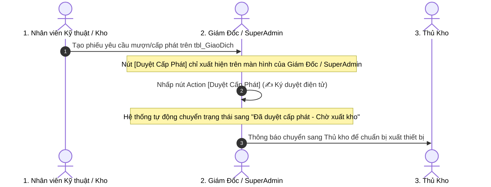

# TÀI LIỆU KỸ THUẬT: CẤU HÌNH NÚT ACTION PHÊ DUYỆT CẤP PHÁT (APPROVE ACTION)
**Mã tài liệu:** `act7.1.md`  
**Dự án:** Quản lý Vật tư & Thiết bị Viễn thông - QLVT-V1 (Công ty Trường Tiến)  
**Nhiệm vụ:** 7.1 - Thiết lập Action Ký duyệt Điện tử Phiếu Cấp phát & Mượn Thiết bị / Dụng cụ  
**Căn cứ:** Ma trận phân quyền master `PQ.V2.MD`

---

## 1. MỤC TIÊU & KIẾN TRÚC NGHIỆP VỤ (APPROVE WORKFLOW)

Khi nhân viên kỹ thuật hoặc thủ kho tạo phiếu mượn thiết bị (camera demo, máy hàn quang, laptop kỹ thuật), phiếu ở trạng thái chờ duyệt. Nút Action **`[Duyệt Cấp Phát]`** cho phép Ban Giám đốc hoặc SuperAdmin ký duyệt điện tử chỉ bằng 1 chạm trên ứng dụng:



---

## 2. THÔNG SỐ CẤU HÌNH KỸ THUẬT CỦA ACTION `[Duyet_Cap_Phat]`

| Mục cấu hình | Giá trị thiết lập | Giải thích kỹ thuật |
| :--- | :--- | :--- |
| **Action name** | **`Duyet_Cap_Phat`** | Tên định danh của Action |
| **For a record of this table** | **`tbl_GiaoDich`** | Bảng dữ liệu chứa các phiếu giao dịch/mượn |
| **Do this** | **`Data: set the values of some columns in this row`** | Cập nhật giá trị cột khi bấm nút |
| **Set these columns** | **`Loai_Giao_Dich` = `"Đã duyệt - Chờ xuất kho"`** | Chuyển đổi trạng thái quy trình |
| **Display Name** | **`✍️ Duyệt Cấp Phát`** | Tên hiển thị trên nút bấm cho người dùng |
| **Display Icon** | **`check-circle`** hoặc **`signature`** | Biểu tượng dấu tích xanh hoặc chữ ký |
| **Position** | **`Display prominently`** *(hoặc `Display inline`)* | Nút bấm to nổi bật trên đầu phiếu |
| **Only if this condition is true** | *(Xem công thức ở Mục 3)* | Phân quyền: **Chỉ SuperAdmin và Admin mới nhìn thấy** |

---

## 3. BIỂU THỨC PHÂN QUYỀN ĐIỀU KIỆN HIỂN THỊ NÚT (BEHAVIOR CONDITION)

Dán đoạn công thức sau vào mục **`Behavior` $\rightarrow$ `Only if this condition is true`**:

```appsheet
AND(
  IN(LOOKUP(USEREMAIL(), "tbl_NhanVien", "Email_NhanVien", "Vai_Tro"), LIST("SuperAdmin", "Admin")),
  OR(
    [Loai_Giao_Dich] = "Xuất cho demo",
    [Loai_Giao_Dich] = "Cấp phát nội bộ",
    [Loai_Giao_Dich] = "Xuất mượn"
  ),
  ISBLANK([Chu_Ky_POD])
)
```

> **Giải thích logic bảo vệ:**
> 1. `IN(LOOKUP(...), LIST("SuperAdmin", "Admin"))`: Chỉ duy nhất Ban Giám đốc và SuperAdmin mới nhìn thấy nút này (Kỹ thuật viên, Thủ kho, Shipper sẽ bị ẩn hoàn toàn).
> 2. `OR([Loai_Giao_Dich] = ...)`: Chỉ hiển thị trên các phiếu thuộc diện xuất mượn / demo / cấp phát nội bộ.
> 3. `ISBLANK([Chu_Ky_POD])`: Chỉ hiển thị khi phiếu chưa hoàn tất giao nhận.

---

## 4. HƯỚNG DẪN THAO TÁC TỪNG BƯỚC TRÊN APPSHEET EDITOR (CLICK-BY-CLICK)

---

### 🔹 BƯỚC 1: TẠO ACTION MỚI TRONG `tbl_GiaoDich`
1. Nhìn vào menu ngoài cùng bên trái, nhấp vào biểu tượng **Hành động (Actions)** *(icon tia sét ⚡)*.
2. Tìm đến bảng **`tbl_GiaoDich`** $\rightarrow$ Nhấp vào dấu **`+ Add action`** (hoặc nút `+` bên cạnh tên bảng).
3. Thiết lập thông số cơ bản ở khung giữa:
   * **Action name:** Nhập `Duyet_Cap_Phat`
   * **For a record of this table:** Đảm bảo là **`tbl_GiaoDich`**
   * **Do this:** Chọn **`Data: set the values of some columns in this row`**

---

### 🔹 BƯỚC 2: THIẾT LẬP CỘT CẦN CẬP NHẬT KHI BẤM NÚT
Tại mục **Set these columns**:
1. Nhấp vào ô chọn cột $\rightarrow$ Chọn cột **`Loai_Giao_Dich`**.
2. Tại ô giá trị bên cạnh, nhập: **`"Đã duyệt - Chờ xuất kho"`** *(có dấu ngoặc kép)*.

---

### 🔹 BƯỚC 3: THIẾT LẬP GIAO DIỆN HIỂN THỊ (APPEARANCE)
Cuộn xuống mục **`Appearance`**:
1. **Display name:** Nhập `✍️ Duyệt Cấp Phát`
2. **Action icon:** Nhập tìm kiếm và chọn icon **`check-circle`** ✅ *(hoặc icon cây bút `edit` / `signature`)*.
3. **Prominence:** Chọn **`Display prominently`** *(để nút hiển thị to rõ ràng ở đầu phiếu)*.

---

### 🔹 BƯỚC 4: THIẾT LẬP PHÂN QUYỀN VÀ ĐIỀU KIỆN (BEHAVIOR)
Cuộn xuống mục **`Behavior`**:
1. Tại dòng **`Only if this condition is true`**:
2. Nhấp vào ô công thức (biểu tượng bình thủy tinh 🧪) $\rightarrow$ Dán chính xác công thức:
   ```appsheet
   AND(
     IN(LOOKUP(USEREMAIL(), "tbl_NhanVien", "Email_NhanVien", "Vai_Tro"), LIST("SuperAdmin", "Admin")),
     OR(
       [Loai_Giao_Dich] = "Xuất cho demo",
       [Loai_Giao_Dich] = "Cấp phát nội bộ",
       [Loai_Giao_Dich] = "Xuất mượn"
     ),
     ISBLANK([Chu_Ky_POD])
   )
   ```
3. Thấy hiện **dấu tích xanh ✅ "The expression is valid"** $\rightarrow$ Bấm **`Save`** trong bảng công thức.

---

### 💾 BƯỚC 5: LƯU HỆ THỐNG
* Nhìn lên góc trên cùng bên phải màn hình lớn, nhấp nút màu xanh **`SAVE`**.

---

## 5. KẾT QUẢ ĐẠT ĐƯỢC & KIỂM THỬ (TESTING)

* **Khi đăng nhập bằng tài khoản Giám Đốc / SuperAdmin:**
  * Mở bất kỳ phiếu giao dịch xuất mượn nào $\rightarrow$ Thấy xuất hiện ngay nút **`✍️ Duyệt Cấp Phát`** to rõ ràng ở đầu phiếu.
  * Khi nhấp vào nút $\rightarrow$ Phiếu tự động chuyển trạng thái sang `"Đã duyệt - Chờ xuất kho"`, sẵn sàng cho Thủ kho quét mã xuất hàng!
* **Khi đăng nhập bằng Kỹ thuật / Thủ kho / Shipper:**
  * Nút này **hoàn toàn vô hình**, bảo đảm tuyệt đối tính nghiêm ngặt trong phê duyệt tài sản công ty!
