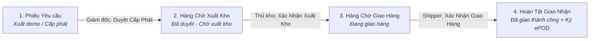

# TÀI LIỆU KỸ THUẬT: CẤU HÌNH LUỒNG CÔNG VIỆC THỦ KHO & GIAO NHẬN (NHIỆM VỤ 7.2 & 7.4)
**Mã tài liệu:** `act7.2_7.4.md`  
**Dự án:** Quản lý Vật tư & Thiết bị Viễn thông - QLVT-V1 (Công ty Trường Tiến)  
**Căn cứ:** Ma trận phân quyền master `PQ.V2.MD`

---

## 1. TỔNG QUAN LUỒNG CHUYỂN TRẠNG THÁI (WORKFLOW PIPELINE)



---

## PHẦN A: CẤU HÌNH CHO THỦ KHO (NHIỆM VỤ 7.2)

### 1. Bổ sung giá trị Enum vào cột `Loai_Giao_Dich`
* Vào **Data** $\rightarrow$ **tbl_GiaoDich** $\rightarrow$ Cột **`Loai_Giao_Dich`** (✏️).
* Thêm các giá trị sau vào mục **Values**:
  * `Đã duyệt - Chờ xuất kho`
  * `Đang giao hàng`
  * `Đã giao thành công`

### 2. Tạo Slice: `Slice_ChoXuatKho`
* **Vào:** `Data` $\rightarrow$ `Slices` $\rightarrow$ `+ New Slice`
* **Slice name:** `Slice_ChoXuatKho`
* **Source table:** `tbl_GiaoDich`
* **Row filter condition:**
  ```appsheet
  [Loai_Giao_Dich] = "Đã duyệt - Chờ xuất kho"
  ```

### 3. Tạo Action: `Xac_Nhan_Xuat_Kho`
* **Vào:** `App` $\rightarrow$ `Actions` $\rightarrow$ `+ New Action`
* **Action name:** `Xac_Nhan_Xuat_Kho`
* **For a record of this table:** `tbl_GiaoDich`
* **Do this:** `Data: set the values of some columns in this row`
* **Set these columns:**
  * `Loai_Giao_Dich` = `"Đang giao hàng"`
* **Appearance:**
  * **Display name:** `📦 Xác Nhận Xuất Kho`
  * **Action icon:** `package` (hoặc `archive-arrow-up`)
  * **Prominence:** `Display prominently`
* **Behavior $\rightarrow$ Only if this condition is true:**
  ```appsheet
  AND(
    [Loai_Giao_Dich] = "Đã duyệt - Chờ xuất kho",
    IN(LOOKUP(USEREMAIL(), "tbl_NhanVien", "Email_NhanVien", "Vai_Tro"), LIST("Thủ kho", "SuperAdmin", "Admin"))
  )
  ```

### 4. Tạo View: `Hàng chờ xuất kho` (Dành cho Thủ Kho)
* **Vào:** `App` $\rightarrow$ `Views` $\rightarrow$ `+ New View`
* **View name:** `Hàng chờ xuất kho`
* **For this data:** `Slice_ChoXuatKho`
* **View type:** `Deck` (hoặc `Table`)
* **Position:** `menu` (hoặc `primary`)
* **Show if (Phân quyền hiển thị View):**
  ```appsheet
  IN(LOOKUP(USEREMAIL(), "tbl_NhanVien", "Email_NhanVien", "Vai_Tro"), LIST("Thủ kho", "SuperAdmin", "Admin"))
  ```

---

## PHẦN B: CẤU HÌNH CHO NHÂN VIÊN GIAO NHẬN (NHIỆM VỤ 7.4)

### 1. Tạo Slice: `Slice_ChoGiaoHang`
* **Vào:** `Data` $\rightarrow$ `Slices` $\rightarrow$ `+ New Slice`
* **Slice name:** `Slice_ChoGiaoHang`
* **Source table:** `tbl_GiaoDich`
* **Row filter condition:**
  ```appsheet
  AND(
    [Loai_Giao_Dich] = "Đang giao hàng",
    OR(
      [Email_NhanVien] = USEREMAIL(),
      IN(LOOKUP(USEREMAIL(), "tbl_NhanVien", "Email_NhanVien", "Vai_Tro"), LIST("SuperAdmin", "Admin"))
    )
  )
  ```

### 2. Tạo Action: `Xac_Nhan_Giao_Hang` (Ký nhận ePOD)
* **Vào:** `App` $\rightarrow$ `Actions` $\rightarrow$ `+ New Action`
* **Action name:** `Xac_Nhan_Giao_Hang`
* **For a record of this table:** `tbl_GiaoDich`
* **Do this:** `Data: set the values of some columns in this row`
* **Set these columns:**
  * `Loai_Giao_Dich` = `"Đã giao thành công"`
* **Appearance:**
  * **Display name:** `✍️ Xác Nhận Giao Hàng`
  * **Action icon:** `signature` (hoặc `truck-check`)
  * **Prominence:** `Display prominently`
* **Behavior $\rightarrow$ Only if this condition is true:**
  ```appsheet
  AND(
    [Loai_Giao_Dich] = "Đang giao hàng",
    OR(
      [Email_NhanVien] = USEREMAIL(),
      IN(LOOKUP(USEREMAIL(), "tbl_NhanVien", "Email_NhanVien", "Vai_Tro"), LIST("Giao nhận", "SuperAdmin", "Admin"))
    )
  )
  ```

### 3. Tạo View: `Hàng chờ giao hàng` (Dành cho Shipper)
* **Vào:** `App` $\rightarrow$ `Views` $\rightarrow$ `+ New View`
* **View name:** `Hàng chờ giao hàng`
* **For this data:** `Slice_ChoGiaoHang`
* **View type:** `Card` (hoặc `Deck` - tối ưu xem trên điện thoại khi đi đường)
* **Position:** `primary` (hoặc `menu`)
* **Show if (Phân quyền hiển thị View):**
  ```appsheet
  IN(LOOKUP(USEREMAIL(), "tbl_NhanVien", "Email_NhanVien", "Vai_Tro"), LIST("Giao nhận", "SuperAdmin", "Admin"))
  ```
