# TÀI LIỆU KỸ THUẬT: ĐẶC TẢ USE CASE MODULE 1 (PHÂN RÃ CHO TÁC NHÂN SUPERADMIN)
**Mã tài liệu:** `uc1_sa_v5.md`  
**Dự án:** Quản lý Vật tư & Thiết bị Viễn thông - QLVT-V1 (Công ty TNHH Viễn thông Trường Tiến)  
**Căn cứ tài liệu:** `PQ.V2.MD`, `HD.GVHD.0509.MD` & `uc1_v2.md`  
**Giai đoạn:** Bước 3 - Bảng đặc tả chi tiết 9 trường cho toàn bộ ca sử dụng thuộc Tác nhân 1: SuperAdmin  

---

## PHẦN 1: SƠ ĐỒ USE CASE PHÂN RÃ TÁC NHÂN SUPERADMIN (PLANTUML)

```plantuml
@startuml
!theme plain
left to right direction
skinparam packageStyle rectangle
skinparam roundcorner 10
skinparam actorStyle awesome
skinparam monochrome false
skinparam shadowing false
skinparam linetype polyline
skinparam nodesep 35
skinparam ranksep 100

' ========================================================
' TÁC NHÂN DUY NHẤT: SUPERADMIN (IT SYSTEM ADMIN) - #ff0f00
' ========================================================
actor "SuperAdmin (SA)\n(Quản trị Hệ thống / IT)" as SA #ff0f00

' ========================================================
' RANH GIỚI MODULE 1: BỐ CỤC LƯỚI 2 CỘT NẰM NGANG CÂN ĐỐI
' ========================================================
rectangle "Module 1: Hệ Thống & Phân Quyền Người Dùng Theo Dõi" <<System Boundary>> {

    ' ----------------------------------------------------
    ' CỘT 1 (BÊN TRÁI): XÁC THỰC & QUẢN TRỊ NHÂN SỰ RBAC
    ' ----------------------------------------------------
    package "1. Xác thực & Chào mừng" as COL1_PKG1 {
        usecase "UC_SA.1: Đăng nhập Google SSO\n(Require User Sign-in & Token Auth)" as UC_Auth
        usecase "UC_SA.2: Điều hướng cá nhân hóa\n(Welcome Card & Smart Routing)" as UC_Welcome

        ' Cố định thứ tự tự nhiên từ trên xuống dưới
        UC_Auth -[hidden]down-> UC_Welcome
    }

    package "2. Quản Trị Nhân Sự & Phân Quyền (RBAC)" as COL1_PKG2 {
        usecase "UC_SA.3: Quản lý hồ sơ nhân sự\n(CRUD toàn quyền tbl_NhanVien)" as UC_User_CRUD
        usecase "UC_SA.4: Cấp & Chuyển đổi vai trò\n(Phân quyền 5 nhóm vai trò)" as UC_Role_Assign
        usecase "UC_SA.5: Khóa / Mở khóa tài khoản\n(Offboarding an toàn khi nghỉ việc)" as UC_Lock_Account

        ' Cố định thứ tự tự nhiên: UC_SA.3 -> UC_SA.4 -> UC_SA.5
        UC_User_CRUD -[hidden]down-> UC_Role_Assign
        UC_Role_Assign -[hidden]down-> UC_Lock_Account
    }

    ' ----------------------------------------------------
    ' CỘT 2 (BÊN PHẢI): BẢO VỆ DỮ LIỆU, GIÁM SÁT & PHỤC HỒI
    ' ----------------------------------------------------
    package "3. Bảo Vệ Dữ Liệu & Xóa Vật Lý" as COL2_PKG1 {
        usecase "UC_SA.6: Thực thi Xóa vật lý bản ghi\n(DUY NHẤT quyền Hard Delete 100% bảng)" as UC_Hard_Delete
    }

    package "4. Giám Sát Hệ Thống & Phục Hồi Dữ Liệu" as COL2_PKG2 {
        usecase "UC_SA.7: Giám sát nhật ký hoạt động\n(Truy vết biến động Audit Trail)" as UC_Audit_Log
        usecase "UC_SA.8: Nhập phục hồi dữ liệu (Import Data)\n(DUY NHẤT SA Import khi gặp sự cố)" as UC_Import_Data
        usecase "UC_SA.9: Trích xuất dữ liệu thô hệ thống\n(Export Raw Data định kỳ)" as UC_Export_Raw
        usecase "UC_SA.10: Quản trị cấu hình Webhook hệ thống\n(Hạ tầng đẩy tin cảnh báo kỹ thuật)" as UC_Webhook_Config

        ' Cố định thứ tự tự nhiên: UC_SA.7 -> UC_SA.8 -> UC_SA.9 -> UC_SA.10
        UC_Audit_Log -[hidden]down-> UC_Import_Data
        UC_Import_Data -[hidden]down-> UC_Export_Raw
        UC_Export_Raw -[hidden]down-> UC_Webhook_Config
    }

    ' Ép bố cục 2 cột cân đối: Cột 1 (Pkg 1, 2) bên trái - Cột 2 (Pkg 3, 4) bên phải
    COL1_PKG1 -[hidden]down-> COL1_PKG2
    COL2_PKG1 -[hidden]down-> COL2_PKG2

    COL1_PKG1 -[hidden]right-> COL2_PKG1
    COL1_PKG2 -[hidden]right-> COL2_PKG2
}

' ========================================================
' ĐƯỜNG KẾT NỐI TỪ SUPERADMIN (MÀU ĐỎ #ff0f00, IN ĐẬM)
' ========================================================

' Kết nối tuần tự sang Cột 1 (Bên trái)
SA -[#ff0f00,bold]-> UC_Auth
SA -[#ff0f00,bold]-> UC_Welcome
SA -[#ff0f00,bold]-> UC_User_CRUD
SA -[#ff0f00,bold]-> UC_Role_Assign
SA -[#ff0f00,bold]-> UC_Lock_Account

' Kết nối tuần tự sang Cột 2 (Bên phải)
SA -[#ff0f00,bold]-> UC_Hard_Delete
SA -[#ff0f00,bold]-> UC_Audit_Log
SA -[#ff0f00,bold]-> UC_Import_Data
SA -[#ff0f00,bold]-> UC_Export_Raw
SA -[#ff0f00,bold]-> UC_Webhook_Config

@enduml
```

---

## PHẦN 2: BẢNG ĐẶC TẢ CHI TIẾT 9 TRƯỜNG CHO TÁC NHÂN SUPERADMIN (10 USE CASES)

---

### BẢNG ĐẶC TẢ 1: UC1.SA.01 - ĐĂNG NHẬP HỆ THỐNG QUA GOOGLE SSO

| STT | Trường thông tin | Nội dung chi tiết đặc tả kỹ thuật |
| :---: | :--- | :--- |
| **1** | **Mã UC** | **`UC1.SA.01`** |
| **2** | **Tên UC** | **Đăng nhập hệ thống qua Google SSO (Require User Sign-in & Token Auth)** |
| **3** | **Actor chính** | **SuperAdmin (Quản trị Hệ thống / IT System Admin)** |
| **4** | **Mục tiêu** | Xác thực danh tính người dùng IT Quản trị cấp cao qua tài khoản Google Workspace doanh nghiệp, kiểm tra trạng thái kích hoạt tài khoản và cấp quyền phiên làm việc cao nhất (`ALL_CHANGES`) trên nền tảng AppSheet. |
| **5** | **Tiền điều kiện (Preconditions)** | 1. Hệ thống AppSheet kích hoạt cấu hình bảo mật `Require User Sign-in = TRUE` và `Authentication Provider = Google`. 2. Bản ghi nhân sự đã được khai báo trước trong bảng `tbl_NhanVien`. 3. Biểu thức kiểm tra trạng thái hoạt động: `LOOKUP(USEREMAIL(), "tbl_NhanVien", "Email_NhanVien", "TrangThai") = "Đang hoạt động"`. 4. Biểu thức xác thực vai trò IT: `LOOKUP(USEREMAIL(), "tbl_NhanVien", "Email_NhanVien", "VaiTro") = "SuperAdmin"`. 5. Thiết bị có kết nối mạng Internet qua giao thức HTTPS bảo mật. |
| **6** | **Kích hoạt (Trigger)** | SuperAdmin mở ứng dụng web trên trình duyệt hoặc khởi chạy app AppSheet trên thiết bị di động/máy tính. |
| **7** | **Luồng chính (Main Flow)** | **1.** Người dùng truy cập đường dẫn ứng dụng QLVT-V1. **2.** AppSheet phát hiện phiên làm việc mới và tự động chuyển hướng đến trang đăng nhập Google OAuth 2.0. **3.** SuperAdmin chọn tài khoản Google công vụ và xác thực mật khẩu / 2FA. **4.** Google phản hồi OAuth Token xác thực danh tính người dùng về máy chủ AppSheet. **5.** Máy chủ AppSheet thực thi hàm `USEREMAIL()`, truy vấn đối soát dữ liệu với bảng `tbl_NhanVien`. **6.** Hệ thống kiểm tra hợp lệ: `TrangThai = "Đang hoạt động"` và `VaiTro = "SuperAdmin"`. **7.** Hệ thống khởi tạo phiên làm việc với toàn quyền truy cập dữ liệu không bị lọc bởi `Security Filters`. **8.** Ứng dụng tự động chuyển tiếp người dùng sang giao diện Welcome Card (`UC1.SA.02`). |
| **8** | **Luồng ngoại lệ (Exceptions)** | **E1 - Email chưa được đăng ký trong CSDL:** Hệ thống từ chối truy cập và hiển thị thông báo: *"Email của bạn chưa được cấp quyền trong hệ thống QLVT-V1. Vui lòng liên hệ IT Quản trị."* (Truy cập bị chặn hoàn toàn). **E2 - Tài khoản bị khóa hoặc nghỉ việc:** Nếu `TrangThai <> "Đang hoạt động"`, bộ lọc bảo mật `Security Filter` sẽ chặn 100% dữ liệu, chuyển hướng đến màn hình thông báo: *"Tài khoản của bạn đã bị khóa hoặc ngừng hoạt động."* **E3 - Mất kết nối mạng / Token hết hạn:** Báo lỗi kết nối máy chủ Google OAuth, yêu cầu kiểm tra đường truyền và thử lại. |
| **9** | **Hậu điều kiện (Postconditions)** | 1. Phiên làm việc (Session) của SuperAdmin được xác thực thành công. 2. Ghi nhận nhật ký truy cập vào hệ thống Audit Log (Email, Thời gian đăng nhập, Thiết bị/IP). 3. Tải toàn bộ cấu hình bảng, hành động và dữ liệu phục vụ tác nghiệp quản trị. |

---

### BẢNG ĐẶC TẢ 2: UC1.SA.02 - ĐIỀU HƯỚNG CÁ NHÂN HÓA VÀ WELCOME CARD

| STT | Trường thông tin | Nội dung chi tiết đặc tả kỹ thuật |
| :---: | :--- | :--- |
| **1** | **Mã UC** | **`UC1.SA.02`** |
| **2** | **Tên UC** | **Điều hướng cá nhân hóa và hiển thị Welcome Card (Welcome Card & Smart Routing)** |
| **3** | **Actor chính** | **SuperAdmin (Quản trị Hệ thống / IT System Admin)** |
| **4** | **Mục tiêu** | Hiển thị bảng chào mừng cá nhân hóa dành riêng cho SuperAdmin, cung cấp lối tắt truy cập nhanh vào bàn làm việc IT (IT Dashboard), hạ tầng quản trị nhân sự, giám sát và cảnh báo kỹ thuật. |
| **5** | **Tiền điều kiện (Preconditions)** | 1. `UC1.SA.01` (Đăng nhập Google SSO) đã hoàn tất thành công. 2. View `Xin chào` (Welcome Card) được cấu hình hiển thị tại trang đích khởi đầu. 3. Điều kiện lọc hiển thị khối điều hướng quản trị: `LOOKUP(USEREMAIL(), "tbl_NhanVien", "Email_NhanVien", "VaiTro") = "SuperAdmin"`. |
| **6** | **Kích hoạt (Trigger)** | Hệ thống tự động chuyển hướng ngay sau khi xác thực thành công hoặc khi SuperAdmin bấm vào menu "Trang chủ / Xin chào". |
| **7** | **Luồng chính (Main Flow)** | **1.** Hệ thống lấy thông tin cá nhân của SuperAdmin từ `tbl_NhanVien`: Họ tên, Email, Ảnh đại diện, Chức vụ, Vai trò (`SuperAdmin`). **2.** Render giao diện thẻ Welcome Card với lời chào: *"Xin chào Quản trị viên Hệ thống: [Họ và Tên]"*. **3.** Hiển thị nhóm nút điều hướng tác vụ nhanh (Quick Action Buttons): &nbsp;&nbsp;&nbsp;&nbsp;a. *Quản trị Nhân sự & Phân quyền (`tbl_NhanVien`)*. &nbsp;&nbsp;&nbsp;&nbsp;b. *Giám sát Nhật ký Hoạt động (Audit Trail)*. &nbsp;&nbsp;&nbsp;&nbsp;c. *Khôi phục Dữ liệu BCP & Import/Export*. &nbsp;&nbsp;&nbsp;&nbsp;d. *Cấu hình Webhook & Cảnh báo Telegram*. &nbsp;&nbsp;&nbsp;&nbsp;e. *Bảng điều khiển toàn diện 360° (Executive Dashboard)*. **4.** Hiển thị các khối Widget tóm tắt: Tổng số nhân sự đang hoạt động, số thiết bị đang bảo trì, tình trạng đồng bộ hệ thống. **5.** SuperAdmin chọn nút chức năng mong muốn để chuyển ngay đến View chuyên trách thông qua hàm `LINKTOVIEW()`. |
| **8** | **Luồng ngoại lệ (Exceptions)** | **E1 - Lỗi hiển thị ảnh đại diện:** Nếu nhân viên chưa cập nhật ảnh, hệ thống tự động tải icon Avatar mặc định theo định danh AppSheet. **E2 - Không lấy được thông tin hồ sơ:** Nếu kết nối cơ sở dữ liệu gián đoạn, hiển thị lời chào mặc định theo địa chỉ `USEREMAIL()`. |
| **9** | **Hậu điều kiện (Postconditions)** | 1. SuperAdmin được định tuyến chính xác đến đúng không gian làm việc quản trị mà không bị nhầm lẫn với giao diện của các vai trò vận hành khác. 2. Giao diện sẵn sàng tiếp nhận các thao tác quản trị tiếp theo. |

---

### BẢNG ĐẶC TẢ 3: UC1.SA.03 - QUẢN LÝ HỒ SƠ NHÂN SỰ (CRUD TBL_NHANVIEN)

| STT | Trường thông tin | Nội dung chi tiết đặc tả kỹ thuật |
| :---: | :--- | :--- |
| **1** | **Mã UC** | **`UC1.SA.03`** |
| **2** | **Tên UC** | **Quản lý hồ sơ nhân sự (CRUD toàn quyền tbl_NhanVien)** |
| **3** | **Actor chính** | **SuperAdmin (Quản trị Hệ thống / IT System Admin)** |
| **4** | **Mục tiêu** | Thêm mới, tra cứu, hiệu chỉnh đầy đủ thông tin hồ sơ nhân viên toàn công ty trong bảng `tbl_NhanVien` để phục vụ định danh và xác thực quyền hạn trên toàn bộ hệ thống. |
| **5** | **Tiền điều kiện (Preconditions)** | 1. SuperAdmin đã đăng nhập và có vai trò `SuperAdmin`. 2. Bảng `tbl_NhanVien` được cấu hình quyền `ALL_CHANGES` cho SuperAdmin. 3. Điều kiện hiển thị View quản lý nhân sự: `Show_If = IN(LOOKUP(USEREMAIL(), "tbl_NhanVien", "Email_NhanVien", "VaiTro"), LIST("SuperAdmin", "Admin"))`. |
| **6** | **Kích hoạt (Trigger)** | SuperAdmin mở danh mục "Quản trị Nhân sự" và bấm nút "Thêm mới" (Add) hoặc chọn 1 nhân viên rồi bấm "Chỉnh sửa" (Edit). |
| **7** | **Luồng chính (Main Flow)** | **1.** SuperAdmin truy cập danh sách nhân sự `tbl_NhanVien_View`. **2.** Chọn thao tác **Thêm mới** hoặc **Chỉnh sửa** hồ sơ hiện hữu. **3.** Hệ thống mở biểu mẫu `tbl_NhanVien_Form`. **4.** SuperAdmin nhập/chỉnh sửa các thông tin: &nbsp;&nbsp;&nbsp;&nbsp;+ `Ma_NhanVien`: Mã tự sinh theo cấu trúc `NV-` kèm số thứ tự (Initial Value: `CONCATENATE("NV-", TEXT(COUNT(tbl_NhanVien[Ma_NhanVien]) + 1, "000"))`). &nbsp;&nbsp;&nbsp;&nbsp;+ `HoVaTen`: Họ và tên đầy đủ (Bắt buộc). &nbsp;&nbsp;&nbsp;&nbsp;+ `Email_NhanVien`: Email Google công vụ (Bắt buộc, duy nhất). &nbsp;&nbsp;&nbsp;&nbsp;+ `SoDienThoai`: Số điện thoại liên hệ (10 chữ số). &nbsp;&nbsp;&nbsp;&nbsp;+ `PhongBan`: Chọn phòng ban (Kỹ thuật, Kho vận, Giao nhận, Ban Giám đốc, IT). &nbsp;&nbsp;&nbsp;&nbsp;+ `ChucVu`: Chức danh công tác. &nbsp;&nbsp;&nbsp;&nbsp;+ `HinhAnh`: Tải ảnh chân dung nhân sự. **5.** Hệ thống tự động kiểm tra tính hợp lệ dữ liệu qua `Valid_If`: &nbsp;&nbsp;&nbsp;&nbsp;+ Kiểm tra trùng email: `NOT(IN([Email_NhanVien], SELECT(tbl_NhanVien[Email_NhanVien], [Ma_NhanVien] <> [_THISROW].[Ma_NhanVien])))`. **6.** SuperAdmin bấm "Save". **7.** Hệ thống tự động cập nhật `NguoiCapNhat = USEREMAIL()` và `ThoiGianCapNhat = NOW()`. **8.** Dữ liệu được đồng bộ an toàn về Google Sheets / Database. |
| **8** | **Luồng ngoại lệ (Exceptions)** | **E1 - Email bị trùng lặp:** Hệ thống cảnh báo *"Email này đã tồn tại trên hệ thống cho một nhân sự khác!"*. Nút Save bị vô hiệu hóa. **E2 - Bỏ trống trường bắt buộc:** Báo lỗi vi phạm trường bắt buộc (`Required`), yêu cầu điền đầy đủ `HoVaTen` và `Email_NhanVien`. **E3 - Định dạng số điện thoại sai:** Hệ thống yêu cầu nhập đúng định dạng số điện thoại Việt Nam. |
| **9** | **Hậu điều kiện (Postconditions)** | 1. Bản ghi nhân sự được tạo mới hoặc cập nhật chính xác trong `tbl_NhanVien`. 2. Ghi nhận nhật ký thay đổi vào hệ thống `tbl_AuditLog`. 3. Nhân viên mới sẵn sàng được cấp vai trò đăng nhập ở `UC1.SA.04`. |

---

### BẢNG ĐẶC TẢ 4: UC1.SA.04 - CẤP VÀ CHUYỂN ĐỔI VAI TRÒ NGƯỜI DÙNG (RBAC)

| STT | Trường thông tin | Nội dung chi tiết đặc tả kỹ thuật |
| :---: | :--- | :--- |
| **1** | **Mã UC** | **`UC1.SA.04`** |
| **2** | **Tên UC** | **Cấp & Chuyển đổi vai trò người dùng (Phân quyền 5 nhóm vai trò)** |
| **3** | **Actor chính** | **SuperAdmin (Quản trị Hệ thống / IT System Admin)** |
| **4** | **Mục tiêu** | Thiết lập, gán mới hoặc thay đổi nhóm vai trò phân quyền (`SuperAdmin`, `Admin`, `KyThuatVien`, `ThuKho`, `GiaoNhan`) cho nhân sự trong bảng `tbl_NhanVien` nhằm định hình chính xác phạm vi bảo mật, menu hiển thị và quyền thao tác dữ liệu. |
| **5** | **Tiền điều kiện (Preconditions)** | 1. SuperAdmin đã đăng nhập hệ thống. 2. Cột `VaiTro` trong `tbl_NhanVien` được thiết lập quyền sửa đổi: `Editable_If = (LOOKUP(USEREMAIL(), "tbl_NhanVien", "Email_NhanVien", "VaiTro") = "SuperAdmin")` (Hoặc có thêm Admin ngoại trừ chính mình). 3. Hồ sơ nhân viên mục tiêu đã tồn tại trong `tbl_NhanVien`. |
| **6** | **Kích hoạt (Trigger)** | SuperAdmin mở biểu mẫu chỉnh sửa hồ sơ nhân viên hoặc bấm Action "Cấp quyền vai trò" trên Detail View. |
| **7** | **Luồng chính (Main Flow)** | **1.** SuperAdmin tìm kiếm và chọn nhân viên cần phân quyền trên danh sách `tbl_NhanVien`. **2.** Mở giao diện chỉnh sửa vai trò. **3.** Tại trường `VaiTro` (Enum), SuperAdmin lựa chọn 1 trong 5 nhóm vai trò chuyên trách: &nbsp;&nbsp;&nbsp;&nbsp;+ `SuperAdmin`: Quản trị hạ tầng, BCP, Import Data, toàn quyền xóa vật lý. &nbsp;&nbsp;&nbsp;&nbsp;+ `Admin`: Ban Giám Đốc điều hành, ký duyệt cấp phát/chi phí, tước quyền xóa. &nbsp;&nbsp;&nbsp;&nbsp;+ `KyThuatVien`: Chuyên viên phần cứng, quản lý lỗi, Dual Warranty, Telegram Bot. &nbsp;&nbsp;&nbsp;&nbsp;+ `ThuKho`: Vận hành kho, nhập thùng quy cách, xuất nhập thiết bị, quét QR. &nbsp;&nbsp;&nbsp;&nbsp;+ `GiaoNhan`: Shipper hiện trường, xem cuốc xe cá nhân, ký nhận e-POD. **4.** SuperAdmin bấm "Save". **5.** Hệ thống lưu giá trị vai trò mới, tự động ghi nhận `NguoiPhanQuyen = USEREMAIL()`, `NgayPhanQuyen = NOW()`. **6.** Ghi nhận sự kiện phân quyền vào `tbl_AuditLog` (Lưu rõ: Vai trò cũ $\rightarrow$ Vai trò mới). **7.** Khi nhân sự tương ứng mở app hoặc bấm Sync, toàn bộ giao diện và bộ lọc bảo mật sẽ lập tức áp dụng theo vai trò mới. |
| **8** | **Luồng ngoại lệ (Exceptions)** | **E1 - Khóa tự hạ quyền của SuperAdmin duy nhất:** Nếu hệ thống chỉ còn duy nhất 1 tài khoản `SuperAdmin` đang hoạt động, biểu thức `Valid_If` sẽ chặn không cho phép đổi vai trò tài khoản đó sang vai trò khác nhằm ngăn chặn rủi ro mất quyền quản trị tối cao (`COUNT(SELECT(tbl_NhanVien[Ma_NhanVien], AND([VaiTro] = "SuperAdmin", [TrangThai] = "Đang hoạt động"))) > 1`). |
| **9** | **Hậu điều kiện (Postconditions)** | 1. Cột `VaiTro` của nhân sự được cập nhật giá trị mới trong cơ sở dữ liệu `tbl_NhanVien`. 2. Quyền truy cập bảng, quyền thao tác nút bấm và phạm vi hiển thị View của người dùng được cập nhật tự động trong chu kỳ đồng bộ tiếp theo. |

---

### BẢNG ĐẶC TẢ 5: UC1.SA.05 - KHÓA VÀ MỞ KHÓA TÀI KHOẢN (OFFBOARDING AN TOÀN)

| STT | Trường thông tin | Nội dung chi tiết đặc tả kỹ thuật |
| :---: | :--- | :--- |
| **1** | **Mã UC** | **`UC1.SA.05`** |
| **2** | **Tên UC** | **Khóa / Mở khóa tài khoản nhân sự (Offboarding an toàn khi nghỉ việc)** |
| **3** | **Actor chính** | **SuperAdmin (Quản trị Hệ thống / IT System Admin)** |
| **4** | **Mục tiêu** | Vô hiệu hóa quyền truy cập hệ thống ngay tức thì khi nhân viên nghỉ việc/tạm đình chỉ mà vẫn bảo toàn 100% dữ liệu lịch sử giao dịch, tài sản và biên bản e-POD; hoặc kích hoạt mở lại tài khoản khi nhân sự tái hoạt động. |
| **5** | **Tiền điều kiện (Preconditions)** | 1. SuperAdmin đã đăng nhập hệ thống. 2. Bản ghi nhân viên tồn tại trong `tbl_NhanVien`. 3. Cột `TrangThai` nhận các giá trị Enum: `Đang hoạt động`, `Đã khóa`, `Nghỉ việc`. 4. Action "Khóa tài khoản" và "Mở khóa tài khoản" được hiển thị theo trạng thái hiện tại của bản ghi. |
| **6** | **Kích hoạt (Trigger)** | SuperAdmin bấm Action Button "Khóa tài khoản" (Icon Khóa) hoặc "Kích hoạt tài khoản" (Icon Mở khóa) trên Detail View của nhân viên. |
| **7** | **Luồng chính (Main Flow)** | **1.** SuperAdmin truy cập danh sách nhân viên `tbl_NhanVien` và chọn nhân sự cần xử lý. **2.** SuperAdmin bấm nút Action: &nbsp;&nbsp;&nbsp;&nbsp;+ Nếu đang hoạt động: Bấm **"Khóa tài khoản"**. &nbsp;&nbsp;&nbsp;&nbsp;+ Nếu đang bị khóa: Bấm **"Kích hoạt tài khoản"**. **3.** Hệ thống hiển thị hộp thoại xác nhận (Confirmation Message): &nbsp;&nbsp;&nbsp;&nbsp;*"Bạn có chắc chắn muốn [KHÓA / MỞ KHÓA] tài khoản của nhân viên [Họ Tên] ([Email]) không?"*. **4.** SuperAdmin bấm "Xác nhận". **5.** Hệ thống thực thi cập nhật giá trị cột: &nbsp;&nbsp;&nbsp;&nbsp;+ Trường hợp Khóa: `TrangThai = "Đã khóa"` (hoặc `"Nghỉ việc"`), `NgayKhoa = TODAY()`, `NguoiThucHien = USEREMAIL()`. &nbsp;&nbsp;&nbsp;&nbsp;+ Trường hợp Mở khóa: `TrangThai = "Đang hoạt động"`, `NgayMoKhoa = TODAY()`, `NguoiThucHien = USEREMAIL()`. **6.** Hệ thống đồng bộ dữ liệu. AppSheet Security Filter kích hoạt ngay lập tức: Ở lần kết nối kế tiếp, tài khoản bị khóa sẽ bị chặn nạp toàn bộ bảng dữ liệu. **7.** Ghi nhận sự kiện Offboarding / Mở khóa vào `tbl_AuditLog`. |
| **8** | **Luồng ngoại lệ (Exceptions)** | **E1 - Tự khóa tài khoản của chính mình:** Nút Action "Khóa tài khoản" bị ẩn hoàn toàn đối với chính tài khoản của SuperAdmin đang đăng nhập thông qua biểu thức `Behavior Only if this condition is true: [Email_NhanVien] <> USEREMAIL()`. **E2 - Cảnh báo nhân viên còn giữ tài sản:** Nếu nhân viên đang đứng tên mượn thiết bị chưa hoàn trả (`COUNT(SELECT(tbl_ThietBi_ChiTiet[Ma_ThietBi], AND([NguoiDangGiu] = [_THISROW].[Ma_NhanVien], [TrangThai_Muon] = "Đang mượn"))) > 0`), hệ thống hiển thị cảnh báo phụ để SuperAdmin lưu ý thu hồi tài sản trước khi hoàn tất thủ tục. |
| **9** | **Hậu điều kiện (Postconditions)** | 1. Trạng thái `TrangThai` của tài khoản đổi sang `Đã khóa` hoặc `Đang hoạt động`. 2. Người dùng bị khóa không thể truy cập bất kỳ dữ liệu nào của công ty. 3. Toàn bộ lịch sử hoạt động, phiếu xuất nhập, ký e-POD trong quá khứ của nhân sự vẫn được bảo toàn nguyên vẹn trong CSDL. |

---

### BẢNG ĐẶC TẢ 6: UC1.SA.06 - THỰC THI XÓA VẬT LÝ BẢN GHI (HARD DELETE)

| STT | Trường thông tin | Nội dung chi tiết đặc tả kỹ thuật |
| :---: | :--- | :--- |
| **1** | **Mã UC** | **`UC1.SA.06`** |
| **2** | **Tên UC** | **Thực thi Xóa vật lý bản ghi (DUY NHẤT quyền Hard Delete 100% bảng)** |
| **3** | **Actor chính** | **SuperAdmin (Quản trị Hệ thống / IT System Admin)** |
| **4** | **Mục tiêu** | Thực hiện xóa vĩnh viễn (Hard Delete) các bản ghi rác, bản ghi nhập sai nghiêm trọng hoặc dữ liệu thử nghiệm trên 100% các bảng dữ liệu (`tbl_NhanVien`, `tbl_VatTu`, `tbl_ThietBi_ChiTiet`, `tbl_GiaoDich`, `tbl_QuanLyThung`, `tbl_NhatKyBaoTri`) để dọn dẹp hệ thống mà không vai trò nào khác được phép thực hiện. |
| **5** | **Tiền điều kiện (Preconditions)** | 1. SuperAdmin đã đăng nhập hệ thống với vai trò `SuperAdmin`. 2. Cấu hình quyền xóa trên mọi bảng (`Table Delete Behavior`) được thiết lập biểu thức bảo mật: `LOOKUP(USEREMAIL(), "tbl_NhanVien", "Email_NhanVien", "VaiTro") = "SuperAdmin"`. 3. Nút Action Delete hệ thống có điều kiện hiển thị: `Show_If = (LOOKUP(USEREMAIL(), "tbl_NhanVien", "Email_NhanVien", "VaiTro") = "SuperAdmin")`. |
| **6** | **Kích hoạt (Trigger)** | SuperAdmin bấm biểu tượng Thùng rác (Action Delete) trên Detail View hoặc Table View của bản ghi cần xóa. |
| **7** | **Luồng chính (Main Flow)** | **1.** SuperAdmin truy cập vào bảng dữ liệu chứa bản ghi cần xử lý (ví dụ: `tbl_ThietBi_ChiTiet`, `tbl_GiaoDich`). **2.** Định vị và chọn bản ghi mục tiêu $\rightarrow$ Bấm nút **"Xóa" (Delete)**. **3.** Hệ thống kiểm tra ràng buộc toàn vẹn dữ liệu quan hệ (Parent-Child Relations). **4.** Hệ thống bật hộp thoại xác nhận cảnh báo an toàn cấp cao: &nbsp;&nbsp;&nbsp;&nbsp;*"CẢNH BÁO QUẢN TRỊ VIÊN: Thao tác này sẽ XÓA VĨNH VIỄN bản ghi [Mã Bản Ghi] khỏi cơ sở dữ liệu và KHÔNG THỂ HOÀN TÁC. Bạn có chắc chắn muốn xóa không?"*. **5.** SuperAdmin chọn **"Đồng ý xóa"**. **6.** Hệ thống thực hiện xóa vật lý dòng dữ liệu khỏi bảng tương ứng trên Google Sheets / Database. **7.** Hệ thống tự động ghi một bản ghi sao lưu tóm tắt vào bảng `tbl_AuditLog` với các trường: `ThoiGian = NOW()`, `NguoiThucHien = USEREMAIL()`, `HanhDong = "HARD_DELETE"`, `BangDuLieu = "[Tên Bảng]"`, `KhoaChinh = "[Mã Bản Ghi]"`, `NoiDung_Snapshot = "[Dữ liệu JSON dòng bị xóa]"`. **8.** Giao diện tự động làm mới, bản ghi biến mất hoàn toàn trên toàn bộ hệ thống. |
| **8** | **Luồng ngoại lệ (Exceptions)** | **E1 - Xóa bản ghi cha có chứa bản ghi con ràng buộc:** Nếu xóa Vật tư đang có Thiết bị chi tiết hoặc xóa Phiếu đang có dòng giao dịch con, hệ thống từ chối xóa và hiển thị cảnh báo: *"Không thể xóa bản ghi cha khi còn tồn tại [X] dữ liệu liên kết con. Vui lòng xử lý dữ liệu con trước."* **E2 - Người dùng khác can thiệp gửi lệnh xóa:** Lệnh xóa bị chặn hoàn toàn tại tầng máy chủ AppSheet (Mã lỗi 403 Forbidden). |
| **9** | **Hậu điều kiện (Postconditions)** | 1. Dòng dữ liệu bị xóa vĩnh viễn khỏi CSDL vật lý. 2. Bản ghi snapshot và sự kiện xóa được lưu an toàn trong `tbl_AuditLog` để phục vụ hậu kiểm. |

---

### BẢNG ĐẶC TẢ 7: UC1.SA.07 - GIÁM SÁT NHẬT KÝ HOẠT ĐỘNG (AUDIT TRAIL)

| STT | Trường thông tin | Nội dung chi tiết đặc tả kỹ thuật |
| :---: | :--- | :--- |
| **1** | **Mã UC** | **`UC1.SA.07`** |
| **2** | **Tên UC** | **Giám sát nhật ký hoạt động hệ thống (Truy vết biến động Audit Trail)** |
| **3** | **Actor chính** | **SuperAdmin (Quản trị Hệ thống / IT System Admin)** |
| **4** | **Mục tiêu** | Giám sát, truy vết chi tiết mọi hành động thêm mới, chỉnh sửa, xóa dữ liệu, đăng nhập và phân quyền của tất cả nhân sự trong toàn công ty để bảo đảm an toàn thông tin và phục vụ kiểm toán nội bộ. |
| **5** | **Tiền điều kiện (Preconditions)** | 1. SuperAdmin đã đăng nhập hệ thống. 2. Bảng `tbl_AuditLog` được kích hoạt cơ chế ghi nhận tự động qua các AppSheet Automation Bots và Change Actions. 3. Quyền xem View Audit Trail được phân quyền: `IN(LOOKUP(USEREMAIL(), "tbl_NhanVien", "Email_NhanVien", "VaiTro"), LIST("SuperAdmin", "Admin"))`. |
| **6** | **Kích hoạt (Trigger)** | SuperAdmin mở phân hệ "Giám sát & Nhật ký" $\rightarrow$ Chọn màn hình "Nhật ký hoạt động (Audit Trail)". |
| **7** | **Luồng chính (Main Flow)** | **1.** SuperAdmin truy cập vào View `Audit_Trail_Dashboard`. **2.** Hệ thống hiển thị danh sách nhật ký hoạt động theo thứ tự thời gian giảm dần (Mới nhất ở trên). **3.** Mỗi dòng log hiển thị chi tiết các trường thông tin: &nbsp;&nbsp;&nbsp;&nbsp;+ `Log_ID`: Mã nhật ký định danh duy nhất. &nbsp;&nbsp;&nbsp;&nbsp;+ `ThoiGian`: Dấu thời gian chính xác (`NOW()`). &nbsp;&nbsp;&nbsp;&nbsp;+ `NguoiThucHien`: Email tài khoản thực hiện (`USEREMAIL()`). &nbsp;&nbsp;&nbsp;&nbsp;+ `VaiTro`: Nhóm vai trò tại thời điểm thực hiện thao tác. &nbsp;&nbsp;&nbsp;&nbsp;+ `BangDuLieu`: Bảng chịu tác động (`tbl_NhanVien`, `tbl_GiaoDich`, `tbl_ThietBi_ChiTiet`, v.v.). &nbsp;&nbsp;&nbsp;&nbsp;+ `HanhDong`: Loại thao tác (`CREATE`, `UPDATE`, `DELETE`, `LOGIN`, `OFFBOARD`). &nbsp;&nbsp;&nbsp;&nbsp;+ `ChiTietThayDoi`: Chi tiết giá trị cũ $\rightarrow$ giá trị mới. **4.** SuperAdmin sử dụng bộ lọc tương tác (Interactive Filters): &nbsp;&nbsp;&nbsp;&nbsp;+ Lọc theo khoảng ngày (Từ ngày - Đến ngày). &nbsp;&nbsp;&nbsp;&nbsp;+ Lọc theo nhân viên cụ thể. &nbsp;&nbsp;&nbsp;&nbsp;+ Lọc theo loại hành động (đặc biệt các thao tác `DELETE` và `OFFBOARD`). **5.** SuperAdmin chọn 1 bản ghi log để xem toàn văn dữ liệu snapshot đối soát. |
| **8** | **Luồng ngoại lệ (Exceptions)** | **E1 - Dữ liệu log quá lớn gây suy giảm tốc độ tải:** View tự động áp dụng bộ lọc mặc định chỉ tải dữ liệu trong 60 ngày gần nhất. Dữ liệu cũ hơn được lưu trữ ngoại tuyến và có thể tra cứu qua chức năng Export (`UC1.SA.09`). |
| **9** | **Hậu điều kiện (Postconditions)** | 1. Cung cấp bức tranh toàn cảnh, minh bạch về toàn bộ các hoạt động vận hành hệ thống. 2. Bảng `tbl_AuditLog` duy trì ở chế độ chỉ đọc (`READ_ONLY`), không ai có thể can thiệp chỉnh sửa dữ liệu nhật ký. |

---

### BẢNG ĐẶC TẢ 8: UC1.SA.08 - NHẬP PHỤC HỒI DỮ LIỆU (IMPORT DATA BCP)

| STT | Trường thông tin | Nội dung chi tiết đặc tả kỹ thuật |
| :---: | :--- | :--- |
| **1** | **Mã UC** | **`UC1.SA.08`** |
| **2** | **Tên UC** | **Nhập phục hồi dữ liệu - BCP (DUY NHẤT SA Import khi gặp sự cố)** |
| **3** | **Actor chính** | **SuperAdmin (Quản trị Hệ thống / IT System Admin)** |
| **4** | **Mục tiêu** | Thực hiện nạp dữ liệu hàng loạt từ tệp CSV/Excel vào cơ sở dữ liệu để phục hồi hệ thống khi có sự cố máy chủ/thảm họa (Business Continuity Plan - BCP), di chuyển dữ liệu lớn hoặc đồng bộ dữ liệu ngoại tuyến khẩn cấp. |
| **5** | **Tiền điều kiện (Preconditions)** | 1. SuperAdmin đã đăng nhập hệ thống với vai trò `SuperAdmin`. 2. Quyền thực thi Import CSV/Excel được cấp quyền DUY NHẤT cho SuperAdmin: `LOOKUP(USEREMAIL(), "tbl_NhanVien", "Email_NhanVien", "VaiTro") = "SuperAdmin"`. 3. Tệp dữ liệu CSV/Excel nguồn tuân thủ đúng định dạng cấu trúc cột (Schema Headers) của bảng đích. |
| **6** | **Kích hoạt (Trigger)** | SuperAdmin bấm Action "Import CSV" trên phân hệ Quản trị BCP hoặc thanh công cụ của bảng dữ liệu cần phục hồi. |
| **7** | **Luồng chính (Main Flow)** | **1.** SuperAdmin truy cập vào bảng dữ liệu cần nạp phục hồi (ví dụ: `tbl_ThietBi_ChiTiet`, `tbl_VatTu`, `tbl_KhachHang`). **2.** SuperAdmin bấm nút Action **"Nhập dữ liệu (Import CSV/Excel)"**. **3.** Hệ thống hiển thị hộp thoại chọn tệp tin tải lên. **4.** SuperAdmin chọn tệp dữ liệu sao lưu hợp lệ từ máy tính. **5.** Hệ thống thực thi tiến trình kiểm tra sơ bộ (Validation Check): &nbsp;&nbsp;&nbsp;&nbsp;+ Kiểm tra tiêu đề cột khớp với Schema bảng đích. &nbsp;&nbsp;&nbsp;&nbsp;+ Kiểm tra các cột khóa chính (`Primary Key`) và kiểu dữ liệu từng cột. **6.** Hệ thống hiển thị bản xem trước dữ liệu (Preview) và số lượng bản ghi sẽ được nạp. **7.** SuperAdmin bấm nút **"Tiến hành Import"**. **8.** Hệ thống nạp dữ liệu theo lô (Batch Insert/Upsert) vào CSDL. **9.** Sau khi hoàn tất, hệ thống hiển thị thông báo tổng kết: *"Nạp thành công [X] bản ghi, lỗi [Y] bản ghi"*, kèm chi tiết dòng lỗi (nếu có). **10.** Ghi nhận sự kiện Import BCP vào `tbl_AuditLog`. |
| **8** | **Luồng ngoại lệ (Exceptions)** | **E1 - Tệp sai cấu trúc cột:** Hệ thống báo lỗi *"Tệp không đúng cấu trúc Schema mẫu. Thiếu các cột bắt buộc: [Tên cột]"*. Hủy bỏ tiến trình Import. **E2 - Sai kiểu dữ liệu trên từng dòng (Data Type Mismatch):** Hệ thống ghi nhận dòng lỗi vào file log báo cáo và nạp thành công các dòng hợp lệ còn lại. **E3 - Tác nhân khác cố tình gọi chức năng:** Chức năng bị ẩn hoàn toàn và bị từ chối ở tầng backend. |
| **9** | **Hậu điều kiện (Postconditions)** | 1. Cơ sở dữ liệu hệ thống được phục hồi hoàn chỉnh dữ liệu. 2. Hệ thống sẵn sàng cho toàn thể nhân viên tiếp tục vận hành bình thường. 3. Audit Trail ghi nhận chi tiết tệp import, số lượng bản ghi và thời gian thực thi. |

---

### BẢNG ĐẶC TẢ 9: UC1.SA.09 - TRÍCH XUẤT DỮ LIỆU THÔ HỆ THỐNG (EXPORT RAW DATA)

| STT | Trường thông tin | Nội dung chi tiết đặc tả kỹ thuật |
| :---: | :--- | :--- |
| **1** | **Mã UC** | **`UC1.SA.09`** |
| **2** | **Tên UC** | **Trích xuất dữ liệu thô hệ thống (Export Raw Data định kỳ)** |
| **3** | **Actor chính** | **SuperAdmin (Quản trị Hệ thống / IT System Admin)** |
| **4** | **Mục tiêu** | Trích xuất toàn bộ dữ liệu thô (Raw Data) của các bảng hệ thống ra tệp CSV/Excel phục vụ lưu trữ sao lưu định kỳ ngoại tuyến (Cold Storage Backup) và phân tích dữ liệu quản trị. |
| **5** | **Tiền điều kiện (Preconditions)** | 1. SuperAdmin đã đăng nhập hệ thống. 2. Action "Export to CSV" được kích hoạt trên các bảng dữ liệu cho SuperAdmin. 3. Thiết bị có đủ dung lượng bộ nhớ để tải và lưu tệp tin. |
| **6** | **Kích hoạt (Trigger)** | SuperAdmin bấm nút Action "Xuất dữ liệu CSV" trên thanh công cụ của bảng dữ liệu tương ứng. |
| **7** | **Luồng chính (Main Flow)** | **1.** SuperAdmin điều hướng đến bảng dữ liệu cần sao lưu (ví dụ: `tbl_GiaoDich`, `tbl_ThietBi_ChiTiet`, `tbl_AuditLog`, `tbl_NhatKyBaoTri`). **2.** SuperAdmin chọn phạm vi trích xuất: Toàn bộ bảng hoặc áp dụng bộ lọc dữ liệu theo khoảng ngày. **3.** SuperAdmin bấm nút Action **"Export to CSV"**. **4.** Hệ thống AppSheet tổng hợp các trường dữ liệu và xuất dữ liệu thành tệp CSV. **5.** Tệp tin được đặt tên theo quy chuẩn tự động: `[TenBang]_[YYYYMMDD_HHMMSS].csv`. **6.** Trình duyệt tự động tải tệp tin về máy tính của SuperAdmin. **7.** Hệ thống tự động ghi nhận nhật ký hành động Export vào `tbl_AuditLog`. |
| **8** | **Luồng ngoại lệ (Exceptions)** | **E1 - Mất kết nối trong quá trình tải tệp:** Trình duyệt thông báo lỗi tải về, SuperAdmin chỉ cần bấm tải lại mà không làm ảnh hưởng đến dữ liệu gốc trong CSDL. |
| **9** | **Hậu điều kiện (Postconditions)** | 1. Tệp sao lưu CSV chứa đầy đủ dữ liệu được lưu an toàn tại máy tính của SuperAdmin. 2. Dữ liệu trên hệ thống không bị thay đổi. |

---

### BẢNG ĐẶC TẢ 10: UC1.SA.10 - QUẢN TRỊ CẤU HÌNH WEBHOOK VÀ CẢNH BÁO

| STT | Trường thông tin | Nội dung chi tiết đặc tả kỹ thuật |
| :---: | :--- | :--- |
| **1** | **Mã UC** | **`UC1.SA.10`** |
| **2** | **Tên UC** | **Quản trị cấu hình Webhook hệ thống (Hạ tầng đẩy tin cảnh báo kỹ thuật)** |
| **3** | **Actor chính** | **SuperAdmin (Quản trị Hệ thống / IT System Admin)** |
| **4** | **Mục tiêu** | Cấu hình, bảo trì và kiểm thử các kết nối Webhook API từ AppSheet Automation Bots đến các nền tảng bên ngoài (Telegram Kỹ thuật, Email Gateway) nhằm bảo đảm hạ tầng thông báo tự động cho các sự cố kỹ thuật và quy trình phê duyệt luôn thông suốt. |
| **5** | **Tiền điều kiện (Preconditions)** | 1. SuperAdmin đăng nhập hệ thống với vai trò `SuperAdmin`. 2. Có sẵn thông số kỹ thuật kết nối: Bot Token, Chat ID nhóm Telegram Kỹ thuật, Endpoint URL. 3. Thẩm quyền can thiệp cấu hình Automation và Webhook thuộc duy nhất vai trò SuperAdmin. |
| **6** | **Kích hoạt (Trigger)** | SuperAdmin mở phân hệ "Cấu hình Hệ thống" $\rightarrow$ Chọn mục "Cấu hình Webhook & Tích hợp". |
| **7** | **Luồng chính (Main Flow)** | **1.** SuperAdmin truy cập giao diện cấu hình Webhook. **2.** Chọn kênh tích hợp cần hiệu chỉnh: `Telegram_Bot_KyThuat` (hoặc `Email_Alert_Bot`). **3.** SuperAdmin cập nhật các thông số kỹ thuật: &nbsp;&nbsp;&nbsp;&nbsp;+ **Url:** `https://api.telegram.org/bot<Token>/sendMessage`. &nbsp;&nbsp;&nbsp;&nbsp;+ **HTTP Method:** `POST`. &nbsp;&nbsp;&nbsp;&nbsp;+ **HTTP Headers:** `Content-Type: application/json`. &nbsp;&nbsp;&nbsp;&nbsp;+ **Body Template:** Cấu trúc JSON thông báo sự cố: &nbsp;&nbsp;&nbsp;&nbsp;&nbsp;&nbsp;`{"chat_id": "<Chat_ID>", "text": "🚨 CẢNH BÁO SỰ CỐ VẬT TƯ: <<[Ten_VatTu]>> (Mã: <<[Ma_ThietBi]>>) - Loại lỗi: <<[Loai_SuCo]>> - Báo bởi: <<[NguoiBaoLoi]>>", "parse_mode": "HTML"}`. **4.** SuperAdmin bấm nút **"Kiểm tra kết nối (Test Webhook)"**. **5.** Hệ thống gửi một Payload thử nghiệm đến nhóm Telegram Kỹ thuật. **6.** SuperAdmin kiểm tra nhóm Telegram để xác nhận tin nhắn cảnh báo mẫu đã hiển thị đúng định dạng. **7.** SuperAdmin bấm **"Lưu & Kích hoạt (Save & Activate)"**. **8.** Ghi log cập nhật cấu hình hạ tầng vào `tbl_AuditLog`. |
| **8** | **Luồng ngoại lệ (Exceptions)** | **E1 - Sai Bot Token hoặc Chat ID:** Telegram API trả về mã lỗi `400 Bad Request` hoặc `401 Unauthorized`. Hệ thống hiển thị chi tiết mã lỗi để SuperAdmin kiểm tra lại Token. **E2 - Endpoint không phản hồi (Timeout):** Hệ thống thông báo lỗi đường truyền và tự động ngắt kích hoạt để tránh treo tiến trình Automation. |
| **9** | **Hậu điều kiện (Postconditions)** | 1. Cấu hình Webhook được lưu trữ an toàn và sẵn sàng kích hoạt trong các Automation Bots của Module 4 (Sự cố & Bảo trì). 2. Mọi sự cố phát sinh trên hiện trường sẽ được gửi tin nhắn cảnh báo tức thì đến nhóm kỹ thuật. |

---
