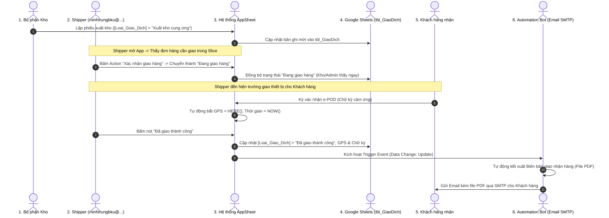

# TÀI LIỆU PHÂN TÍCH YÊU CẦU NGHIỆP VỤ: LUỒNG TÁC NGHIỆP GIAO NHẬN e-POD KHÉP KÍN & TỰ ĐỘNG HÓA EMAIL
**Mã tài liệu:** `ycptnv.a.md`  
**Dự án:** Quản lý Vật tư & Thiết bị An ninh - QLVT-V1 (Công ty Trường Tiến)  
**Tài khoản nhân sự thực hiện:** `minhtrungbku@gmail.com` (Nhân viên giao nhận / Shipper)  
**Hệ thống lưu trữ & nền tảng:** Google AppSheet kết hợp Google Sheets `rdbms-schema-truong-tien-v9` (`tbl_GiaoDich`)  
**Ngày lập phân tích:** 20/09/2026  

---

## 1. TỔNG QUAN LUỒNG NGHIỆP VỤ (END-TO-END WORKFLOW)

---

## 2. PHÂN RÃ CÁC NHIỆM VỤ CẦN XỬ LÝ (5 NHIỆM VỤ CỐT LÕI)

Để hiện thực hóa trọn vẹn luồng nghiệp vụ trên, hệ thống cần xử lý tuần tự **5 Nhiệm vụ** sau:

---

### 🔹 NHIỆM VỤ 1: Cấu hình Slice & View tiếp nhận đơn cho Shipper
* **Mục tiêu:** Khi Thủ kho tạo phiếu `Xuất kho cung ứng`, đơn hàng này phải xuất hiện ngay trên giao diện của nhân viên giao nhận (`minhtrungbku@gmail.com`).
* **Các hạng mục xử lý:**
  1. Cập nhật `Row filter condition` của Slice (`Slice_ChoGiaoHang`) để hiển thị các đơn có trạng thái:
     * `[Loai_Giao_Dich] = "Xuất kho cung ứng"` (Đơn mới sẵn sàng giao).
     * `[Loai_Giao_Dich] = "Đang giao hàng"` (Đơn đang trên đường giao).
     * `[Loai_Giao_Dich] = "Đã giao thành công"` trong ngày hôm nay (`DATE([Ngay_KH_Nhan]) = TODAY()`).
  2. Ràng buộc điều kiện sở hữu đơn: `[Email_NhanVien] = USEREMAIL()`.

---

### 🔹 NHIỆM VỤ 2: Thiết lập Action "Xác nhận nhận đơn / Bắt đầu giao hàng"
* **Mục tiêu:** Cho phép Shipper bấm 1 chạm (Quick Action) để tiếp nhận cuốc xe, chuyển trạng thái sang `Đang giao hàng`, thông báo cho Ban Giám Đốc và Thủ kho biết hàng đang trên đường vận chuyển.
* **Các hạng mục xử lý:**
  1. Tạo Custom Action trong AppSheet:
     * **Tên Action:** `Xác nhận giao hàng` (hoặc `Bắt đầu giao`).
     * **Target Table:** `tbl_GiaoDich`.
     * **Do this:** `Data: set the values of some columns in this row`.
     * **Set Columns:** `[Loai_Giao_Dich] = "Đang giao hàng"`.
  2. Điều kiện hiển thị Action (`Only if this condition is true`):
     * Chỉ hiện khi `[Loai_Giao_Dich] = "Xuất kho cung ứng"` và người dùng là nhân viên được gán đơn.

---

### 🔹 NHIỆM VỤ 3: Cấu hình Giao diện e-POD hiện trường (Chữ ký cảm ứng & Tọa độ GPS)
* **Mục tiêu:** Khi đến hiện trường, mở màn hình thu thập bằng chứng giao nhận điện tử minh bạch.
* **Các hạng mục xử lý:**
  1. Cấu hình cột **`Chu_Ky_POD`** (hoặc `Signature`):
     * Kiểu dữ liệu: `Signature`.
     * Thuộc tính: Bắt buộc ký khi hoàn tất giao nhận (`Required_If`: `[Loai_Giao_Dich] = "Đang giao hàng"`).
  2. Cấu hình cột **`Vi_Tri_GPS`**:
     * Kiểu dữ liệu: `LatLong`.
     * Giá trị khởi tạo / Reset on edit: `= HERE()` để tự động bắt tọa độ vệ tinh tại hiện trường.
  3. Cấu hình cột **`Ngay_KH_Nhan`**:
     * Kiểu dữ liệu: `DateTime`.
     * Giá trị tự động gán: `= NOW()`.

---

### 🔹 NHIỆM VỤ 4: Thiết lập Action / Trạng thái "Xác nhận đã giao thành công"
* **Mục tiêu:** Đóng giao dịch, chuyển trạng thái thành `Đã giao thành công`, cập nhật trạng thái thiết bị trong kho và trên Google Sheets `rdbms-schema-truong-tien-v9`.
* **Các hạng mục xử lý:**
  1. Cập nhật `[Loai_Giao_Dich] = "Đã giao thành công"`.
  2. Kiểm tra tính toàn vẹn dữ liệu: Không cho phép bấm hoàn tất nếu chưa có chữ ký `[Chu_Ky_POD]` hoặc chưa có tọa độ `[Vi_Tri_GPS]`.
  3. Cập nhật trạng thái cá thể thiết bị trong `tbl_ThietBi_ChiTiet` sang `"Đã bàn giao khách hàng"`.

---

### 🔹 NHIỆM VỤ 5: Cấu hình Automation Bot sinh PDF Biên bản bàn giao & Gửi Email SMTP
* **Mục tiêu:** Tự động tạo file PDF biên bản giao nhận chuẩn A4 và gửi email cảm ơn/xác nhận tới khách hàng ngay khi đơn hàng chuyển sang `Đã giao thành công`.
* **Các hạng mục xử lý:**
  1. **Event Trigger:** Bắt sự kiện cập nhật trên bảng `tbl_GiaoDich` khi `[Loai_Giao_Dich] = "Đã giao thành công"`.
  2. **Tạo Template Google Docs:** Thiết kế mẫu Biên bản giao nhận vật tư thiết bị an ninh chuẩn A4 (thể hiện Logo Trường Tiến, Tên khách hàng, Danh mục thiết bị, Serial, MAC, Tọa độ GPS và Chữ ký e-POD).
  3. **Cấu hình Email Task:**
     * **To:** `[ID_KhachHang].[Email_KhachHang]` (hoặc email liên hệ).
     * **CC / BCC:** `admin@truongtien.com`, `kho@truongtien.com`.
     * **Subject:** `[Trường Tiến] Biên bản bàn giao vật tư thiết bị an ninh - Phiếu [ID_GiaoDich]`.
     * **Attachment:** Tự động đính kèm file PDF vừa sinh.

---

## 3. BẢNG TỔNG HỢP TIẾN ĐỘ THỰC THI (ROADMAP)

| STT | Tên Nhiệm Vụ | Phân Hệ Liên Quan | Mức Độ Ưu Tiên | Trạng Thái |
| :---: | :---|:---|:---:|:---:|
| **NV 1** | Cấu hình Slice & View tiếp nhận đơn cho Shipper | Data / Slices / UX | Cao | ⏳ Chờ xác nhận |
| **NV 2** | Thiết lập Action "Xác nhận bắt đầu giao hàng" | Behavior / Actions | Cao | ⏳ Chờ xác nhận |
| **NV 3** | Cấu hình Form e-POD: Chữ ký cảm ứng & Tự động GPS | Data / Columns | Cao | ⏳ Chờ xác nhận |
| **NV 4** | Thiết lập Action "Xác nhận đã giao thành công" | Behavior / Data | Cao | ⏳ Chờ xác nhận |
| **NV 5** | Cấu hình Automation Bot sinh PDF & Gửi Email SMTP | Automation / Bots | Trung bình | ⏳ Chờ xác nhận |

---

> 📌 **Kế hoạch tiếp theo:** Toàn bộ 5 nhiệm vụ trên đã được chuẩn bị đầy đủ kịch bản kỹ thuật và công thức chi tiết. Khi bạn sẵn sàng và nói **"đồng ý xử lý lần lượt từng nhiệm vụ"**, chúng ta sẽ bắt đầu ngay từ **Nhiệm vụ 1**!