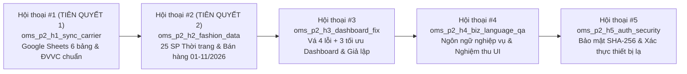

# TIÊU CHUẨN CHỦ DỰ ÁN ODOMS — GIAI ĐOẠN 2 (`oms_p2_ui` Master Standard)

> **Phạm vi dự án**: Hệ thống Quản lý Đơn hàng Đa kênh Thông minh (ODOMS)  
> **Thư mục làm việc duy nhất**: `S:\HTTT\`  
> **Cuộc hội thoại tiêu chuẩn gốc**: `oms_p2_ui`  
> **URL Đồng bộ Google Sheets hiện hành**: `https://script.google.com/macros/s/AKfycbz6rZY-zx9nslSBnilGuggzeXFGbAe_3IwaQazglnCoh9lwZ7rrB6IDaAIAdqrfegUb/exec`  
> **Mục đích tệp tin**: Làm tài liệu tiêu chuẩn gốc để phân rã, điều phối và nghiệm thu kết quả của **5 cuộc hội thoại con độc lập** (`#1` → `#5`).

---

# PHẦN I. KIẾN TRÚC 4 TẦNG DỮ LIỆU (THỜI TRANG 25 SẢN PHẨM & LỊCH SỬ TỪ THÁNG 01/2026 ĐẾN 22/11/2026)

Khi mở trực tiếp `S:\HTTT\01_ODOMS_WEB_APP\index.html` trên trình duyệt, Web App **không tự động đọc** các tệp `.csv` trong thư mục `S:\HTTT\01_ODOMS_WEB_APP\du_lieu_mau_excel\` lúc khởi động (các tệp `.csv` này chỉ phục vụ khi người dùng tải tệp Excel thủ công tại màn hình *Tiếp nhận / Gom đơn* hoặc đối chiếu mẫu).

Vì vậy, để dữ liệu chuyên ngành **Thời trang (5 danh mục, 25 mã sản phẩm)** tham chiếu từ `S:\HTTT\fashion68.js` và dữ liệu bán hàng lịch sử từ **Tháng 01/2026 đến ngày 22/11/2026** đồng bộ xuyên suốt trên mọi màn hình, dữ liệu bắt buộc phải được cập nhật đồng nhất tại **4 tầng**:

| Tầng dữ liệu | Vị trí tệp / nơi lưu trữ | Vai trò bắt buộc |
| :--- | :--- | :--- |
| **Tầng 1: Khởi tạo & Danh mục gốc** | `S:\HTTT\01_ODOMS_WEB_APP\js\mock_data.js` *(tham chiếu chuẩn từ `S:\HTTT\fashion68.js`)* | Khai báo **25 sản phẩm Thời trang** (5 danh mục: *Áo, Quần, Váy & Đầm, Giày & Dép, Phụ kiện thời trang*), giữ nguyên kịch bản kiểm thử tranh chấp tồn kho `SP-AO-POLO-01` (tồn vật lý 10 cái, gồm 2 lô `LO-2026-A1` và `LO-2026-A2`), cập nhật bộ đơn mẫu 5 sàn và vận đơn mẫu có đủ ĐVVC. |
| **Tầng 2: Cơ sở dữ liệu vận hành tập trung** | **Google Sheets (6 trang tính)** qua `S:\HTTT\02_REALTIME_BACKEND_SYNC\ODOMS_Backend_API.gs` | Nơi lưu dữ liệu thật để Web App đồng bộ 2 chiều (`DatHang`, `TonKho`, `LuuKho`, `VanDon`, `NhanSu`, `NhatKy`). Cung cấp sẵn hàm `seedFashion2026Data()` để chạy 1 lần trên Apps Script là xóa sạch 5 mã cũ và nạp đủ 25 mã Thời trang + chuỗi đơn hàng/vận đơn từ `01/2026` đến `22/11/2026`. |
| **Tầng 3: Lịch sử doanh thu & bộ lọc thời gian** | `S:\HTTT\01_ODOMS_WEB_APP\js\app.js` *(hàm `getMonthlyHistoricalDataset()`)* & `S:\HTTT\01_ODOMS_WEB_APP\index.html` | Mở rộng chuỗi lịch sử doanh thu và Xếp hạng sản phẩm bán chạy từ **Tháng 01/2026 đến 22/11/2026** (bổ sung đầy đủ Quý 1–4/2026 và Tháng 01–11/2026 ở các bộ lọc) để Biểu đồ Combo *Xu hướng Đơn hàng & Doanh thu* có đường gấp khúc đa điểm chân thực. |
| **Tầng 4: Bộ tệp Excel/CSV mẫu thực hành** | `S:\HTTT\01_ODOMS_WEB_APP\du_lieu_mau_excel\*.csv` *(5 tệp `.csv`)* | Cập nhật đồng bộ toàn bộ 5 tệp `.csv` sang 25 mã Thời trang, bổ sung cột `Đơn vị vận chuyển` chuẩn theo từng sàn và trải ngày đặt từ Tháng 01/2026 đến 22/11/2026 để đồng nhất khi kiểm thử tải tệp từ máy tính. |

---

# PHẦN II. ĐÁNH GIÁ NỘI DUNG & THỨ TỰ ĐIỀU KIỆN TIÊN QUYẾT

Để đảm bảo tính nhất quán dữ liệu và tránh phải sửa lại nhiều lần cùng một tệp hoặc nạp lại Google Sheets nhiều lượt, toàn bộ hạng mục được chia thành **5 giai đoạn nối tiếp theo thứ tự điều kiện tiên quyết nghiêm ngặt**:

### Lý do phụ thuộc (Điều kiện tiên quyết):
1. **Hội thoại #1 là điều kiện tiên quyết số 1**: Hiện `ODOMS_Backend_API.gs` mới có 5 trang tính (`DatHang`, `TonKho`, `LuuKho`, `NhanSu`, `NhatKy`), chưa có cột `DonViVanChuyen` trong `DatHang` và chưa có trang tính `VanDon`. Phải chốt xong kiến trúc 6 trang tính, cơ chế bắt ĐVVC theo nguồn đơn và Deploy xong bản Google Apps Script mới trước khi nạp bất kỳ dữ liệu Thời trang nào.
2. **Hội thoại #2 là điều kiện tiên quyết số 2**: Sau khi Google Sheets có đủ 6 trang tính chuẩn, mới chuyển đổi đồng bộ 25 sản phẩm Thời trang + dữ liệu bán hàng từ `01/2026` đến `22/11/2026` vào `mock_data.js`, 5 tệp `.csv`, `app.js`, `index.html` và nạp sạch lên Google Sheets bằng `seedFashion2026Data()`.
3. **Hội thoại #3 phụ thuộc #1 và #2**: Khi Google Sheets đã có dữ liệu Thời trang đa ngày cùng đủ 6 bảng (có `VanDon` và `DonViVanChuyen`), việc vá 4 lỗi logic + 3 điểm tối ưu trên Giao diện Tổng quan và chạy giả lập kiểm chứng bằng Node.js mới phản ánh chính xác 100% thực tế vận hành.
4. **Hội thoại #4 thực hiện sau #1–#3**: Quét sạch 100% thuật ngữ kỹ thuật IT còn tồn đọng trên toàn bộ hệ thống (cả mã cũ lẫn mã mới), chuẩn hóa đồng nhất giao diện phẳng góc vuông trên tất cả màn hình và nghiệm thu luồng nghiệp vụ trước khi khóa bảo mật.
5. **Hội thoại #5 thực hiện cuối cùng (sau #1–#4)**: Khi giao diện, dữ liệu, đồng bộ 6 bảng và ngôn ngữ nghiệp vụ đã ổn định hoàn toàn, tiến hành khóa chặt tầng đăng nhập bằng mã băm SHA-256 phía máy chủ và bổ sung lớp xác thực thiết bị lạ qua điện thoại (Gmail / Telegram Bot) mà không làm gián đoạn quá trình phát triển và kiểm thử ở các giai đoạn trước.

---

# PHẦN III. PHÂN RÃ CHI TIẾT 5 CUỘC HỘI THOẠI CON (KÈM TIÊU CHÍ NGHIỆM THU)

## Quy tắc chung BẮT BUỘC cho cả 5 cuộc hội thoại con

1. **3 Quy tắc kiểm soát Agent:**
   - Chỉ truy cập và thao tác trong thư mục `S:\HTTT\`.
   - Trình bày trước phương án, kiến trúc, cấu trúc trang tính (nếu có) và danh sách tệp cần sửa — chỉ sửa sau khi người dùng xác nhận đồng ý.
   - Báo cáo chi tiết sau khi sửa: nêu rõ từng tệp, thuộc thư mục nào trong `S:\HTTT`, nội dung thay đổi và số dòng cụ thể.

2. **Quy chuẩn ngôn ngữ nghiệp vụ vận hành (kế thừa `ReOMStqP1_UI_NV_KHO` & `ReOMStqP1_UI_NV_TNGD`):**
   - Toàn bộ nhãn nút bấm, trạng thái đồng bộ, thông báo lỗi/thành công, hướng dẫn cấu hình hiển thị trên giao diện ODOMS phải dùng ngôn ngữ nghiệp vụ vận hành cho người quản lý.
   - Tuyệt đối cấm thuật ngữ IT hiển thị lên giao diện: `Webhook`, `API Endpoint`, `JSON Payload`, `Request timeout`, `HTTP 200/500`, `LocalStorage`, `CloudSyncAdapter`, `Live Analytics`, `Cache`, `Batch FEFO`, `ATP`, `Mock data`, `Schema`, `Null/Undefined`, v.v.

3. **Bảo toàn tuyệt đối:**
   - Quy tắc phân quyền & hiển thị 4 tài khoản (`dttd` quản trị chính hiển thị đăng nhập nhanh; `lhmt` quản trị dự phòng ẩn khỏi danh sách đăng nhập nhanh và hiển thị lời chào `"Chào bạn, Admin"`; `ntqg`, `nttn` nhân viên nghiệp vụ).
   - Kịch bản kiểm thử tranh chấp tồn kho mã `SP-AO-POLO-01` (tồn vật lý 10 cái giữa 4 kênh).

4. **Quy chuẩn thiết kế giao diện phẳng tối giản (Áp dụng đồng nhất trên toàn bộ màn hình):**
   - **Hình khối & Bề mặt:** Giữ nguyên nền sáng và hệ thống viền hiện tại cho tất cả thẻ chức năng nghiệp vụ; **tuyệt đối không bo góc (để hoàn toàn góc vuông `border-radius: 0px`)**, không dùng hiệu ứng đổ bóng (`box-shadow: none`) hay dải màu chuyển sắc (gradient).
   - **Hiệu ứng tương tác (Hover):** Khi rê chuột đến bất kỳ thẻ chức năng nghiệp vụ nào, thẻ đó phải **đổi màu nền/viền nổi bật (highlight) đồng bộ theo đúng phong cách màu đang áp dụng khi rê chuột vào các mục nghiệp vụ trên thanh điều hướng bên (Sidebar)** (thực hiện bằng đổi màu nền và viền, không dùng đổ bóng phát quang).
   - **Hiển thị số liệu:** Toàn bộ con số thống kê, tiền tệ và tồn kho phải căn thẳng cột (`tabular-nums`).

---

## Cuộc hội thoại con #1: `oms_p2_h1_sync_carrier`

- **Điều kiện tiên quyết:** Không (Làm đầu tiên).
- **Mục tiêu:**
  1. Thiết kế lại đồng bộ 2 chiều Google Sheets chuẩn **6 trang tính** (`DatHang`, `TonKho`, `LuuKho`, `VanDon`, `NhanSu`, `NhatKy`), bổ sung cột `DonViVanChuyen` vào `DatHang` và tạo mới trang tính `VanDon` để lưu trữ/đồng bộ vận đơn tập trung.
  2. Xây dựng cơ chế bắt ĐVVC (`carrier`) đúng chuẩn nghiệp vụ 3 tầng theo nguồn phát sinh đơn:
     - Đơn Sàn TMĐT (Shopee, TikTok Shop, Lazada): đọc trực tiếp từ trường ĐVVC của sàn/tệp Excel nhập vào.
     - Đơn POS: tự động gán `Tại quầy`.
     - Đơn Facebook / ngoài sàn chưa tạo vận đơn: để trạng thái `Chưa gán ĐVVC`, tự động cập nhật ngay ĐVVC thật khi tạo/đẩy vận đơn vào bảng `VanDon`.
  3. Xuất mã Google Apps Script tách biệt sạch sẽ (`ODOMS_Backend_API.gs`) để người dùng copy dán lên Google Sheets và triển khai (Deploy) 1 lần.
- **Tệp dự kiến tác động:**
  - `S:\HTTT\02_REALTIME_BACKEND_SYNC\ODOMS_Backend_API.gs` *(và xuất tệp `.gs` tách biệt nếu cần)*
  - `S:\HTTT\01_ODOMS_WEB_APP\js\oms_engine.js`
  - `S:\HTTT\01_ODOMS_WEB_APP\js\app.js` *(phần đồng bộ `shipments` 2 chiều & hướng dẫn kết nối bằng ngôn ngữ nghiệp vụ)*
- **Tiêu chí nghiệm thu:**
  - Có sơ đồ luồng đồng bộ + bảng cấu trúc 6 trang tính được người dùng duyệt trước khi viết code.
  - Kiểm thử đẩy (`SYNC_ALL`) & kéo (`PULL_ALL`) thành công đủ 6 bảng giữa Web App và Google Sheets, không mất cột `DonViVanChuyen` và trang tính `VanDon`.
  - Màn hình cấu hình kết nối Google Sheets không còn bất kỳ từ kỹ thuật IT nào.

---

## Cuộc hội thoại con #2: `oms_p2_h2_fashion_data`

- **Điều kiện tiên quyết:** Hoàn tất Hội thoại `#1` (đã Deploy Google Sheets 6 bảng có cột ĐVVC).
- **Mục tiêu:**
  1. Chuyển đổi 100% danh mục sản phẩm sang chuyên ngành **Thời trang** (5 danh mục: *Áo, Quần, Váy & Đầm, Giày & Dép, Phụ kiện thời trang*; 25 mã sản phẩm) theo đúng `S:\HTTT\fashion68.js`, giữ nguyên kịch bản tranh chấp tồn kho `SP-AO-POLO-01` (10 cái, 2 lô `LO-2026-A1` & `LO-2026-A2`).
  2. Tạo bộ dữ liệu bán hàng & doanh thu lịch sử trải dài **từ Tháng 01/2026 đến ngày 22/11/2026** (đủ 5 sàn, có cột ĐVVC chuẩn theo nguồn đơn, trải nhiều ngày/tháng để biểu đồ Combo *Xu hướng Đơn hàng & Doanh thu* có đường gấp khúc đa điểm chân thực).
  3. Cập nhật đồng bộ toàn bộ 5 tệp `.csv` mẫu trong `S:\HTTT\01_ODOMS_WEB_APP\du_lieu_mau_excel\`, đồng bộ lại dữ liệu mẫu trong `mock_data.js`, mở rộng `getMonthlyHistoricalDataset()` về Tháng 01/2026, đồng thời **viết sẵn hàm `seedFashion2026Data()` trong `ODOMS_Backend_API.gs`** để khi bấm Chạy (Run) một lần trên Apps Script sẽ tự động xóa dữ liệu 5 mã cũ và nạp sạch trọn bộ 25 mã Thời trang + chuỗi đơn hàng/vận đơn **từ Tháng 01/2026 đến ngày 22/11/2026** lên đủ 6 trang tính Google Sheets.
- **Tệp dự kiến tác động:**
  - `S:\HTTT\01_ODOMS_WEB_APP\js\mock_data.js`
  - 5 tệp `.csv` trong `S:\HTTT\01_ODOMS_WEB_APP\du_lieu_mau_excel\`
  - `S:\HTTT\02_REALTIME_BACKEND_SYNC\ODOMS_Backend_API.gs` *(bổ sung hàm `seedFashion2026Data()`)*
  - `S:\HTTT\01_ODOMS_WEB_APP\js\app.js` *(mở rộng `getMonthlyHistoricalDataset()` và Top sản phẩm sang Thời trang từ Th01/2026 đến 22/11/2026)*
  - `S:\HTTT\01_ODOMS_WEB_APP\index.html` *(bổ sung tùy chọn Tháng 01–04/2026, Tháng 11/2026 & Quý 1–4/2026 ở các bộ lọc Doanh thu)*
- **Tiêu chí nghiệm thu:**
  - Toàn bộ 5 màn hình (*Tồn kho, Tiếp nhận/Gom đơn Excel mẫu, Phân bổ lô hàng, Vận đơn, Báo cáo*) hiển thị 100% sản phẩm Thời trang, không còn dấu vết Tai nghe / Bàn phím / Bình giữ nhiệt.
  - Kịch bản tranh chấp tồn kho `SP-AO-POLO-01` (đủ 10 cái cho các đơn đầu, chặn thiếu tồn đơn sau) vẫn chạy chính xác.
  - Bấm Chạy hàm `seedFashion2026Data()` trên Apps Script nạp sạch lên Google Sheets đủ 25 mã Thời trang và chuỗi đơn/vận đơn từ Tháng 01/2026 đến ngày 22/11/2026.

---

## Cuộc hội thoại con #3: `oms_p2_h3_dashboard_fix`

- **Điều kiện tiên quyết:** Hoàn tất Hội thoại `#1` & Hội thoại `#2`.
- **Mục tiêu:**
  1. Vá triệt để **4 lỗi logic** đã phát hiện qua giả lập trong `S:\HTTT\01_ODOMS_WEB_APP\js\app.js`:
     - Sửa tính Tồn kho khả dụng (KPI 7) & Sản phẩm sắp hết hàng (Cột Phải) dùng đúng `availableStock` / `physicalStock - reservedStock` thay cho `allocatedQty`.
     - Sửa lọc trạng thái vận chuyển (`PENDING_PICKUP`, `IN_TRANSIT`, `DELIVERED`, `FAILED_RETURNING`) cho KPI 3 *Đang giao*, KPI 5 *Hủy / Trả hàng*, và Cảnh báo đỏ *đơn giao thất bại*.
     - Thay thế trường `s.isLate` không tồn tại bằng logic thực tế (`FAILED_RETURNING + PENDING_PICKUP`).
     - Áp dụng `resolveOrderCarrier(ord)` chuẩn nghiệp vụ 3 tầng (`VanDon` → `ord.carrier` → `Tại quầy` / `Chưa gán ĐVVC`).
  2. Hoàn thiện **3 điểm nhỏ**:
     - Đưa `this.renderDashboardP2()` xuống sau `this.renderShippingTab()` trong `renderAll()`.
     - Đồng bộ checkbox `#dashSelectAllUrgent` theo đúng danh sách đang lọc nâng cao và tự bỏ tích sau khi *Xử lý hàng loạt*.
     - Sửa bộ lọc `Kho Phường Bình Phú` loại trừ cả `Q7` và `HN`/`HANOI`.
  3. Hoàn thiện Biểu đồ Combo *Xu hướng Đơn hàng & Doanh thu* hiển thị mượt mà chuỗi nhiều mốc thời gian (và tự thích ứng nếu lọc về 1 ngày duy nhất).
  4. Chạy giả lập trực tiếp bằng Node.js trên toàn bộ mã nguồn thật kết nối Google Sheets thật để kiểm chứng từng con số trên 7 thẻ KPI, 2 biểu đồ, 3 cảnh báo và bảng 9 cột. **Nếu kết quả giả lập phát hiện bất kỳ điểm nào còn thiếu hoặc sai lệch số liệu, phải dừng lại báo cáo và hỏi ý kiến người dùng xác nhận trước khi sửa tiếp.**
- **Tệp dự kiến tác động:**
  - `S:\HTTT\01_ODOMS_WEB_APP\js\app.js` *(và điều chỉnh nhỏ ở `S:\HTTT\01_ODOMS_WEB_APP\index.html` / `S:\HTTT\01_ODOMS_WEB_APP\css\style.css` để chuẩn hóa góc vuông phẳng tối giản nếu kết quả giả lập hoặc kiểm tra hiển thị yêu cầu)*
- **Tiêu chí nghiệm thu:**
  - Bản chạy giả lập Node.js xác nhận 0 lỗi thực thi, 0 trùng ID, 0 `NaN`/`undefined`; số liệu KPI 7 khớp đúng tổng `availableStock`, cảnh báo sắp hết hàng hiện đúng các mã tồn thấp kèm nút *Nhập*, KPI 3 & KPI 5 khớp đúng dữ liệu bảng `VanDon`.
  - Mọi thẻ chức năng trên Dashboard vuông góc (`border-radius: 0px`), không đổ bóng (`box-shadow: none`), số liệu căn thẳng cột (`tabular-nums`) và đổi màu hover đồng bộ với Sidebar.

---

## Cuộc hội thoại con #4: `oms_p2_h4_biz_language_qa`

- **Điều kiện tiên quyết:** Hoàn tất Hội thoại `#1`, `#2`, `#3`.
- **Mục tiêu:**
  1. Tổng kiểm tra và chuyển hóa 100% văn bản hiển thị giao diện (nhãn nút, tiêu đề thẻ, nhãn trạng thái, thông báo kết nối, hộp thoại lỗi/thành công, nhật ký hiển thị cho quản lý) sang ngôn ngữ nghiệp vụ vận hành kế thừa tiêu chuẩn `ReOMStqP1_UI_NV_KHO` & `ReOMStqP1_UI_NV_TNGD`.
  2. Quét tự động toàn bộ mã nguồn để chứng minh 0 lần xuất hiện các từ kỹ thuật IT (`Webhook`, `API Endpoint`, `JSON Payload`, `Request timeout`, `HTTP 200/500`, `LocalStorage`, `CloudSyncAdapter`, `Live Analytics`, `Cache`, `Batch FEFO`, `ATP`, `Mock data`, `Schema`, `Null/Undefined`...) trên văn bản hiển thị cho người dùng, đồng thời kiểm tra tính nhất quán của thiết kế góc vuông phẳng tối giản trên toàn hệ thống.
  3. Chạy kiểm thử giả lập tổng thể cuối cùng (kiểm tra đủ 4 tài khoản phân quyền `dttd`, `lhmt`, `ntqg`, `nttn` + toàn bộ luồng nghiệp vụ).
- **Tệp dự kiến tác động:**
  - `S:\HTTT\01_ODOMS_WEB_APP\index.html`
  - `S:\HTTT\01_ODOMS_WEB_APP\js\app.js`
  - `S:\HTTT\01_ODOMS_WEB_APP\js\oms_engine.js`
  - `S:\HTTT\01_ODOMS_WEB_APP\js\excel_handler.js`
  - `S:\HTTT\01_ODOMS_WEB_APP\css\style.css` *(chỉ thay chuỗi văn bản hiển thị UI và đồng bộ style phẳng góc vuông, không đổi tên biến/hàm nội bộ)*
- **Tiêu chí nghiệm thu:**
  - Báo cáo quét sạch thuật ngữ IT trên toàn giao diện (kèm bảng đối chiếu *Trước → Sau*).
  - Toàn bộ giao diện nhất quán góc vuông `border-radius: 0px`, không đổ bóng, không gradient, hover đồng bộ Sidebar, số liệu `tabular-nums`.
  - Nghiệm thu toàn bộ 4 vai trò đăng nhập & đồng bộ 2 chiều Google Sheets hoạt động ổn định.

---

## Cuộc hội thoại con #5: `oms_p2_h5_auth_security`

- **Điều kiện tiên quyết:** Hoàn tất Hội thoại `#1`, `#2`, `#3`, `#4`.
- **Mục tiêu:**
  1. **Ẩn thông tin đăng nhập bằng mã băm một chiều (SHA-256) chạy ổn định trên `file:///`:**
     - **Bắt buộc dùng hàm băm SHA-256 viết thuần JavaScript (Pure JS)** phía trình duyệt *(tuyệt đối không dùng `window.crypto.subtle` vì bị trình duyệt khóa trên giao thức cục bộ `file:///S:/HTTT/01_ODOMS_WEB_APP/index.html`)*, đảm bảo kết quả khớp tuyệt đối với `Utilities.computeDigest(Utilities.DigestAlgorithm.SHA_256, ...)` phía `ODOMS_Backend_API.gs`.
     - Xóa bỏ hoàn toàn trường `username` và `password` dạng chữ rõ trong `mock_data.js`, `LocalStorage`, mã nguồn trình duyệt và dữ liệu trả về trình duyệt; thay thế bằng cặp mã băm `MaBamTaiKhoan` (`userHash = SHA256(username)`) và `MaBamDangNhap` (`authHash = SHA256(username + ":" + password)`) để khi nhấn F12 (Sources, Console, Application, Network) không thể đọc được tên đăng nhập hay mật khẩu gốc.
     - **Gỡ bỏ hoàn toàn khối "Đăng nhập nhanh"** chứa sẵn `username / password` trên Màn hình Đăng nhập (`renderLoginQuickAccounts`).
     - **Tách riêng cổng xác thực `AUTH_LOGIN` / `AUTH_VERIFY_OTP` / `AUTH_TRUST_LOGIN`** trên `ODOMS_Backend_API.gs`; gói tin `PULL_ALL` bắt buộc **lọc bỏ hoàn toàn** các cột nhạy cảm (`TenDangNhap`, `MatKhau`, `MaBamTaiKhoan`, `MaBamDangNhap`, `ThietBiTinCay`, `TenDangNhapTam`, `MatKhauTam`), chỉ trả hồ sơ hiển thị nhân sự (`MaNhanSu`, `HoVaTen`, `KyHieuAvatar`, `VaiTro`, `PhongBan`, `CaLamViec`, `TrangThaiTaiKhoan`, `DiaChiNhanMa`, `QuyenQuanTriGoc`, `TaiKhoanDuPhongAn`).
     - **Xóa sạch chuỗi tên đăng nhập viết cứng** (`"dttd"`, `"lhmt"`, `"ntqg"`, `"nttn"`) khỏi mã nguồn phía trình duyệt (`app.js`, `oms_engine.js`); chuyển hoàn toàn việc ẩn tài khoản dự phòng và hiển thị lời chào `"Chào bạn, Admin"` sang kiểm tra cờ trạng thái do máy chủ trả về (`isHiddenBackup: true`, `isRoot: true`), đồng thời bảo toàn nguyên vẹn phân quyền 4 tài khoản.
  2. **Xác thực thiết bị lạ, gửi mã bảo mật 6 số & Cơ chế thu hồi phiên ghi nhớ an toàn:**
     - **Tự động nhận diện kênh gửi mã theo cột `DiaChiNhanMa`**:
       - Nếu `DiaChiNhanMa` là **Email (có ký tự `@`)** → gửi tự động qua **Gmail (`MailApp.sendEmail`)** tích hợp sẵn trong Google Apps Script để chạy được ngay không cần cấu hình Bot.
       - Nếu `DiaChiNhanMa` là **dãy số Chat ID** và đã cấu hình `TELEGRAM_BOT_TOKEN` trong `PropertiesService` (Script Properties) → gửi trực tiếp qua **Telegram Bot**.
     - Khi nhân sự đăng nhập trên thiết bị/trình duyệt mới chưa từng xác thực, `ODOMS_Backend_API.gs` tự sinh mã xác thực 6 số, lưu tạm bằng **`CacheService.getScriptCache()`** với thời hạn đúng **180 giây (3 phút)** để tự hủy (không ghi rác vào Google Sheets), giới hạn nhập sai tối đa **5 lần**, hỗ trợ nút **"Gửi lại mã xác thực"** (đếm ngược 60 giây).
     - **Luồng hộp thoại xác nhận "Tin cậy thiết bị này?" sau khi nhập đúng mã 6 số:**
       - Ngay sau khi tài khoản *(đặc biệt là tài khoản dự phòng `lhmt` và các tài khoản đăng nhập lần đầu trên thiết bị mới)* nhập đúng Mã 6 số tạm thời từ Gmail/Telegram, giao diện hiển thị hộp thoại **"Tin cậy thiết bị này?"** theo chuẩn phẳng góc vuông (`border-radius: 0px`, `box-shadow: none`, hiệu ứng hover đồng bộ Sidebar) gồm:
         - Ô tích chọn bên dưới: `[ ]` **"Không cần xác nhận nữa"**
         - Hai nút thao tác: **"Có"** và **"Không"**
       - **Xử lý chặt chẽ 3 trường hợp:**
         1. **Bấm "Không"**: Không lưu thiết bị vào cột `ThietBiTinCay` trên Google Sheets, hủy phiên tạm và quay trở lại màn hình đăng nhập ban đầu *(bắt buộc đăng nhập và xác thực lại mã 6 số ở lần sau)*.
         2. **Bấm "Có" *(không tích "Không cần xác nhận nữa")***: Lưu thiết bị tin cậy lên cột `ThietBiTinCay` trên Google Sheets và vào thẳng giao diện nghiệp vụ ODOMS *(lần sau trên máy này bỏ qua bước gửi mã 6 số, nhưng vẫn yêu cầu nhập mật khẩu)*.
         3. **Bấm "Có" kèm tích chọn `[✓]` "Không cần xác nhận nữa"**: Máy chủ cấp và lưu mã phiên tin cậy thiết bị (`deviceTrustToken`, hạn mặc định **30 ngày**) gắn với `ThietBiTinCay` trên Google Sheets rồi vào thẳng giao diện nghiệp vụ ODOMS. Khi người dùng tắt máy và khởi động lại, màn hình đăng nhập tự nhận diện thiết bị đã xác thực, hiển thị lại địa chỉ Gmail đã xác thực trước đó và chỉ cần bấm nút **"Đăng nhập"** (đối chiếu `deviceTrustToken` qua máy chủ) là vào hệ thống mà không cần nhập lại mật khẩu hay mã 6 số *(tuyệt đối không lưu mật khẩu chữ rõ hay tên đăng nhập chữ rõ vào `LocalStorage` để giữ nguyên chuẩn chống soi F12)*.
     - **Thu hồi phiên ghi nhớ & Đăng xuất an toàn:**
       - Cổng đăng nhập 1 chạm (`AUTH_TRUST_LOGIN`) bằng `deviceTrustToken` **bắt buộc kiểm tra lại trên Google Sheets**: tài khoản đang ở trạng thái hoạt động, mã phiên vẫn tồn tại trong `ThietBiTinCay` và **chưa quá hạn (mặc định 30 ngày)**.
       - Khi Quản trị viên **đổi mật khẩu hoặc khóa tài khoản**, hệ thống tự động xóa toàn bộ `ThietBiTinCay` của nhân sự đó.
       - Bổ sung nút **"Đăng xuất khỏi mọi thiết bị"** tại tab **Nhân sự** *(dành cho Quản trị viên, gọi cổng `STAFF_REVOKE_DEVICES`)* và tùy chọn **"Đổi tài khoản / Hủy ghi nhớ thiết bị này"** trên màn hình đăng nhập 1 chạm.
  3. **Ghi nhận IP mạng đăng nhập, Nhật ký truy cập & Nhận diện IP tĩnh Kho / Văn phòng tin cậy:**
     - **Thu thập địa chỉ IP đường truyền (IP tĩnh / IP nhà mạng) khi đăng nhập**: Ngay khi nhân sự bấm **"Đăng nhập"**, trình duyệt gọi nhanh dịch vụ tra cứu IP công cộng *(giới hạn thời gian chờ tối đa `1.5 giây`; nếu mất kết nối dịch vụ tra cứu thì tự động gán `"Không xác định"` để không làm gián đoạn thao tác)* và gửi kèm `clientIp` lên cổng `AUTH_LOGIN` của `ODOMS_Backend_API.gs`.
     - **Ghi nhận lịch sử truy cập vào trang tính `NhatKy` *(hiển thị tại mục "Nhật ký Hệ thống")***:
       - Bổ sung trường địa chỉ mạng truy cập (`DiaChiMang`) vào từng bản ghi đăng nhập *(đăng nhập thành công, cảnh báo truy cập từ mạng/thiết bị lạ, nhập sai mật khẩu / sai mã xác thực, hoặc tạm khóa do vượt số lần thử)*.
       - Trên giao diện bảng **"Nhật ký Hệ thống — Ghi nhận lịch sử đăng nhập"**, hiển thị tên cột bằng ngôn ngữ nghiệp vụ (**"Địa chỉ mạng truy cập"**) và định dạng dãy số địa chỉ mạng theo chuẩn căn thẳng cột (`tabular-nums`).
     - **Cơ chế nhận diện IP tĩnh Kho / Văn phòng tin cậy**:
       - Bổ sung cấu hình danh sách IP tĩnh của Kho / Văn phòng trên Google Sheets *(xử lý tại `ODOMS_Backend_API.gs`)*.
       - Khi nhân sự *(bao gồm cả tài khoản dự phòng `lhmt`)* đăng nhập từ **đúng IP tĩnh của Kho / Văn phòng đã khai báo**, hệ thống tự nhận diện mạng nội bộ tin cậy và cho phép vào thẳng giao diện nghiệp vụ ngay sau khi khớp mã băm *(miễn bước gửi mã 6 số qua Gmail/Telegram)*.
       - Khi đăng nhập từ **IP mạng bên ngoài** *(mạng di động 4G, Wi-Fi ngoài kho)* trên thiết bị chưa được lưu trong `ThietBiTinCay`, hệ thống bắt buộc gửi Mã 6 số về Gmail/Telegram và hiển thị hộp thoại **"Tin cậy thiết bị này?"** *(góc vuông `border-radius: 0px`, `box-shadow: none`, hover đồng bộ Sidebar)*.
  4. **Đồng bộ nhân sự đăng nhập 2 chiều (Google Sheets ⇄ ODOMS) & Chống ghi đè cột bảo mật:**
     - **Chiều 1 — Tạo nhân sự mới trực tiếp trên Google Sheets → Đồng bộ về ODOMS:**
       - Bổ sung trên trang tính `NhanSu` đầy đủ các cột bảo mật & nhập liệu: `MaBamTaiKhoan` (`userHash = SHA256(username)`), `MaBamDangNhap` (`authHash = SHA256(username + ":" + password)`), `DiaChiNhanMa`, `ThietBiTinCay` và **2 cột nhập tạm** (`TenDangNhapTam`, `MatKhauTam`) dành cho quản lý nhập tay trên Google Sheets.
       - Trong `ODOMS_Backend_API.gs`, cài đặt cơ chế **tự động mã hóa** *(qua trình kích hoạt chỉnh sửa bảng tính `onEdit` / trình kích hoạt cài đặt và quét dự phòng mỗi khi gọi cổng đăng nhập/đồng bộ)*: hễ phát hiện dòng nào có dữ liệu ở `TenDangNhapTam` / `MatKhauTam` thì tự động băm SHA-256 ghi vào cả `MaBamTaiKhoan` và `MaBamDangNhap`, đồng thời xóa sạch chữ rõ ở 2 cột tạm *(hiển thị `"Đã mã hóa"`)*.
       - Nhân sự mới tạo trên Google Sheets đăng nhập được ngay qua cổng `AUTH_LOGIN`; hồ sơ hiển thị (*Mã NV, Họ tên, Vai trò, Phòng ban, Ca làm, Trạng thái, Địa chỉ nhận mã*) tự động đồng bộ về tab **Nhân sự** của ODOMS qua `PULL_ALL` *(đã lọc bỏ hoàn toàn `MaBamTaiKhoan`, `MaBamDangNhap`, `ThietBiTinCay`, `TenDangNhapTam`, `MatKhauTam`)*.
     - **Chiều 2 — Tạo nhân sự mới & Quản trị tài khoản trên ODOMS → Đồng bộ lên Google Sheets *(chống ghi đè cột bảo mật)*:**
       - Quy định **`SYNC_ALL` chỉ đồng bộ 5 bảng nghiệp vụ (`DatHang`, `TonKho`, `LuuKho`, `VanDon`, `NhatKy`)**, **tuyệt đối không ghi đè toàn bảng `NhanSu`** từ trình duyệt để tránh xóa trắng các cột bảo mật trên Google Sheets.
       - Mọi thao tác quản trị nhân sự từ màn hình **Nhân sự** trên ODOMS bắt buộc đi qua **4 cổng riêng biệt**: `STAFF_CREATE`, `STAFF_UPDATE_PROFILE`, `STAFF_RESET_AUTH`, `STAFF_REVOKE_DEVICES`.
       - Khi tạo mới hoặc đặt lại mật khẩu trên ODOMS, trình duyệt dùng hàm SHA-256 thuần JS băm ngay `MaBamTaiKhoan` và `MaBamDangNhap` trước khi gửi lên `ODOMS_Backend_API.gs` *(tuyệt đối không gửi mật khẩu chữ rõ qua mạng)*. Máy chủ dựa vào `MaBamTaiKhoan` để kiểm tra trùng tên đăng nhập trước khi ghi dòng mới lên Google Sheets, giúp tài khoản có hiệu lực đăng nhập ngay trên mọi thiết bị.
  5. **Chống dò mật khẩu, xử lý thiếu địa chỉ nhận mã, mất mạng & Bảo toàn bảng `NhanSu`:**
     - **Chống dò mật khẩu (Rate Limit)**: Giới hạn nhập sai mật khẩu tối đa **5 lần liên tiếp trong 15 phút** *(đếm theo `MaBamTaiKhoan` lưu trên `CacheService`)*; vượt ngưỡng thì **khóa tạm đăng nhập 5 phút** và ghi vết đúng nhân sự vào **"Nhật ký Hệ thống"** (trang tính `NhatKy`).
     - **Xử lý thiếu địa chỉ nhận mã**: Nếu đăng nhập từ thiết bị/mạng lạ mà ô `DiaChiNhanMa` đang trống, không gọi hàm gửi thư mà hiển thị thông báo vận hành rõ ràng: *"Tài khoản chưa khai báo địa chỉ nhận mã xác thực, vui lòng liên hệ Quản trị viên"*.
     - **Xử lý mất kết nối mạng**: Đăng nhập bắt buộc có kết nối tới máy chủ xác thực Google Sheets *(không lưu mật khẩu dự phòng cục bộ trên trình duyệt để không phá vỡ mục tiêu chống soi F12)*. Khi mất mạng hoặc máy chủ không phản hồi, hiển thị thông báo bằng ngôn ngữ nghiệp vụ vận hành (*"Không thể kết nối máy chủ xác thực, vui lòng kiểm tra đường truyền mạng"*), tuyệt đối không hiển thị lỗi kỹ thuật tiếng Anh.
     - **Bảo toàn bảng `NhanSu` trước hàm khởi tạo dữ liệu mẫu**: Đảm bảo hàm `seedFashion2026Data()` *(Hội thoại `#2`)* chỉ khởi tạo dữ liệu hàng hóa/đơn hàng/vận đơn, **tuyệt đối không ghi đè ngược mật khẩu chữ rõ hay làm mất các cột bảo mật** của bảng `NhanSu` sau khi nâng cấp Hội thoại `#5`.
  6. **Giao diện, Ngôn ngữ nghiệp vụ & Tuân thủ 4 Quy tắc chung:**
     - Tuân thủ tuyệt đối 4 Quy tắc chung của `OMS_P2_STANDARD.md`: chỉ thao tác trong `S:\HTTT\`, trình bày phương án để duyệt trước khi sửa, báo cáo chi tiết từng tệp & số dòng sau khi sửa; bảo toàn nguyên vẹn 4 tài khoản gốc (`dttd`, `lhmt` ẩn dự phòng `isHiddenBackup: true`, `ntqg`, `nttn`) và kịch bản tranh chấp tồn kho `SP-AO-POLO-01` (10 cái).
     - Thiết kế hộp thoại nhập mã xác thực thiết bị mới, hộp thoại **"Tin cậy thiết bị này?"**, nút **"Đăng xuất khỏi mọi thiết bị"** và màn hình đăng nhập 1 chạm theo đúng chuẩn phẳng góc vuông (`border-radius: 0px`, `box-shadow: none`, không gradient, hiệu ứng hover đổi màu nền/viền đồng bộ Sidebar, số đếm ngược và dãy số địa chỉ mạng dùng `tabular-nums`).
     - Toàn bộ nhãn hiển thị và thông báo dùng ngôn ngữ vận hành *(ví dụ: "Mã xác thực bảo mật", "Xác nhận thiết bị đăng nhập mới", "Đã gửi mã xác thực về điện thoại", "Tin cậy thiết bị này?", "Không cần xác nhận nữa", "Địa chỉ mạng truy cập", "Đăng xuất khỏi mọi thiết bị", "Đổi tài khoản / Hủy ghi nhớ thiết bị này")*; tuyệt đối không hiển thị từ kỹ thuật IT (*WAN IP, Client IP, SHA-256, Hash, Token, Device ID, Webhook, API, OTP, Cache...*).
- **Tệp dự kiến tác động:**
  - `S:\HTTT\01_ODOMS_WEB_APP\js\mock_data.js`
  - `S:\HTTT\02_REALTIME_BACKEND_SYNC\ODOMS_Backend_API.gs` *(bổ sung cổng `AUTH_LOGIN`, `AUTH_VERIFY_OTP`, `AUTH_TRUST_LOGIN`, 4 cổng quản trị nhân sự `STAFF_CREATE` / `STAFF_UPDATE_PROFILE` / `STAFF_RESET_AUTH` / `STAFF_REVOKE_DEVICES`, giới hạn `SYNC_ALL` chỉ 5 bảng nghiệp vụ, tự động mã hóa `TenDangNhapTam`/`MatKhauTam` → `MaBamTaiKhoan`/`MaBamDangNhap`, giới hạn thử sai 5 lần/15 phút khóa 5 phút qua `CacheService`, cấu hình IP tĩnh Kho/Văn phòng, ghi `DiaChiMang` vào `NhatKy`, quản lý `ThietBiTinCay` & `deviceTrustToken` 30 ngày, gửi Gmail/Telegram theo `DiaChiNhanMa`, lọc sạch cột nhạy cảm khỏi `PULL_ALL`, và bảo vệ `NhanSu` khỏi `seedFashion2026Data()`)*
  - `S:\HTTT\01_ODOMS_WEB_APP\js\oms_engine.js`
  - `S:\HTTT\01_ODOMS_WEB_APP\js\app.js`, `S:\HTTT\01_ODOMS_WEB_APP\index.html` & `S:\HTTT\01_ODOMS_WEB_APP\css\style.css` *(hàm SHA-256 thuần JS, tra cứu IP timeout 1.5s gửi kèm `clientIp`, cột "Địa chỉ mạng truy cập" `tabular-nums`, gỡ khối đăng nhập nhanh, luồng đăng nhập 1 chạm + tùy chọn "Đổi tài khoản / Hủy ghi nhớ thiết bị này", nút "Đăng xuất khỏi mọi thiết bị" tại tab Nhân sự, hộp thoại nhập mã 6 số & hộp thoại "Tin cậy thiết bị này?" góc vuông phẳng tối giản)*
- **Tiêu chí nghiệm thu:**
  - Mở F12 kiểm tra toàn bộ mã nguồn (Sources), bộ nhớ trình duyệt (Application/LocalStorage), Console và gói tin mạng (Network kể cả `PULL_ALL`): **0 lần xuất hiện** tên đăng nhập hay mật khẩu chữ rõ của cả 4 tài khoản và không lộ các cột `MaBamTaiKhoan`, `MaBamDangNhap`, `ThietBiTinCay`, `TenDangNhapTam`, `MatKhauTam`.
  - Chạy trực tiếp trên `file:///S:/HTTT/01_ODOMS_WEB_APP/index.html` không văng lỗi `crypto.subtle`.
  - **Đồng bộ nhân sự 2 chiều & Chống ghi đè**: Nhập nhân sự mới trên Google Sheets ở `TenDangNhapTam`/`MatKhauTam` tự mã hóa thành `"Đã mã hóa"` và đăng nhập được ngay; tạo/sửa/đặt lại mật khẩu từ tab Nhân sự ODOMS đi qua cổng `STAFF_*`, chặn trùng `MaBamTaiKhoan`, không truyền chữ rõ qua mạng; `SYNC_ALL` chỉ đồng bộ 5 bảng nghiệp vụ và `seedFashion2026Data()` không làm mất cột bảo mật bảng `NhanSu`.
  - **IP tĩnh Kho/Văn phòng & 3 trường hợp Tin cậy thiết bị + Thu hồi phiên**: Đúng IP tĩnh vào thẳng (kể cả `lhmt`); IP ngoài kho trên thiết bị mới nhận mã 6 số (1–5 giây) và chạy chuẩn 3 trường hợp hộp thoại *"Tin cậy thiết bị này?"*; đăng nhập 1 chạm kiểm tra lại trạng thái hoạt động + hạn 30 ngày trên Google Sheets; đổi mật khẩu / khóa tài khoản / bấm *"Đăng xuất khỏi mọi thiết bị"* lập tức thu hồi toàn bộ `ThietBiTinCay`; màn hình 1 chạm có nút *"Đổi tài khoản / Hủy ghi nhớ thiết bị này"*.
  - **Chống dò mật khẩu, thiếu địa chỉ nhận mã & Nhật ký IP**: Nhập sai 5 lần trong 15 phút tự khóa tạm 5 phút và ghi vết vào `NhatKy`; tài khoản trống `DiaChiNhanMa` hiện đúng thông báo vận hành; bảng *"Nhật ký Hệ thống"* hiển thị đầy đủ cột *"Địa chỉ mạng truy cập"* (`tabular-nums`, fallback `"Không xác định"` sau 1.5s); ngắt mạng hiện đúng thông báo nghiệp vụ tiếng Việt.

---

# PHẦN IV. CÁCH SỬ DỤNG TỆP TIÊU CHUẨN NÀY

1. Tệp tiêu chuẩn gốc được lưu tại: **`S:\HTTT\OMS_P2_STANDARD.md`**.
2. Khi mở từng cuộc hội thoại con mới theo đúng thứ tự (`oms_p2_h1_sync_carrier` → `oms_p2_h2_fashion_data` → `oms_p2_h3_dashboard_fix` → `oms_p2_h4_biz_language_qa` → `oms_p2_h5_auth_security`), dán câu lệnh khởi động chuẩn dưới đây *(thay đúng số và tên hội thoại tương ứng)*:

> *"Hãy đọc tệp tiêu chuẩn `S:\HTTT\OMS_P2_STANDARD.md` và thực hiện đúng nội dung của **Hội thoại con #2 (`oms_p2_h2_fashion_data`)**. Tuân thủ tuyệt đối 4 nhóm Quy tắc chung bắt buộc (3 quy tắc kiểm soát Agent trong `S:\HTTT\`, ngôn ngữ nghiệp vụ vận hành cấm từ IT, bảo toàn 4 tài khoản & kịch bản `SP-AO-POLO-01`, và giao diện phẳng góc vuông `border-radius: 0px` đồng bộ màu hover với Sidebar). Hãy tóm tắt quy tắc bạn nắm được và trình bày phương án để tôi duyệt trước khi thực hiện."*
